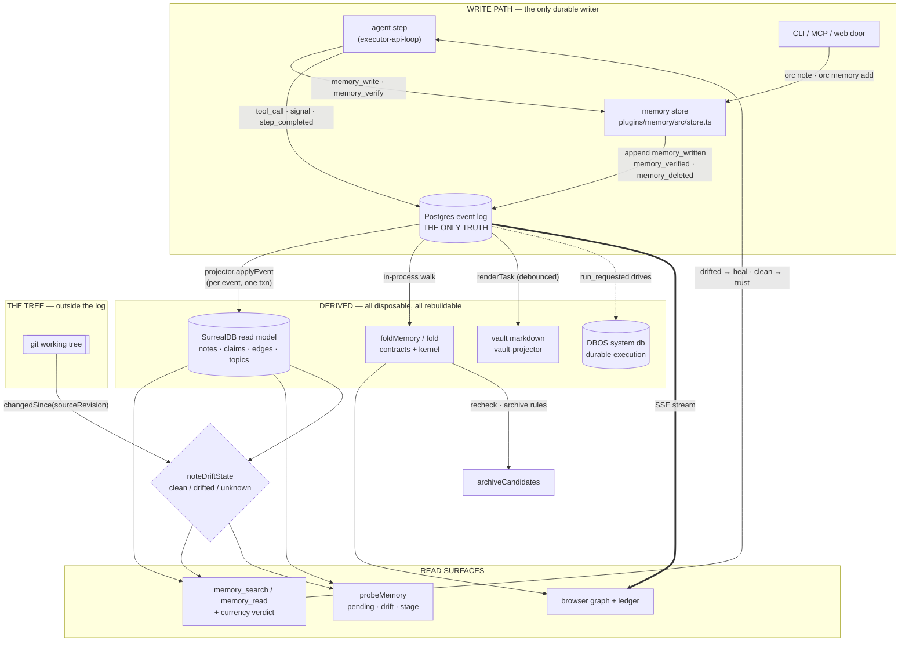
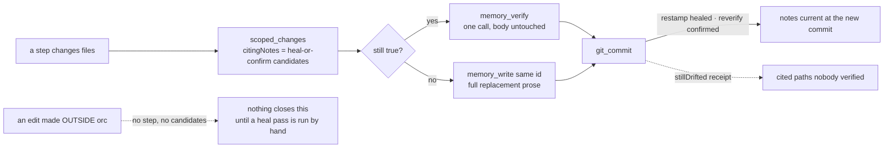
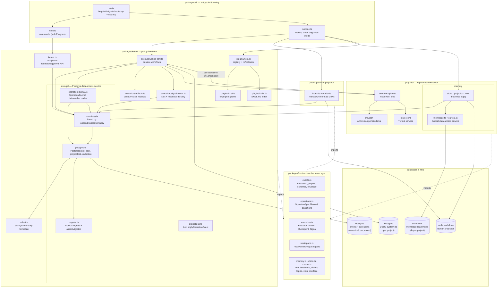
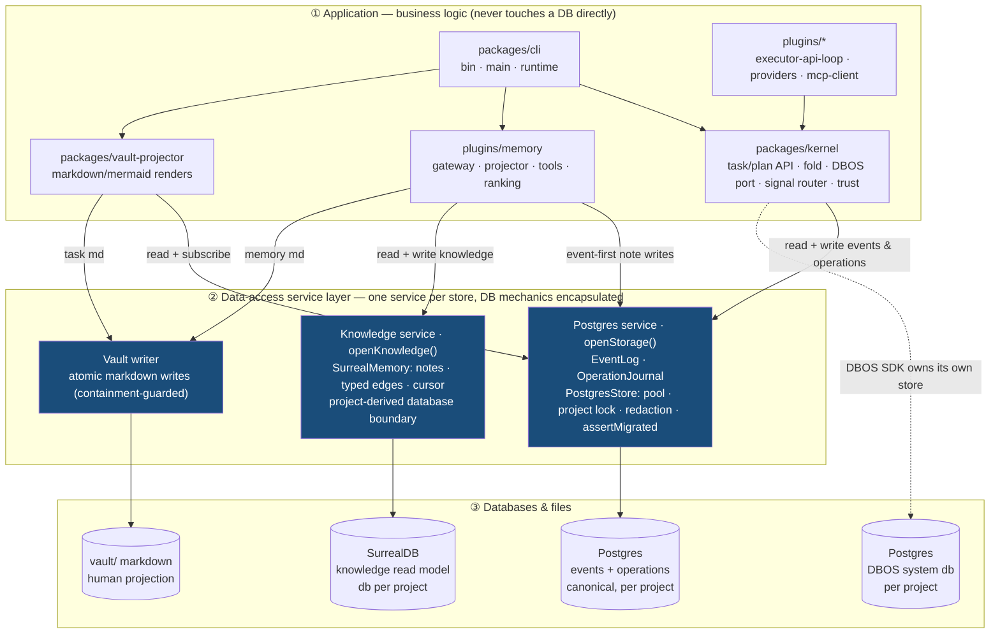
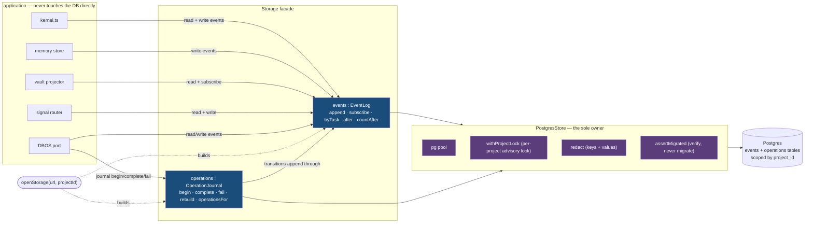
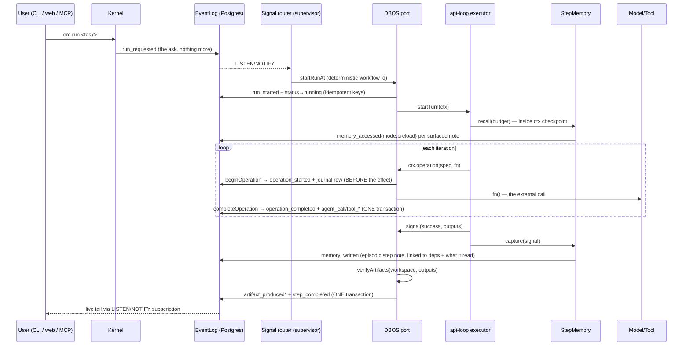
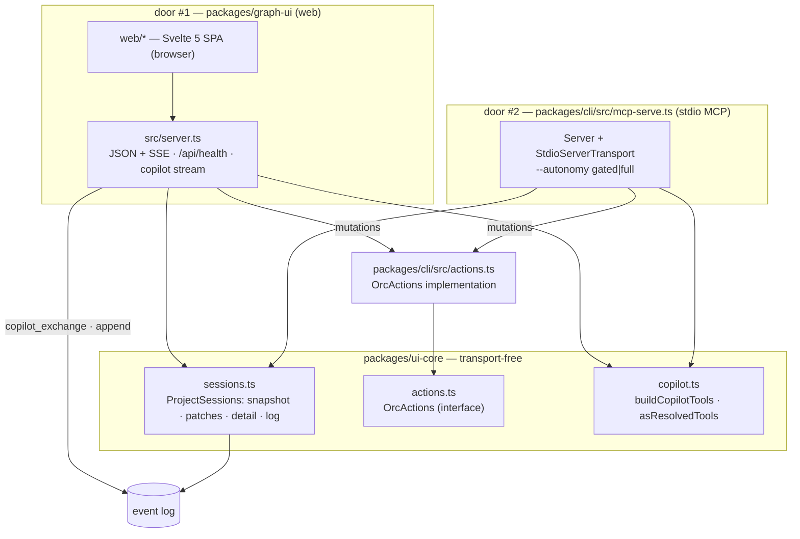

# Architecture

One paragraph of ground truth: the Postgres **event log is the only truth**. Every other
store — the operations journal, SurrealDB, the vault, DBOS's system database — is either a
rebuildable index over that log or a disposable projection of it. All state is `fold(events)`.
Everything below is arranged around protecting that invariant.

## Data flow — one write, every consequence

Where a fact enters, what derives from it, and which direction each arrow may run. Every edge out
of the log is a *rebuild*; no arrow ever points back into it except an append.

**The one rule the diagram encodes:** every box outside `write` can be deleted and rebuilt from the
log. Nothing may live only in a derived stage, and no derived stage may be the sole writer of a
fact. `orc memory rebuild` and `orc vault rebuild` exist to prove it.

**Two inputs, not one.** Currency is the only judgement that reads something the log does not
contain — the git working tree. That is why drift can move without any event being appended, and
why a repo edited outside orc accumulates staleness no projection can repair on its own.

**The one loop that closes.** `tools → agent → store → log → surreal → drift → tools` is the
self-healing cycle: a reader is told a note is stale, corrects it under the same id, and the write
re-stamps it current. Every other path is one-way.

### Where knowledge goes stale, and what closes it

A change reaching the tree without passing through this loop leaves notes describing code that
moved. Three mechanisms close that gap, and only the first is automatic:

`scoped_changes` and `memory_verify` register on the same predicate — `stepMayVerify`: any auditor
step except the grounded planner, which shares the role but has audited nothing. `git_commit` then
advances the stamps the task earned and reports `stillDrifted`: notes citing committed paths that
no step verified. The corpus-level drift ratio is an **advisory** at every door — a prompt for a
human decision, never a trigger, because a rebuild firing on its own costs more than the staleness
it cures.

## System map — modules

Every first-party module, its package, and how the calls flow. The data-access services live
in the nested `storage/` cluster (Postgres) and the memory plugin's `knowledge.ts` (Surreal);
the tier-by-tier view is the next section.

### Legend

| Notation | Meaning |
|---|---|
| Rectangle | First-party module (file named in the node) |
| Nested box | The data-access service inside its package (`storage/`, memory's `knowledge.ts`) |
| Cylinder | A database or file store. **Postgres events is truth**; the rest are index or projection |
| Solid arrow | Runtime call / data flow direction |
| Dashed arrow | Compile-time dependency only (imports types/schemas, never calls back) |

## System map — three tiers

The same system as three layers: business logic never touches a database — every read and
write crosses the **data-access service layer** in the middle. One service per store, each
encapsulating connection, project scoping, locking/transactions, and redaction. Swap a
backend or add a store and only its service changes; the tiers above and below do not.

### Legend

| Notation | Meaning |
|---|---|
| **① / ② / ③** | The three tiers: application → data-access services → databases |
| Blue box (tier ②) | A data-access service — the only code that opens/queries its store |
| Cylinder (tier ③) | A database or file store. **Postgres events is truth**; the rest are index or projection |
| Solid arrow | Runtime call / data flow (every app→DB edge passes through a service) |
| Dashed arrow | DBOS SDK manages its own system database — the one store not behind our services |

The layer is realized as sibling openers, each returning a facade whose methods are the whole
contract — callers never see a pool, a lock, or a query:

- **`openStorage(url, { projectId })` → `Storage { events, operations }`** — the Postgres
  service (`packages/kernel/src/storage/`). `PostgresStore` owns the pool, the per-project
  advisory lock, redaction, and schema verification; `EventLog` (append/subscribe/query) and
  `OperationJournal` (before/after nodes) sit on top. Migration is a separate explicit
  `orc db migrate` step — `openStorage` only verifies and fails loudly if the schema is behind.
- **`openKnowledge(config)` → `Knowledge`** — the SurrealDB service
  (`plugins/memory/src/knowledge.ts`), encapsulating auth and the project-derived database
  name. The memory gateway/projector/tools read and write through it and never open a Surreal
  session themselves.

The kernel is business logic and stays free of both: it takes an `EventLog`, not a pool. The
memory plugin's `createMemory` is the orchestrator that assembles the two services into the
memory domain services. The one exception drawn dashed: the DBOS SDK manages its own system
database directly (durable workflow checkpoints), which is not ours to mediate.

Dependency rule (`docs/EXTENDING.md` invariant 3): **contracts import nothing**, kernel
imports contracts, plugins import contracts (never the kernel's internals beyond its public
exports), and the kernel never imports plugins — it receives them (`createDbosPort(opts)`,
`createPluginHost(config, seed)`).

## The storage service — read/write boundary

Every Postgres read and write goes through one facade. Callers never touch a pool, a lock,
redaction, or migrations — they call `events` / `operations` and the service handles the rest.

Every write path is one locked transaction: `EventLog.append` acquires the project lock,
jsonb-shapes and redacts the payload, validates it, inserts, `pg_notify`s, and commits — all
atomically. `OperationJournal` writes its node and its transition events *through* that same
`EventLog` inside one lock, so the durable graph node and the append-only history can never
disagree. Reads are project-scoped queries that bypass the lock. Migration is separate
(`orc db migrate` → `migrateDatabase`); `openStorage` only verifies and fails loudly if the
schema is behind. Missing migration tables map to 0 applied; connection/auth/permission errors
remain their original failures.

## Knowledge — raw evidence vs distilled note

The event log and the knowledge graph answer different questions, and the split is deliberate.
The log is *what happened*: every model call, every tool result, redacted once at the storage
boundary and otherwise kept verbatim, because an audit that paraphrases is not an audit. The
graph is *what we now believe*: notes an agent chose to write, small enough to pull back into a
later context.

Web research is where the split earns itself. A fetched page is untrusted evidence, never
instructions — it enters through an ordinary MCP tool a plan opted into via `toolRefs`, and its
raw text stays in the redacted `tool_result` event. What reaches memory is a distilled `research`
note, which is the one note kind that **must** carry at least one citation: a finding without
provenance is an unsourced claim. So a prompt-injection string embedded in a page survives in the
audit trail (where it is evidence of what the server returned) and never reaches
`vault/memory/**` (where it would read as project knowledge). The trust boundary itself is
unchanged — MCP declaration plus `orc mcp trust` grant. The `web-research` skill is the posture,
not the enforcement.

Note length has two different limits, and conflating them cost real model calls. `MEMORY_LIMITS`
names both: `bodyChars` (100,000) is what the **store** accepts — deliberately generous, because the
same bound re-parses history and tightening it would make older notes fail to parse and vanish from
every fold. `searchableBodyChars` (7,000) is what the **embedder** can see, sized to fit inside
`embedInputChars` (8,000) alongside title and summary. The advertised JSON schema carries the
*searchable* number, so a writer self-limits at generation time; the lint only fires past it, and
states the fact (text beyond it is stored and readable but invisible to semantic search) rather than
a style preference. Advertised is always ≤ enforced — promising more than the parser accepts is the
dangerous inversion, and a test pins that direction.

Citations are value objects on the note, not nodes: a cited URL creates no note row and no graph
edge, so the graph stays a graph of *our* knowledge. `retrievedAt` is stamped by the projector
from the canonical `memory_written` event timestamp — a writer cannot supply one, and a replay
reproduces it exactly.

Access is a fact, not bookkeeping. `memory_accessed` is appended by the call sites that know a
pull delivered something — `memory_read` on a hit, `memory_neighbors` against its seed, `orc
memory cat` — and `hits`/`lastAccessedAt` project from those events like every other field, so
they survive `rebuild()`. A miss, a failure, and `memory_search` record nothing: a summary list
is not a read. The counter is measurement, not policy — nothing ranks or expires on it. It exists
so that a future decay/sweep (`docs/IDEAS.md` entry 1) can be tuned against an observed hot/cold
split instead of a guessed half-life.

### Claims — the addressable unit of knowledge

A semantic note carries **claims**: individually addressable statements, each with a
content-derived id. `claimId(text)` is the
sha256 of the whitespace-normalized text, first 12 hex chars — *the id IS the statement*. A
positional index would shift the moment one claim retires, which the temporal model makes
routine; a content hash is stable without counter state, self-deduplicating within a note, and
gives a rewording the correct meaning (a new claim, with the old one invalidated rather than
mutated).

Two shapes, deliberately split. `ClaimInput` is what a writer supplies (`id`, `text`,
`sourceRevision`); `Claim` adds `validFrom`, which the **projector** stamps from the committed
event. An agent cannot date its own claim, and there is no placeholder to leak — the same rule a
source's `retrievedAt` follows.

Writes are **additive**. A writer names what to add (`addClaims`) and what to retire
(`invalidates`); supplying the `claims` array wholesale is deliberately impossible, because under
the store's merge-on-omit rule an array would REPLACE, which is exactly the behaviour additive
writes exist to prevent. Invalidation wins over addition inside one write: stating both means the
claim should be gone.

The tombstone lives on the **event** (`MemoryWrittenPayload.invalidates`), never on the note — the
note payload carries live claims only. So the log is the only surface a retired claim survives on,
and `orc memory claims <id> --history` folds it to recover both the claim and the write that
retired it. Everything else (`orc memory claims <id>`, the `claims` arm of `memory_search`) reads
the live set from the read model. Either form of the command takes `--json` for a script — the raw
claim array, `[]` when there is none.

### Topics — grouping that is derived, never authored

Claims cluster by embedding cosine into **topics**: a browsable inventory and lateral navigation.
A topic is explicitly *not* an agent-spelled filter — nobody writes one, and a `topicKey` is only
ever handed out by the surface that listed it — the `memory_topics` tool for an agent, `orc memory
topics` (with `--json` for a script) for a human. Diversifying search results by topic is
deliberately
*not* built yet: `ClaimHit` carries no `topicKey`, so nothing round-robins — `dedupeByNote` already
spreads a result set across notes, and spreading it across topics waits for a search observably
dominated by one.

`plugins/memory/src/cluster.ts` holds the algorithm and nothing else — zero imports, no database,
no embedder, no clock — and is the designated extension seam. It is average-link agglomerative:
each round merges the globally best pair, which is what makes the partition independent of input
order. Leader/threshold-join was rejected for the opposite property: `orc memory rebuild` replays
the same seq order, so an order-dependent algorithm would faithfully reproduce any bad split and
drift could never be repaired.

`memory_topics` is a tool rather than an implicit re-rank so that lateral navigation is **tracked**:
fetching one topic appends `memory_topic_accessed` carrying the resolved label, which is the ongoing
evidence `MEMORY_CLUSTER_THRESHOLD` keeps being calibrated against. That constant is **0.65,
measured** — the cosine cut above which two claims group together. It is re-swept whenever the
embedder OR the corpus size changes, because both are one decision with it: a cut through one
model's cosine distribution does not port to another model, and it does not port across corpus
sizes either — the same value that was well-tuned at one corpus size fragmented at another. The full
sweep tables, the domination/trade-off reasoning behind the current value, and the limits of the
evidence (one repository, one embedding model) are recorded on the constant itself, in
`plugins/memory/src/cluster.ts`.

### Three stages, in order

Claims and topics sit in different stages of one pipeline, and the boundary is what keeps the read
model disposable:

1. **Append to the log.** `memory_written` carries the note with its resolved live claims, plus the
   event-level `invalidates`. This is the only durable writer; everything below is recomputable.
2. **Project per event, inside one transaction.** `applyEvent` materializes the note row, its
   edges, and its `claim` rows in the same Surreal transaction that advances the cursor. This is
   where `validFrom` gets stamped. A claim that survives a rewrite is upserted **in place**, never
   deleted and recreated: a fixed record id deleted and re-created inside one Surreal transaction
   stays deleted at commit (measured), so a refresh must retire only genuinely-stale rows.
3. **Derive by stateless recompute.** `refreshTopics` reads the `claim` table and rewrites the
   `topic` table, outside the event transaction, from the drain rather than from `applyEvent`.

Stage 3 may never be the only writer of a fact. Nothing carries a `topicKey` column; the topic
table is derivable from the claim table, which is derivable from the log, and `clear()` drops both
so a rebuild reproduces them.

> **Claim rows exist only after a projection.** The projector materializes them, so a read model
> built before a note's claims were written has none until `orc memory rebuild` replays the log.
> Nothing synthesises claims for a note that asserts none: such a note contributes zero claims and
> `orc memory topics` correctly reports no topics, and `--json` prints `[]`. That is neither a
> broken embedder nor a broken
> pipeline — it is a corpus that has not stated anything yet.

### Note lifecycle — currency, healing, retirement

Age is not the axis. A note about a file nobody has touched is still true after six months; a note
about a file refactored ten minutes ago is not. Every judgement below reads `sourceRevision` — the
commit a note was stamped with at write time — never a clock.

**Currency** is decided by `noteDriftState` (`plugins/memory/src/drift.ts`), against the **working
tree**, not `HEAD`: an uncommitted edit has already invalidated a note that describes the file. It
is tri-state, and each state means something a reader can act on:

| state | meaning | what a reader is told |
| --- | --- | --- |
| `clean` | declared paths unmoved since the stamp | `current: true` — trust it, do not re-read those paths |
| `drifted` | a declared path changed since the stamp | re-read them; correct the note by writing the **same id** |
| `unknown` | the stamped revision is unreachable | re-read if you need certainty; this is not evidence of error |

A note carrying **no** `sourceRevision` or **no** declared paths is uncheckable. It folds to `clean`
(the fail-toward-not-drifted rule) but nothing was checked, so no surface may claim it is current.

**Two independent stamps, fresher wins.** `sourceRevision` is set by the store on every write;
`verified.revision` is set only by `memory_verify`, and by nothing else. A note whose code moved
after it was written but before an auditor read it against the tree is *not* stale — without that
either-clean rule a verification could never clear anything, and heal passes re-derived notes that
had just been confirmed.

**Healing is the same call as writing.** `memory_write` is an upsert that re-stamps
`sourceRevision`, so correcting a drifted note under its own id clears the drift. A correction
covers the whole retrieval surface — title and summary too, since searchers read the summary first
and merge-on-omit keeps a stale one verbatim. `body` and `summary` are **full replacements**: a
partial write is a truncation, not a merge.

**Retirement is decided by evidence, never by elapsed time or coldness** (`archive.ts`, a pure
zero-import rule table). A note is archivable only when it is superseded by a surviving note, or is
task-scaffolding whose task has settled. Drift is explicitly *not* grounds for retirement — it is
the input to healing, and archiving a drifted note discards exactly the knowledge the heal loop
exists to repair. An inbound link from a survivor protects a note against both, because nothing
repairs a link left dangling at a dead id.

Archiving **deletes the note's rows from the read model** rather than filtering them at each query,
so search, neighbours, ranking, topics and `ls` exclude it with no query change and no path able to
forget the filter. It stays fully reversible: every revision is in the log, and writing the same id
with `archived: false` re-projects it.

## Execution flow — one step, durably

A client never starts a run. It **records the ask** and watches the stream; the supervisor's signal
router turns that ask into a workflow. This is what lets a run outlive the terminal that asked for
it (`ctrl-c` ends the watch, `orc cancel` ends the run).

### Retrieval lanes — what a step may be handed

Two sibling rules in `contracts/memory.ts`, deliberately not merged because they answer different
questions:

- **`linkLookupScopes(fromScope)`** — where does a link *id* resolve? Own scope, then `project`.
- **`taskLaneScopes(taskId, ancestorTaskIds)`** — what may this *step* read? Its own plan scope,
  then every ancestor's, then `project`.

The ancestor half is load-bearing: a split child's id is `${parent}.${step}.${callId}`, so
`plan-<child>` is a different scope from the `plan-<parent>` its subplan notes were authored in.
Without the ancestor lanes a child cannot see its own decomposition. Both `recall` and the step's
own `memory_search` take the same lanes, and the scope predicate reaches the **query** — the
semantic arm ranks then truncates, so filtering afterwards would let one task's plan notes occupy
every slot.

`isUiMetaNote` excludes chat infrastructure (project display name, working directory) from the
retrieval surface entirely; it stays readable by id, which is how the chats list resolves a name.

### Step memory — the one seam

Everything a running step does to the knowledge graph goes through `StepMemory`
(`contracts/execution.ts`), bound per step by the composition root from `plugins/memory`'s
`bindStepMemory`. The executor decides only **when**: `recall` before the first prompt (wrapped in
`ctx.checkpoint`, so a replay reuses the recorded notes), `capture` after the signal. What is
searched, recorded, written and linked is the memory domain's business — the executor holds no store
handle and never drives a model-facing memory tool itself.

Two consequences the graph depends on:

- **`recall` returns two surfaces from one call** (`RecalledContext`): matched **claims** and the
  notes that matched without asserting one. Claims take their share of the budget first — a matched
  statement is something the step can act on, where a note summary is a pointer it must spend a
  `memory_read` to follow — and the notes arm gets the remainder, so one preload costs what the
  caller allotted. Both come from one call so they share one budget and one replay checkpoint; two
  calls could rebuild `messages[0]` differently on recovery.
- **`recall` records what it surfaced** (`memory_accessed{mode: 'preload'}`), one access per owning
  **note**, deduped by `(scope, id)` — a note that matched through three of its claims is not
  charged three times. `memory_search` records nothing by design, so without this the retrieval path
  that runs on *every* step earned no activation and left no provenance for consolidation.
- **`capture` writes edges, not just a node**: `depends_on` the ambient notes of the steps this one
  consumed, `derived_from` every durable note it actually pulled. Both resolve under
  `linkLookupScopes`, so a run wires itself into the graph instead of adding isolated nodes.

`recall` is scoped by `taskLaneScopes(taskId, ancestorTaskIds)` — the retrieval lanes above, so a
split child sees the decomposition its parent authored and not only its own plan scope — and that
scope reaches the **query**, never a post-filter, for the reason stated there.

A run's outcome is the **tree's**, not the root task's (`projections.subtreeOutcome`). A grounded
parent finishes the moment its plan step splits, so its own status reads `done` while the child
doing the work may be `blocked` — observed live, reported at the terminal as success with exit
code 0. `awaiting_approval` is deliberately not a failure there: a gated child is a stopping point
the watch already announces by name.

A crash between `operation_started` and completion leaves an **unresolved node** — visible in
`orc status`, `orc replay`, and `vault/tasks/<id>/execution.md`. Recovery reuses completed
journal nodes and re-attempts unresolved ones as explicitly at-least-once (attempts counted).

## Feedback delivery and grounded approval

`feedback_provided` is both audit history and the durable outbox. The event carries the requesting
step/run envelope; immediate delivery and the signal router use `feedback:<event-seq>` as DBOS's
idempotency key. The live router handles new events, and startup replays replies for still-running
tasks, healing a crash after append but before send.

For a grounded plan step, an exact normalized `approve` reply also stores SHA-256 of the canonical
plan-note graph — a record of what was approved, not a value the gate compares. `finalize_plan`
accepts only a human approval from the same run token, and refuses the freeze if anything was written
to the task's plan scope after that approval's seq, naming the note ids. Missing, cross-attempt, or
stale approval returns a tool error before any child split.

## Adapters — two doors over one transport-free core

Everything a user or an external agent touches goes through `@orc/ui-core`, which is
transport-free by contract: it exposes `ProjectSessions` (live read model: snapshots,
patches, transcripts, plans, log rows), `OrcActions` (the one mutation surface), and the
copilot toolset. Adapters stay thin because the core does the thinking:

Door discipline, stated precisely:

- **One toolset, two doors.** `buildCopilotTools` defines the read+mutate surface once;
  the web copilot consumes it as an AI toolset, the MCP server reshapes the same set via
  `asResolvedTools` (zod → JSON Schema). The doors differ in exactly one tool: `approve`.
  The web UI has an approve *button* (human click); the copilot has NO approve tool (P2);
  MCP gets an approve tool only behind the launch-time `--autonomy full` dial, attributed
  `approvedBy: mcp` in the `plan_approved` event.
- **The web door journals its conversations**: each copilot exchange is appended as a
  `copilot_exchange` event (server-side, home project only); the chat pane rebuilds from
  the log — the browser is a cache, never the record.
- **The stdio door owns stdout**: boot diagnostics rebind to stderr (bin.ts, first lines),
  and the MCP transport holds the real stdout while `process.stdout.write` reroutes to
  stderr — a lazily-booting DBOS (winston writes past `console`) cannot corrupt frames.
- **Health is a provider, not a subsystem**: the CLI wires `probeMemory` into the web
  server's `opts.health`; the footer polls `/api/health` and shows degradation + projector
  lag within one 15s interval.

## Responsibilities

| Component | Owns | Explicitly does NOT own |
|---|---|---|
| `contracts` | Zod schemas, event kinds + typed payloads, executor/port/store interfaces, the workspace containment guard | Any I/O, any storage, any policy |
| `kernel/storage/postgres` | The one Postgres owner: pool, project-scoped advisory lock (`withProjectLock`), redaction wiring, schema verification | Deciding *what* to store; the DBOS system database |
| `kernel/storage/event-log` | Project-bound append (jsonb-shape → redact → validate → insert → notify, one locked transaction), idempotency keys, lossless subscribe with reconnect, scoped queries + `countAfter`, `latestNoteEvent` (one indexed row per note — migration 0004) | Deciding *what* to append (callers do), projections |
| `kernel/storage/operation-journal` | Durable before/after nodes (begin/complete/fail), rebuild-from-log; transitions append through the `EventLog` in the same locked transaction | Model/tool specifics; the checkpoint machinery (that's the port) |
| `kernel/storage/migrate` | Explicit `migrateDatabase`; `assertMigrated` fails loudly when a database is behind | Migrating implicitly at open time |
| `kernel/redact` | The single storage-boundary normalizer: NUL strip + secret redaction (keys and values) | Being called anywhere except append/journal storage |
| `kernel/projections` | `fold(events) → State` as a reduce over `foldInto` (one event, one accumulator), `applyOperationEvent` (shared by live journal and rebuild), crash dedup | Persisting anything |
| `kernel/live-state` | `openLiveState(log)` — a subscription-maintained `State` index, re-seeded when the log is truncated or replaced. Serves advisory reads (budget chain, "is anything running") | Reads that decide a write — those stay inside `log.transaction` |
| `contracts/memory` folds | `foldMemory` / `foldMemoryInto` — every derivation over the memory stream (live notes, write times, node access, edge access) in ONE walk, batch or incremental. `bumpAccess` and `viaEdge` are the single increment and edge-canonicalization rules, applied by both the log fold and the Surreal projector | Deciding policy — `archive.ts`'s rule table and the graph do that |
| `kernel/kernel.ts` | Atomic task/plan lifecycle, feedback outbox events, seq-bound human approval over the log | Execution |
| `kernel/dbos-port` | Durable run/step workflows, `ctx.checkpoint` and `ctx.operation` wrappers, retry policy, queue partitioning, cancellation cascade, output receipt commit | Model/tool specifics (executor's job), plan authoring |
| `kernel/signal-router` | Resolving splits, starting approved children, and live/startup delivery of committed feedback | Composing plans, executing steps |
| `kernel/plugins/*` | Registry + propose-time ref validation (`host`), fingerprint trust store (`trust`), SKILL.md indexing (`skills`), T2 extension loading | Runtime tool execution (that's the hub/executor) |
| `plugins/executor-api-loop` | The model⇄tool loop, prompt assembly (incl. knowledge protocol + the recalled-context block), signal/output pre-flight, per-call operation journaling | Durability (delegates to ctx), trust, receipts, **what to remember** (delegates to `ctx.memory`) |
| `plugins/memory` | Event-first note store (gateway stamps git revision, resolved lazily), transactional Surreal projection of notes + edges + `claim` rows, stateless topic derivation (`refreshTopics`, stage 3, driven from the drain and only by drains that touched claims), per-project database boundary, hybrid (vector⊕keyword) retrieval with activation re-ranking over both notes and claims, the `StepMemory` binding (recall/capture, ambient edges), consolidation lifecycle, tri-state drift probe, evidence-based archival + cancel-time sweep, `vault/memory/**` rebuild | Being authoritative — Surreal and vault/memory are disposable. Authoring a topic: stage 3 derives them, nobody writes one |
| `packages/vault-projector` | Deterministic markdown/mermaid renders of tasks, execution, lineage, task expansion; coalesced live re-render | Truth of any kind; whole-log scans |
| `packages/cli` | Pre-bootstrap help/init/migrate, command surface, project discovery, startup/shutdown order, degraded-memory wiring | Business rules (kernel's job) |
| `packages/ui-core` | Transport-free UI core: `ProjectSessions` (live folds, graph patches, transcripts, log rows), `OrcActions` interface, the copilot toolset + `asResolvedTools` door-#2 bridge | Any transport (HTTP/SSE/stdio are adapters' jobs), any DOM |
| `packages/graph-ui` | Door #1: web adapter — JSON+SSE routes, CSRF-token mutations fenced to the home project, `/api/health`, copilot streaming + `copilot_exchange` journaling, browser page | Deciding what a graph or plan IS (ui-core's job) |
| `packages/cli/mcp-serve` | Door #2: stdio MCP adapter — same toolset via `asResolvedTools`, memory read tools, the `--autonomy gated\|full` approve dial, stdout ownership | Its own tool semantics (they are the copilot's), trust/init (CLI-only, never over MCP) |

## Identity and isolation

`orc init` mints `projectId` into the git-ignored `.orc/identity.json` (the committable
`.orc/config.json` carries settings only). Everything derives:

- **parallelism ceiling** — three limits stack, and only the first is a setting: `concurrency`
  (default 3) caps concurrent steps **per depth**; the run workflow schedules in dependency waves
  and awaits each wave whole (DBOS binds child workflows positionally, so launch order must be a
  pure function of `(plan, done, failed)`); and Phase 1 admits one supervisor per project because
  the zone write-fence is an in-process map. `orc serve` prints all three at startup
- events/operations rows carry `project_id`; every query filters on it
- the per-project advisory lock serializes writers within a project only
- execution belongs to a **supervisor** (`orc serve`), not to the command that asked for a run: a
  client appends `run_requested` and watches the event stream, and the supervisor's signal router
  turns that ask into a workflow. Presence is a heartbeat row in `supervisors` (beat every 5s,
  trusted for 30s), not an exclusive lock, so "two are up and both healthy" stays expressible;
  identity is the claimed slot id (`supervisor-1`, …), passed to `DBOS.setConfig({ executorID })`
  so DBOS recovery is per-supervisor and a restart reclaims its own in-flight work. Phase 1 admits
  one supervisor per project. Consequence at the terminal: ctrl-c ends the watch, `orc cancel` ends
  the run; `--no-daemon` puts the runtime back inside the command for tests and benchmarks
- DBOS system database name = `deriveSystemUrl(dbUrl, projectId)`
- SurrealDB database name = `projectDatabaseName(base, projectId)`
- `requireProject(config)` gates project commands; uninitialized directories can still run
  help, `orc db migrate`, and `orc init`
- `orc init` seeds the first-party analysis/plan/documentation skills without overwriting project files
