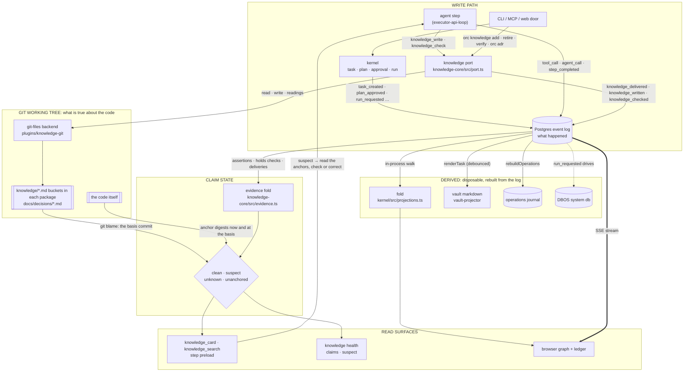
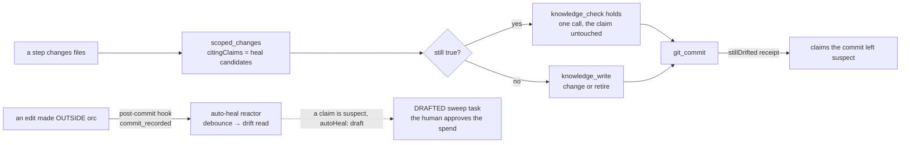
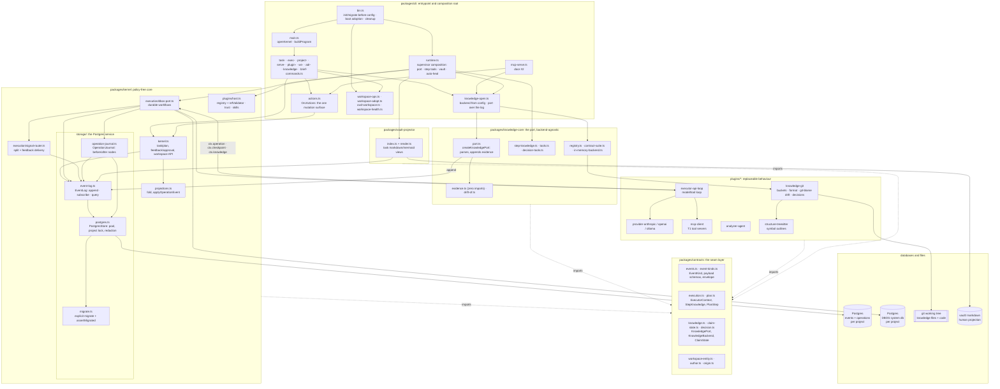
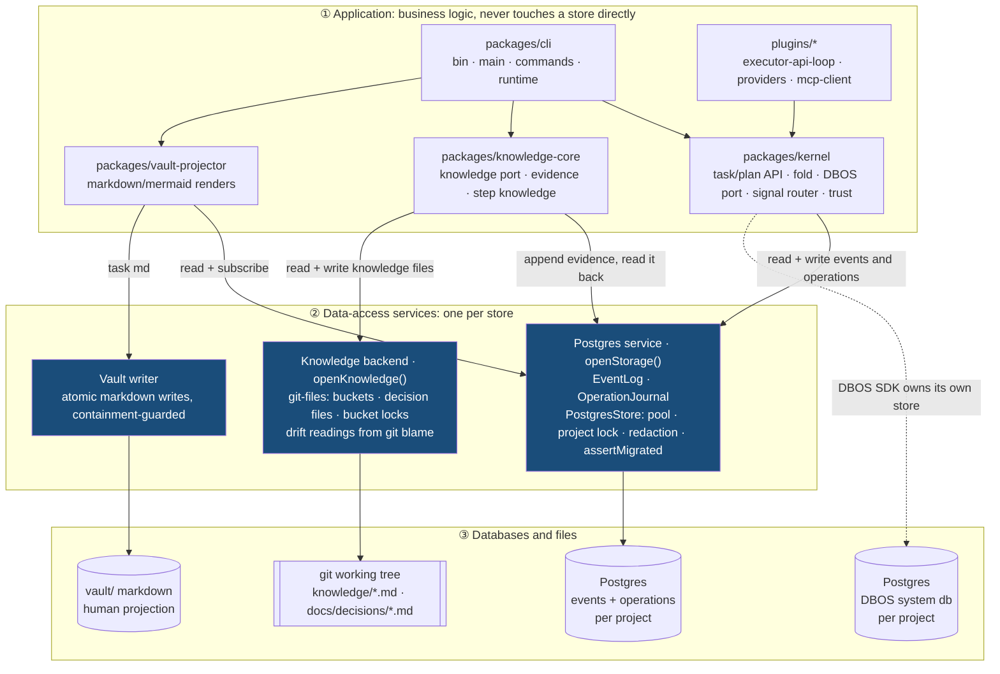
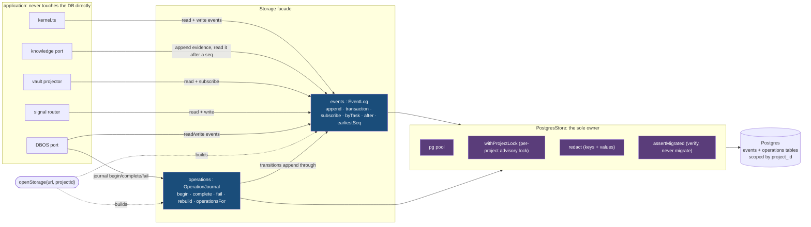
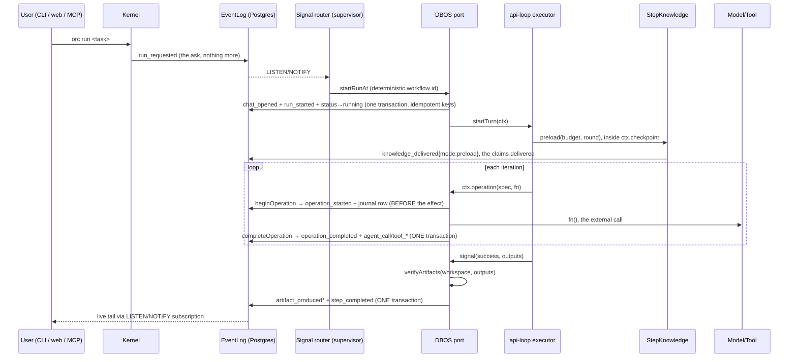
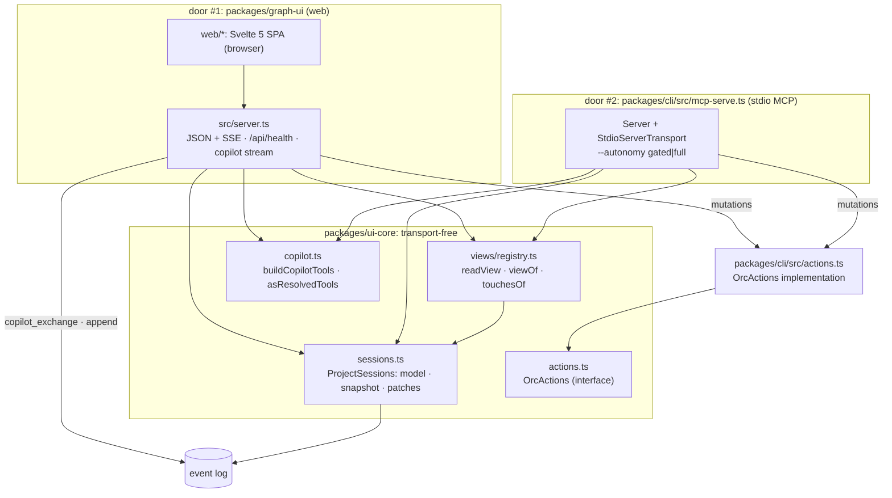

# Architecture

Two sources of truth, each for one question. **The event log records what happened; git holds what is true about the
code.** The Postgres event log is the only record of what happened: every task, plan, approval, run, model call,
tool call, and every knowledge delivery, write and check. All runtime state is `fold(events)`: the operations
journal is a rebuildable index of the log, the vault a disposable projection of it, and DBOS's system database holds
only the workflow engine's own checkpoints. What the project holds true about its code (claims and decisions) is
Markdown in the repository, the [knowledge files](knowledge-files.md), reviewed, branched and merged with the code
they describe. The log keeps evidence about those files, never their content as a second truth.

## Data flow: one write, every consequence

Where a fact enters, what derives from it, and which direction each arrow may run.

**The rule the diagram encodes.** Every box under DERIVED can be deleted and rebuilt from the log, and no derived
stage is the only writer of a fact. The knowledge files are not derived from the log: git is their history. A
log reset loses only the evidence about them, and each claim then reads its state from its git-blame basis
alone.

**One writer per concern.** The knowledge port appends events and never touches files; a knowledge backend
touches files and never appends events. The kernel writes task, plan, run and workspace events and never touches
the knowledge files.

**Three inputs to a claim's state.** The bucket's git history names the commit that last wrote the claim's line
(the basis); the working tree holds the anchored code now; the log holds evidence of what writers and checkers
saw. An edit made outside orc moves a claim's state without any event being appended.

**Workspaces enter the log as project-level facts.** `workspace_created`, `workspace_retitled`,
`workspace_archived` and `workspace_merged` carry `taskId: null`: they are about a checkout, not about any one
task. Every boot **adopts** the checkout it runs in: before any command handler runs, a directory the fold has
not seen yet gets its `workspace_created`, so a checkout joins the tree by being used and nothing is registered
by hand. Everything downstream reads that fold: the `cwd` a run is recorded with, the workspace an author names,
the grouping `orc tasks` prints, and each workspace's health. A step reads and writes the knowledge files of its
task's workspace checkout; a door reads and writes those of the checkout it runs in.

**The loop that closes.**
`knowledge tools → agent → port → bucket file + knowledge_written → state → knowledge tools` is the self-healing
cycle: a reader is shown a claim as `suspect`, reads its anchors, and either confirms it (`knowledge_check` with
`holds`, which records the anchors' current digests) or corrects it (a change or a retire). Every other path is
one-way.

### Where knowledge goes stale, and what closes it

A change that reaches the tree without passing through the loop leaves claims describing code that moved. Both
paths close: in-task before the commit, and out-of-task through the commit reactor.

`scoped_changes` is offered to the verify-capable auditor steps (`stepMayVerify`: any auditor step except the
grounded plan step) and to the finish step (`stepMayReconcile`); `knowledge_check` is offered to the first group
only. `git_commit` reports `stillDrifted`: the claims the commit left suspect.

The out-of-orc path: the post-commit hook (`scripts/hooks/post-commit.sh`) appends `commit_recorded`, and the
supervisor's reactor (config `autoHeal`, `draft` or `off`, default `draft`) debounces a commit burst into one
reaction. It reads claim states in the checkout of the workspace that committed and, when any claim is
`suspect` and that workspace has no open sweep, drafts one sweep task with its plan proposed. The plan is one
auditor step that lists up to 50 suspect ids, reads each claim's anchors and calls `knowledge_check` on it;
`autoHealIterations` (`ORC_AUTO_HEAL_ITERATIONS`) bounds its budget. The reactor never approves its own sweep: a
model pass firing on its own would cost more than the staleness it cures, so the spend waits at the human gate.
`orc knowledge drift` prints the same states, `orc knowledge stats` reports what agents were handed and which
files they read that no claim covers, and `orc knowledge verify` lets a person record a claim as holds, false
with a correction, or unknown.

## System map: modules

Every first-party package and the calls between them. The data-access code lives in `packages/kernel/src/storage/`
(Postgres) and in the knowledge backend (files); the next section shows the same system by tier.

### Legend

| Notation | Meaning |
|---|---|
| Rectangle | First-party module (files named in the node) |
| Nested box | The data-access service inside its package (`packages/kernel/src/storage/`) |
| Cylinder | A database or file store. The Postgres events table is the record of what happened; the rest are index or projection |
| Double-bordered box | The git working tree: the knowledge files and the code they describe |
| Solid arrow | Runtime call or data flow direction |
| Dashed arrow | Compile-time dependency only (imports types and schemas, never calls back) |

## System map: three tiers

The same system as three layers: business logic never touches a store directly; every read and write crosses
the **data-access layer** in the middle. One service per store, each owning its connection or file access,
project scoping, locking and redaction. Swap a backend or add a store and only its service changes.

### Legend

| Notation | Meaning |
|---|---|
| **① / ② / ③** | The three tiers: application → data-access services → stores |
| Blue box (tier ②) | A data-access service: the only code that opens or queries its store |
| Store (tier ③) | Postgres holds what happened; the git working tree holds what is true about the code; the vault is a projection |
| Solid arrow | Runtime call or data flow (every application-to-store edge passes through a service) |
| Dashed arrow | The DBOS SDK manages its own system database, the one store not behind our services |

The services are sibling openers, each returning a facade whose methods are the whole contract:

- **`openStorage(url, { projectId })` → `Storage { events, operations }`**: the Postgres service
  (`packages/kernel/src/storage/`). `PostgresStore` owns the pool, the per-project advisory lock, redaction and
  schema verification; `EventLog` (append, subscribe, query) and `OperationJournal` (before/after nodes) sit on
  top. Migration is a separate explicit `orc db migrate` step: `openStorage` only verifies, and fails loudly if
  the schema is behind.
- **`openKnowledge(config)` → a `KnowledgeBackend`, or `{ unavailable }`**: the knowledge service
  (`packages/cli/src/knowledge-open.ts`). It resolves the configured plugin (`knowledge.plugin` in
  `.orc/config.json`, default `git-files`) through `resolveKnowledgeBackend`; `"knowledge": null` turns knowledge
  off. `knowledgeAccess(opening, log, checkout)` wraps the backend in a `KnowledgePort` whose append and evidence
  source are the event log.

The kernel stays free of both: it takes an `EventLog`, not a pool, and it never opens a knowledge backend. The
CLI is the composition root that assembles them. The one exception, drawn dashed: the DBOS SDK manages its own
system database (durable workflow checkpoints), which is not ours to mediate.

Dependency rule ([`EXTENDING.md`](EXTENDING.md) invariant 3): **contracts depend on zod alone**; the kernel,
`knowledge-core` and the plugins import contracts; plugins never import the kernel's internals; the kernel never
imports a plugin or `knowledge-core`. It receives them (`createDbosPort(opts)`, `createPluginHost(config, seed)`),
and the CLI hands the knowledge port to each step through `stepTools`.

## The storage service: the read/write boundary

Every Postgres read and write goes through one facade. Callers never touch a pool, a lock, redaction or
migrations; they call `events` / `operations` and the service handles the rest.

Every write path is one locked transaction: `EventLog.append` acquires the project lock, jsonb-shapes and redacts
the payload, validates it, inserts, `pg_notify`s, and commits, all atomically. `OperationJournal` writes its node
and its transition events *through* that same `EventLog` inside one lock, so the durable graph node and the
append-only history can never disagree. Reads are project-scoped queries that bypass the lock. Migration is
separate (`orc db migrate` → `migrateDatabase`). Missing migration tables count as 0 applied; connection, auth and
permission errors remain their original failures.

## Knowledge: evidence in the log, claims in git

The event log and the knowledge files answer different questions, and the split is deliberate. The log is *what
happened*: every model call, every tool result, redacted once at the storage boundary and otherwise kept
verbatim, because an audit that paraphrases is not an audit. The knowledge files are *what we now hold true about
the code*: claims an agent or a person chose to write, small enough to hand to a later context, and reviewed with
the code in the same diff.

Web research is where the split earns itself. A fetched page is untrusted evidence, never instructions: it enters
through an ordinary MCP tool a plan opted into via `toolRefs`, and its raw text stays in the redacted
`tool_result` event. What reaches the knowledge files is a distilled claim that an agent wrote, which the
`web-research` skill asks to carry its sources. So a prompt-injection string hidden in a page survives in the
audit trail, where it is evidence of what the server returned, and reaches the files only as far as an agent
restates it in a claim a reviewer sees. The trust boundary itself is the MCP declaration plus the
`orc mcp trust` grant; the skill is the posture, not the enforcement.

### The port and the backend

Consumers reach knowledge only through `KnowledgePort` (`packages/contracts/src/knowledge.ts`): `card`,
`search`, `get`, `write`, `drift`, `check`, `preload`, and the decision calls `decisions`, `decision` and
`recordDecision`. `createKnowledgePort` (`packages/knowledge-core/src/port.ts`) implements it over any
`KnowledgeBackend`:

- it parses every input with the contract's schemas and asks `checkoutOf` which checkout the call acts on;
- it calls the backend, which reads and writes files and never appends;
- it appends one event per act: `knowledge_delivered` for every card, search, get or preload that handed claims
  over; `knowledge_written` for every write and every recorded decision; `knowledge_checked` for every check;
- a failed append never fails the act: a write or check returns `evidence not recorded: <reason>` among its
  warnings, and a read logs the same line.

A backend is a `KnowledgePlugin` chosen in `.orc/config.json` (`knowledge: { plugin, options }`). Every backend
passes the shared suite in `packages/knowledge-core/src/contract-suite.ts`; the in-memory backend
(`createInMemoryBackend`) passes it too. The git-files backend (`plugins/knowledge-git`) files each claim by its
first anchor (layout and grammar in [knowledge-files.md](knowledge-files.md)), takes a lock per bucket file for
every write, re-plans when another writer raced it, and refuses a write into a bucket it cannot fully read.
Knowledge written on a branch exists only in that checkout until the branch merges.

### Claims

A claim is one line in a bucket: its text, its class (`fact`: what the code does; `why`: the reason it is that
way), an 8-character id, up to 8 anchors (a path, optionally at a symbol), tags, sources, and an optional link to
a decision. The id is random, except that an agent's retried tool call derives its additions' ids from the
call's idempotency key (`knowledgeIdFrom`), so a retry writes the same claims.

Writes are **patches** (`KnowledgePatch`): `add`, `change` (an id plus only the fields to replace) and `retire`,
up to 100 items each, plus a `why` and an optional `decision`. A changed claim keeps its id; a retired claim leaves
its file, and the log's `knowledge_written` keeps its ref. A symbol anchor is canonicalized when it is written:
the short form becomes the full name from the file's outline, and an unknown symbol is refused with the closest
names.

`knowledge_written` carries the refs added, changed and retired, the files touched, the write's `why` and
decision, and **assertions**: for each claim the write stated (an addition, or a change to its text or anchors),
the digest each anchor had right after the write. `knowledge_checked` carries the verdict, the claim's text, and
the digests its anchors had when it was checked.

### Claim state: drift and evidence

A claim has one of four states (`ClaimState`): `clean`, `suspect`, `unknown`, `unanchored`. The backend's
`readings` give each anchor two digests: one at the claim's **basis** (the commit `git blame` names for the
claim's own line in its bucket; the working tree, for a line not yet committed) and one now, in the working
tree. `foldEvidence` (`packages/knowledge-core/src/evidence.ts`, a pure fold with zero imports) reduces the log's
knowledge events to the digests writes asserted and `holds` checks confirmed, keyed by claim id, text and anchor.
`driftOf` judges each anchor with `anchorState` and each claim with `claimState`
(`packages/contracts/src/claim-state.ts`): a confirmed digest is clean, asserted digests are the only clean ones
when there are any, and otherwise an anchor is clean exactly when its code is unchanged since the basis. The full
rule table is in [knowledge-files.md](knowledge-files.md#the-four-claim-states).

So a claim stays clean through commits that leave its anchors' code alone, a `holds` check clears it until that
code changes again, and rewording a claim starts its evidence afresh. Evidence is read from the log once and then
incrementally (`createEvidenceReader`), and re-read from the start when the log's earliest seq changes (a purge).
When the log is unreachable, `orc knowledge drift` reads states from git blame alone and says so.

### Decisions

A decision is one file under `docs/decisions/`, recorded by `orc adr new` or the `record_decision` tool through
the port. It changes only by supersession: `orc adr supersede` or `record_decision` with `supersedes` writes the
new file and marks the old one `superseded` with `supersededBy`, in one locked write. The decision tools
(`decision_list`, `decision_read`, `record_decision`) are offered to the grounded plan step and the finish step.
`orc brief` lists the accepted decisions.

### Provenance

Every knowledge event names its `Author`: the door (`agent`, `cli`, `mcp` or `human`), the **workspace the act
came from**, its origin (chat and door), and, for an agent, the task, step and run plus executor, model and role.
`workspaceId` is required: the workspace is only knowable at the moment of the act, and recovered later it would
have to be guessed from an envelope that is absent on a CLI write and wrong for a task that moved. An agent step's
author is built by `stepAuthor` and names the workspace its **task** belongs to, which may be a different worktree
from the one the supervisor was started in. Every other door (CLI, MCP, the auto-heal reactor) names the checkout
its process runs in, through one shared `cwdAuthor`, which throws rather than substituting a default.

Delivery is a fact, not bookkeeping. `knowledge_delivered` names the ids a card, search, get, at-risk push or
preload actually handed over, and which of those it was (`DeliveryMode`). `orc knowledge stats` folds deliveries
with the `fs_read` calls that followed them to report what agents were handed and which files they read that no
claim covers. Nothing ranks or expires on it. The CLI's own `card` and `search` read the backend directly and
record no delivery.

## Execution flow: one step, durably

A client never starts a run. It **records the ask** and watches the stream; the supervisor's signal router turns
that ask into a workflow. This is what lets a run outlive the terminal that asked for it (`ctrl-c` ends the
watch, `orc cancel` ends the run).

This loop repeats once per step, in the plan's dependency order. The kernel appends steps no planner authors, and
`Kernel.proposeSplit` refuses, in every split but the kernel's own freeze, a step that claims the `finish` or
`checks` id or the finisher or committer role:

- every root plan except the grounded scaffold and the auto-heal sweep, and every frozen grounded pipeline, ends
  with a **finish** step (`packages/kernel/src/finish-step.ts`). It reconciles the claims the task recorded
  (`task_claims`), records the task's decision if it made one, and asks once;
- when `config.finishChecks` is non-empty, a **checks** step runs right before it: a deterministic
  `AgentExecutor` with no model (`CHECKS_EXECUTOR_REF`, `packages/kernel/src/execution/checks-executor.ts`) that
  runs each configured command concurrently through the one command spawner
  (`packages/kernel/src/execution/run-command.ts`) and always signals success. A failing command is named in its
  summary, never a block, and the finish step leads its question with any failure;
- a frozen grounded pipeline under `autoCommit` ends with a **commit** step after the finish step:
  `… → checks → finish → commit`.

### Step knowledge: the seam

What a running step reads from and records in the knowledge files goes through `StepKnowledge`
(`packages/contracts/src/execution.ts`), bound per step by the composition root from `knowledge-core`'s
`bindStepKnowledge`. The executor decides only **when**: `knowledge.preload` before the first prompt (wrapped in
`ctx.checkpoint`, so a replay rebuilds the prompt from the recorded claims), and `knowledge.claimsAt` after each
edit. The executor holds no backend handle. A retried step's first prompt also carries its previous attempt's
failure (`ExecutorContext.priorFailure`, set by the port from the step's folded state).

**`preload(budget, round)` hands the first prompt claims in four arms, under one budget.** The binding builds one
`KnowledgePort.preload` request:

- `pushed`: the claims live in the writes of the step's **root** task tree (`listTaskKnowledgeWrites`, latest
  first: a task owns its subtree's writes plus its grounded parent's);
- `here` and `around`: claims anchored at or under a path the step's title and instructions name (plus each zone
  glob's static folder), exact matches first, then claims anchored in a folder above one;
- `search`: the backend's ranked search over the step's title and instructions.

The port judges every claim's state through the same evidence fold `drift` uses, orders each arm clean →
unanchored → unknown → suspect, keeps a claim only in the first arm that has it, and cuts the lot to
`knowledgePreloadTokens` (default 1,200, `ORC_KNOWLEDGE_PRELOAD_TOKENS`, 0 = off). Tokens are counted at chars/4
of the line the step is shown; the first claim is always kept, then the rest greedily in order. It appends
**one** `knowledge_delivered{mode: preload}` per round, keyed `<runToken>:preload:<round>`, carrying exactly the
ids it delivered; a continuation round preloads again and records its own. The loop renders them as the "Known
project context" block: one `Currency:` count line, then one section per non-empty arm, each claim as
`preloadLine` (`packages/contracts/src/preload-line.ts`, the same string the port costs), which is the knowledge
file's line format with the state shown when it is not clean. A failing read yields no block and one warning,
never a failed step.

The tools a step gets come from the same binding: `knowledge_card`, `knowledge_search` and `knowledge_write` for
every step; `knowledge_check` for a verify-capable step; `task_claims` for the finish step; the decision tools
for the grounded plan step and the finish step. With knowledge off or unavailable the tools are still offered
and answer `knowledge unavailable: <reason>`, and preload and `claimsAt` return nothing.

A run's outcome is the **tree's**, not the root task's (`subtreeOutcome` in `packages/kernel/src/projections.ts`).
A grounded parent finishes the moment its plan step splits, so its own status reads `done` while the child doing
the work may be `blocked`. `awaiting_approval` is not a failure there: a gated child is a stopping point the
watch already announces by name.

A crash between `operation_started` and completion leaves an **unresolved node**, visible in `orc status`,
`orc replay` and the task's execution page in the vault. Recovery reuses completed journal nodes and re-attempts
unresolved ones as explicitly at-least-once (attempts counted).

## Feedback delivery and grounded approval

`feedback_provided` is both audit history and the durable outbox. The event carries the requesting step/run
envelope; immediate delivery and the signal router use `feedback:<event-seq>` as DBOS's idempotency key. The live
router handles new events, and startup replays replies for still-running tasks, healing a crash after the append
but before the send.

For a grounded plan step, an exact normalized `approve` reply also stores the SHA-256 of the task's canonical plan
notes: a record of what was approved, not a value the gate compares. `finalize_plan` accepts only an approval
from a door in `groundedApprovalDoors` (default `cli`) within the same run token, and refuses the freeze if any
plan note was written after that approval's seq, naming the note ids. A missing, cross-attempt or stale approval
returns a tool error before any child split.

## Adapters: two doors over one transport-free core

Everything a user or an external agent touches goes through `@orc/ui-core`, which is transport-free by contract.
It exposes `ProjectSessions` (the live read model every read is answered against: events, folded state and
graph, plus graph snapshots and per-event patches), the view registry that answers every named read over that
model (`readView`/`viewOf`, see [the read side](#the-read-side-the-view-registry) below), `OrcActions` (the one
mutation surface), and the copilot toolset. Adapters stay thin because the core does the thinking:

Door discipline, stated precisely:

- **A door parses, names its `Origin`, and presents the result.** Task verbs live in `OrcActions`; checkout
  lifecycle verbs live in `WorkspaceOps`. `main.ts` supplies `wsCommand` a memoized `WorkspaceDoor` holding
  `workspaces`, `reads`, the workspace config and the workspace listing, never the mutating `Kernel` and never
  `actions`. Boot adoption stays at the composition root. Web action buttons use `NO_CHAT(Door.web)`, terminal
  commands `NO_CHAT(Door.cli)`, and MCP calls `NO_CHAT(Door.mcp)`; a copilot tool call carries that
  conversation's chat id and `Door.web`. Origin identifies the caller's interaction; it grants no authority. A
  door's author source follows `authorSourceOf(origin.door)`; `orc adr` records a human author.
- **One toolset, two doors.** `buildCopilotTools` defines the read and mutate surface once; the web copilot consumes
  it as an AI toolset, and the MCP server reshapes the same set via `asResolvedTools` (zod → JSON Schema), and adds
  the knowledge read tools (`knowledge_card`, `knowledge_search`) under its own author. Beyond those, the doors
  differ in exactly one tool: `approve`. The web UI has an approve *button* (a human click); the copilot has no
  approve tool; MCP lists an approve tool when actions are wired, but it refuses unless the launch-time
  `--autonomy full` dial permits it, and such an approval is attributed `approvedBy: mcp` in the `plan_approved`
  event.
- **The web door journals its conversations.** `copilotChat` mints an id when the browser passes `chatId: null`,
  or continues the id it echoes. Tool events may precede the open. `appendCopilotExchange` atomically appends a
  keyed `chat_opened` and the first `copilot_exchange`; later exchanges append only the exchange. The
  home-project server publishes a separate `chat` frame only after that transaction resolves; `done` carries
  usage. Empty, foreign-project and failed appends publish no id. The pane adopts only the committed id and
  rebuilds its conversation from the log.
- **The stdio door owns stdout**: boot diagnostics rebind to stderr (the first lines of `bin.ts`), and the MCP
  transport holds the real stdout while `process.stdout.write` reroutes to stderr, so a lazily-booting DBOS
  (winston writes past `console`) cannot corrupt frames.
- **Health is a provider, not a subsystem**: the CLI wires knowledge health (claims and suspect count, or the
  reason knowledge is unavailable) and supervisor health into the web server's `opts.health`; the console header
  polls `/api/health` every 15 s.

## Chats and the event envelope

Every stored event names a required, nullable `chatId` and a required `door`. `Origin` defines those fields
once; the event envelope extends it. `Door` names where the call entered: `web` for the browser and its copilot,
`cli` for the terminal, `mcp` for external MCP calls, `supervisor` for durable execution, and `hook` for the
post-commit append. A call outside a conversation uses `NO_CHAT(door)`. The post-commit hook reads
`ORC_CHAT_ID`, supplied by a run's commit tool, and records a null chat id when it is absent. The database's
`door` column is `NOT NULL` without a default: a row that does not name its entry door cannot exist, and a past
event's door is never guessed.

`chat_opened` is the only chat lifecycle event. It records kind, title, workspace and task at opening, a nullable
parent `ChatRef` (chat id plus event sequence), and a nullable external session reference. A run uses its
deterministic workflow id as its chat id; `appendRunInit` appends the open before `run_started` in the same
transaction. Its parent points to the initiating `run_requested`, or a split child's `split_proposed`, when that
event belongs to another chat.

`chatDigests` derives each `ChatDigest` from the event log on every read. End, outcome, usage, questions, the
claims written, checked and retired, commits, artifacts and caused tasks, plans and runs are never stored as a
second record. A run's end uses only status changes for the task its open names, even if that open arrives later
than those events; a split child's status changes cannot end its parent. Other chat kinds have no end. Usage sums only
events belonging to that chat, without adding its children's spend. Events whose chat was never opened yield no
digest.

## The read side: the view registry

Every read the browser or an in-process caller can make is a **named view**: a pure function of the folded read
model (`ReadModel { seq, events, state, graph }`) to a result. Each is declared once on the wire
(`packages/ui-core/src/wire.ts`'s `ViewName` and `WIRE`: each name's param schema and result schema, so a name
added with no matching pair fails the build) and implemented once under `packages/ui-core/src/views/`
(`view.ts`'s `View<N>`/`Touchable
` interfaces; one file per view: `timeline.ts`, `chats.ts`, `node.ts`,
`transcript.ts`, `plans.ts`, `plan-notes.ts`, `models.ts`, `operator-state.ts`; `registry.ts`'s `VIEWS` table and
its `ViewsCoverNames` compile-time guard, which fails the build the moment a name on the wire has no
implementation). Health is not a view: it probes knowledge and the supervisor rather than folding the log, and
the browser polls it at `/api/health`.

**A read states its scope.** `Scope` and its discriminant `ScopeType` live in
`packages/contracts/src/scope.ts`: project, workspace id, task id with a required `subtree` boolean, or chat id.
`inScope` is the one membership rule, including taskless knowledge events attributed to their author's task and
workspace, and commits attributed to their checkout. `timeline` requires `scope`, applies scope, kind and
sequence filters before its limit, then summarizes the matching events. `chats` also requires `scope`: any
matching event admits the chat, but its digest uses the whole log so its cost and outcome are complete.

`scopePatternsOf` stales the project, workspace, exact task and chat queries an event belongs to. Ancestor task
queries with `subtree: true` have no live invalidation; no browser consumer issues them. Every chat-bearing event
stales `chats`; a child's `chat_opened` also stales its parent's chat query. `copilotFocus` derives the selected
task's spec, status and direct children, or the selected workspace's root requests, from folded state. The
copilot system prompt includes that focus, discriminated by the same `ScopeType`; selection is not stored as
another source of truth.

**The browser consumes leaf contracts.** Runtime imports from `@orc/contracts/<subpath>` must not reach Node
builtins. The `Scope` and `ChatDigest` schemas stay separate from their event-reading folds. The runtime dependency
walk in `packages/contracts/src/browser-leaves.test.ts` derives its entries from the browser and
`packages/ui-core/src/wire.ts`, then guards their contract subpaths; `bun run check:web` also builds the Vite bundle
after checking Svelte, catching resolution failures typechecking cannot.

**One route.** `GET /api/view/<name>?project=<id>&q=<json>` (`VIEW_ROUTE`, built by `viewPath` and read back by
`viewParams`) answers every view through `readView`: parse params against `WIRE[name].params`, call the view's
`read`, wrap the result in `ViewEnvelope({ seq, data })`. A view's own "not found" is a null `read`, answered
404; a name that is no view is the same 404. An in-process caller (the copilot's tools, the MCP door) skips the
HTTP round trip and the re-parse through `viewOf`, which takes typed params and returns the typed result
directly; a re-parse there would cost a full deep copy of an answer that can run to a 500-row log or a whole
transcript. Adding a read costs one view file and one entry in `WIRE`/`VIEWS`, never a second route and never a
door-specific reshaping of the same question.

**Every payload carries `seq`, and an older-than-held payload is ignored.** A view's envelope, a graph snapshot,
and every SSE frame carry the event position they describe. `newer()`
(`packages/graph-ui/web/src/lib/api/seq-guard.ts`) keeps whichever of two seq-stamped view answers is fresher, so
a fetch racing a fresher one cannot overwrite the fresher cached value. `planFrame`
(`packages/graph-ui/web/src/lib/frame-plan.ts`, tested with no connection in the loop) applies the same rule to
the stream itself: an envelope whose `seq` is behind what the tab already holds is a **regression** (the log was
reset out-of-band), and everything describing the graph and ledger on that frame is withheld while the caller
resyncs from a fresh snapshot. `touched` and the pushed operator value are never withheld, because neither
describes a moment the client could have already moved past.

**The stream says which views went stale, not which rows changed.** Each view, as a `Touchable`, answers
`touches(event, model)` with the *param patterns* one appended event makes stale; `touchesOf` runs this over the
whole registry and the server ships the result as the frame's `touched: Touch[]`. The browser holds no refresh
table of its own: `view-client.ts`'s `viewKey`/`touchKey` key its TanStack cache by
`['view', name, project, params]`, and a `touched` entry invalidates every held query whose params structurally
contain the pattern's keys (TanStack's own partial match, pinned by `view-client.test.ts` against a real
`QueryClient`). `view-client.ts`'s 250 ms trailing coalescer (built over `touch-coalesce.ts`'s generic debounce)
folds a burst of touches on one key into one refetch. A client-side filter table would be a second copy of the
staleness rule this scheme keeps in one place, on the server, beside each view.

**Operator state is folded server-side from the whole log and pushed, never fetched.** Open questions
(`open-questions.ts`, keyed by `(taskId, topic)` via the shared `feedbackKey`/`openFeedbackTopics` rule,
withdrawn once the task is terminal), retryable tasks (the kernel's own `canRetry`, so an offered retry is one
both the button and the port will accept) and planned tasks compose into one `OperatorState`, read by
`operatorStateView` and carried on the SSE frame's `operator` field rather than touched and refetched: it changes
on almost every append, so a refetch per event would be a round trip for a value already beside the frame. It
rides whichever frame the connection needs it on, the catch-up frame when there is one, else an id-less sync
frame, and is never withheld by a seq regression, because a reconnecting tab must still learn which tasks are
waiting on a human before any event is owed for it. `operator.svelte.ts` holds the last non-null value a frame
carried; nothing else derives it from events, so there is one fold of the log to disagree with instead of two.

**The rule this seam exists to keep:** a new read is a new view file, never a route, a client-side filter, or a
browser fold.

## Responsibilities

| Component | Owns | Explicitly does NOT own |
|---|---|---|
| `packages/contracts` | Zod schemas, event kinds and typed payloads, the executor, port and backend interfaces, the knowledge vocabulary (`KnowledgePort`, `KnowledgeBackend`, `ClaimState` and its pure rules), the step's workspace containment guard (`workspace.ts`), and the workspace record (`workspace-entity.ts`) | Any I/O, any storage, any policy |
| `packages/kernel/src/storage/postgres.ts` | The one Postgres owner: pool, project-scoped advisory lock (`withProjectLock`), redaction wiring, schema verification | Deciding *what* to store; the DBOS system database |
| `packages/kernel/src/storage/event-log.ts` | Project-bound append (jsonb-shape → redact → validate → insert → notify, one locked transaction), idempotency keys, lossless subscribe with reconnect, scoped queries, `earliestSeq` for detecting a truncated log | Deciding *what* to append (callers do), projections |
| `packages/kernel/src/storage/operation-journal.ts` | Durable before/after nodes (begin, complete, fail), rebuild from the log; transitions append through the `EventLog` in the same locked transaction | Model and tool specifics; the checkpoint machinery (that is the port) |
| `packages/kernel/src/storage/migrate.ts` | Explicit `migrateDatabase`; `assertMigrated` fails loudly when a database is behind | Migrating implicitly at open time |
| `packages/kernel/src/redact.ts` | The single storage-boundary normalizer: NUL strip and secret redaction (keys and values) | Being called anywhere except append and journal storage |
| `packages/kernel/src/projections.ts` | `fold(events) → State` as a reduce over `foldInto` (one event, one accumulator), `applyOperationEvent` (shared by the live journal and the rebuild), crash dedup | Persisting anything |
| `packages/kernel/src/live-state.ts` | `openLiveState(log)`: a subscription-maintained `State` index, re-seeded when the log is truncated or replaced. Serves advisory reads (budget chain, "is anything running") | Reads that decide a write: those stay inside `log.transaction` |
| `packages/kernel/src/kernel.ts` | Atomic task and plan lifecycle, feedback outbox events, seq-bound human approval over the log, the folded record of each task's knowledge writes (`listTaskKnowledgeWrites`), and the one writer of workspace records (adoption, `orc ws new`, retitle and archive, the merge fact), including resolving a run's `cwd` from the task's workspace at `requestRun` | Execution; the knowledge files; probing git or the filesystem (that is `git.ts` and the caller's) |
| `packages/kernel/src/execution/dbos-port.ts` | Durable run and step workflows, `ctx.checkpoint` and `ctx.operation` wrappers, retry policy, queue partitioning, cancellation cascade, output receipt commit | Model and tool specifics (the executor's job), plan authoring |
| `packages/kernel/src/execution/signal-router.ts` | Resolving splits, starting approved children, live and startup delivery of committed feedback | Composing plans, executing steps |
| `packages/kernel/src/plugins/` | Registry and propose-time ref validation (`host`), fingerprint trust store (`trust`), SKILL.md indexing (`skills`), T2 extension loading | Runtime tool execution (that is the hub's and the executor's) |
| `packages/knowledge-core` | The knowledge port over any backend (parsing, checkout resolution, one evidence event per act), the evidence fold and claim-state judgement, preload arms and budget, the step's knowledge and decision tools, the backend registry and the shared backend contract suite | Reading or writing files (the backend's job); deciding which backend (config) |
| `plugins/knowledge-git` | The git-files backend: bucket layout and canonical format, per-bucket locks, `fmt` and `check`, decision files, BM25 search, drift readings from `git blame` and anchor digests | Appending events (the port's job); symbol outlines (the structure provider's) |
| `plugins/structure-treesitter` | Symbol outlines and comment-insensitive digests for TypeScript and JavaScript | Which symbols a claim names |
| `plugins/executor-api-loop` | The model⇄tool loop, prompt assembly (incl. the knowledge protocol and the known-context block), signal and output pre-flight, per-call operation journaling | Durability (delegates to ctx), trust, receipts, **what to preload or record** (delegates to `ctx.knowledge`) |
| `packages/vault-projector` | Deterministic markdown and mermaid renders of tasks, plans, execution, lineage and sessions; coalesced live re-render | Truth of any kind; whole-log scans |
| `packages/cli` | Pre-bootstrap help, init and migrate, the command surface, project discovery, startup and shutdown order, the composition of the knowledge port and the step tools, boot adoption of the checkout (`workspace-adopt`) and the impure half of workspace health: does the directory exist, is it clean (`workspace-health`) | Business rules (the kernel's job); the health state table itself (pure, in `packages/kernel/src/workspaces.ts`) |
| `packages/ui-core` | Transport-free UI core: `ProjectSessions` (live folds, graph snapshots and patches), the view registry (`readView`/`viewOf`/`touchesOf` over `WIRE`), the `OrcActions` interface, the copilot toolset and the `asResolvedTools` bridge to door #2 | Any transport (HTTP, SSE and stdio are the adapters'), any DOM |
| `packages/graph-ui` | Door #1, the web adapter: JSON and SSE routes, CSRF-token mutations fenced to the home project, `/api/health`, copilot streaming and `copilot_exchange` journaling, the browser page | Deciding what a graph or plan IS (ui-core's job) |
| `packages/cli/src/mcp-serve.ts` | Door #2, the stdio MCP adapter: the same toolset via `asResolvedTools`, the knowledge read tools, the `--autonomy gated\|full` approve dial, stdout ownership | Its own tool semantics (they are the copilot's), trust and init (CLI-only, never over MCP) |

## Identity and isolation

`orc init` mints `projectId` into the git-ignored `.orc/identity.json`, which lives in the repository's MAIN
checkout, not in whichever checkout the command ran from. A linked worktree resolves the project root via git's
`--git-dir` vs `--git-common-dir`: `project-root.ts` holds the pure rule (`resolveProjectRoot(dir, gitDirs)`,
tested without a repository), and `git.ts` the one probe that calls `git rev-parse --git-dir --git-common-dir`
(`gitDirs`). The two are EQUAL for a main checkout (even from a subdirectory), a submodule and a bare repo, none
of which are re-rooted, and DIFFER only for a linked worktree, where `--git-dir` names the worktree's own
`.git/worktrees/<name>` and `--git-common-dir` the shared `.git`; only then does `projectRoot` become the parent
of the shared `.git`. `OrcConfig` exposes both directories a command needs:

| Directory | Reads/writes |
|---|---|
| `projectRoot` (main checkout) | identity, `.orc/trust.json`, `.orc/serve.log` / `.orc/serve.pid`, extensions, the `vaultDir` default (the vault projection is one per project, rebuilt from the log), the `.env` fallback |
| `dir` (checkout the command runs in) | the tracked `.orc/config.json` settings, the skills index (`skillsDir`: tracked source, so it moves with the branch), the knowledge files and their drift readings, the commit tool, the grounding source, the workspace adopted at boot, a worktree-local `.env` override |

`skillsDir` defaults to the vault's own location re-rooted in the checkout (`<dir>/vault/skills`), and stays at
`<vaultDir>/skills` when the vault sits outside the repository: a vault elsewhere is one directory for every
checkout.

**Ceiling: one skill index per supervisor process.** `createPluginHost` opens a single `SkillIndex` over the
`skillsDir` of the checkout the supervisor was started in, and every step reads through it. So a worktree whose
branch *adds* a role skill is still resolved against the supervisor's copy: the new skill is invisible until the
supervisor is restarted from a checkout that has it, and the run fails naming it. The upgrade path is a
per-workspace index opened from the task's own checkout; nothing needs it while the shipped role skills are the
only ones the kernel appends steps for.

Outside git, or wherever `--git-dir` and `--git-common-dir` are equal, `projectRoot === dir`: the directory keeps
its own identity rather than being re-rooted into an ancestor's. Everything else derives:

- a project spans many **workspaces**, the checkouts it is worked in. Identity is per repository and minted once;
  a workspace is per checkout, keyed by its resolved `cwd`, recorded by adoption at boot, and is the unit a task,
  a run and an author bind to. Two kinds only: `checkout` (the main checkout) and `worktree` (a linked worktree,
  orc-created under `.orc/worktrees/<slug>` on branch `orc/<slug>`, or your own); `managed` marks the ones orc may
  `git worktree remove`. `onTrunk` is captured at adoption against `trunkBranch` (unset: git's `origin/HEAD`, else
  `main`), and a checkout that switches branch is re-adopted as a new workspace
- **parallelism ceiling**: three limits stack, and only the first is a setting. `concurrency` (default 3) caps
  concurrent steps **per depth**; the run workflow schedules in dependency waves and awaits each wave whole (DBOS
  binds child workflows positionally, so launch order must be a pure function of `(plan, done, failed)`); and one
  supervisor is admitted per project, because the zone write-fence is an in-process map. `orc serve` prints all
  three at startup
- events and operations rows carry `project_id`; every query filters on it
- the per-project advisory lock serializes writers within a project only
- execution belongs to a **supervisor** (`orc serve`), not to the command that asked for a run: a client appends
  `run_requested` and watches the event stream, and the supervisor's signal router turns that ask into a
  workflow. Presence is a heartbeat row in `supervisors` (a beat every 5 s, trusted for 30 s), not an exclusive
  lock; identity is the claimed slot id (`supervisor-1`, …), passed to `DBOS.setConfig({ executorID })` so DBOS
  recovery is per supervisor and a restart reclaims its own in-flight work. At the terminal, ctrl-c ends the
  watch and `orc cancel` ends the run; `--no-daemon` puts the runtime back inside the command for tests and
  benchmarks
- DBOS system database name = `deriveSystemUrl(dbUrl, projectId)`
- `requireProject(config)` gates project commands; uninitialized directories can still run help,
  `orc db migrate` and `orc init`. `orc init` run from a worktree initializes the repository, not the worktree:
  identity lands in `projectRoot`
- `orc init` seeds the shipped skills (`SHIPPED_SKILLS`) without overwriting project files
