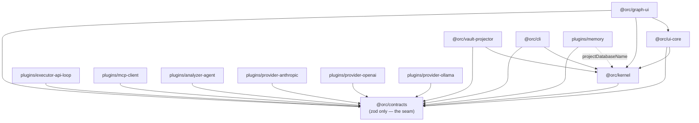
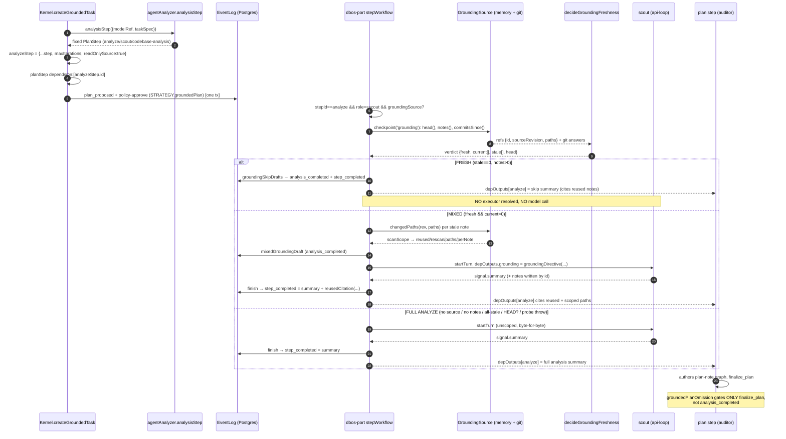

# orc — Codebase Architecture Reference

> A comprehensive, structured reference for the orc codebase. This document is the
> exhaustive companion to `docs/ARCHITECTURE.md`: where that file orients, this one catalogues —
> every load-bearing file, symbol, signature, and responsibility, organized by subsystem and tied
> together by the system-wide data flows and architectural patterns that make them cohere.
>
> Verified against source 2026-07-30.

---

## 1. Ground truth

**orc is an event-sourced multi-agent task orchestrator.** A single Postgres `events` table
(`packages/kernel/src/storage`) is the **only durable source of truth** in the entire system. Every
other subsystem's state is a *rebuildable projection* — a pure, disposable fold over that one
append-only log:

- the kernel's in-memory **task/plan/step fold** (`packages/kernel/src/projections.ts` `foldInto`);
- the durable **operations index** (`packages/kernel/src/storage/operation-journal.ts`
  `rebuildOperations`);
- the **SurrealDB memory knowledge graph** (`plugins/memory/src/surreal.ts` `applyEvent`);
- the git-friendly **markdown vault** (`packages/vault-projector/src/index.ts` `renderTaskFiles`);
- **graph-ui's live graph** (`packages/ui-core/src/sessions.ts` `buildGraph`);
- the **DBOS operation journal** (durable-execution replay state).

Kill any of these and it reconstructs byte-for-byte (vault) or state-for-state (everything else) by
re-reading the log from seq 0. Every *mutation* funnels through one writer path — the `Kernel`'s
private `append()` — which runs inside a per-project `pg_advisory_xact_lock` (writers serialize per
project) and applies a **redact-then-validate** discipline (`ctx.redact` *before*
`PAYLOAD_SCHEMAS[kind].parse`) so a secret can never reach a zod error, a projection, or a
downstream fold. `assertMigrated()` refuses to open a store on a behind schema rather than
auto-migrating it: the log's shape is a deliberate act, never a boot side effect.

---

## 2. Repository layout

**6 packages** (`packages/*`):

| Package | Role |
|---|---|
| `contracts` (`@orc/contracts`) | The seam layer: zod schemas + extension-point interfaces + pure helpers; the leaf of the dependency DAG, zod its only dependency. |
| `kernel` (`@orc/kernel`) | The event-log writer, the Postgres storage cluster, the fold/projection layer, the plugin host, config, and the DBOS-durable execution engine. |
| `cli` (`@orc/cli`) | The composition root: wires kernel + plugin host + DBOS port + memory into one process and exposes two doors (web / MCP) plus the CLI itself. |
| `ui-core` (`@orc/ui-core`) | The transport-free `ProjectSessions` read API (snapshots, patches, the folded read model) plus the view registry that answers every named read over it — over the log fold + memory fold. |
| `graph-ui` (`@orc/graph-ui`) | The one shipped UI adapter: a Bun HTTP+SSE server plus a sigma.js WebGL browser bundle over `ui-core`. |
| `vault-projector` (`@orc/vault-projector`) | Folds the log into a git-friendly markdown vault (task index/log/execution/lineage/plan/session files). |

**7 plugins** (`plugins/*`):

| Plugin | Role |
|---|---|
| `analyzer-agent` | The `Analyzer` implementations: `agentAnalyzer()` (grounded scout) and `regroundAnalyzer()` (maintenance reground). |
| `executor-api-loop` | The `AgentExecutor` — the model⇄tool turn loop (`api-loop`), plus the built-in fs tools and the zone write-fence. |
| `mcp-client` | The `ToolSource` — the trust-gated MCP tool-server host, plus the `web-mcp` search/fetch composition root. |
| `memory` | The `MemoryStore` + `EmbeddingProvider`-consuming knowledge graph: SurrealDB projection, retrieval fusion, topic clustering, sweeps. |
| `provider-anthropic` | `ModelProvider` over `@ai-sdk/anthropic`, with OAuth + prompt-caching fetch wrappers. |
| `provider-ollama` | `ModelProvider` over ollama (free-by-default costs) + the sole `EmbeddingProvider` implementation. |
| `provider-openai` | `ModelProvider` over `@ai-sdk/openai` for any OpenAI-compatible endpoint: configurable base URL, auth (API key, Codex ChatGPT login, none), API flavour and model discovery, behind its own fetch transport. |

---

## 3. Dependency DAG

`@orc/contracts` is the leaf: every package and plugin depends on it, and it depends on nothing back
(zod only). `kernel` depends only on `contracts`. The consumers of `kernel` are `cli`, `ui-core`,
`vault-projector`, and `memory` (the last only for `projectDatabaseName`). Every plugin depends only
on `contracts` (executor-api-loop lists concrete providers under `devDependencies` — test fixtures —
never `dependencies`, so at runtime it only ever receives an already-resolved `LanguageModel`).



The seam is dependency inversion: high-level policy (kernel, executors, providers) and low-level
detail (UI renderers, storage projectors) both point their imports *inward* at `contracts`, so any
of them can be swapped without the others knowing. The concrete plugins implement interfaces
`contracts` *declares* — `AgentExecutor`, `ModelProvider`, `ToolSource`, `Analyzer`,
`EmbeddingProvider`, `ExtensionApi` — and never know about each other.

---

## 4. Key entry points & the two doors

**Composition root — `packages/cli/src/bin.ts` `main()`.** The one file that calls `buildPlugins`
*and* `openKernel` *and* `buildProgram` together, standing up a `Kernel`, a plugin host
(providers/executors/analyzers/skills/extensions/MCP hub), a DBOS execution port, and the memory
subsystem into one running process. Every other CLI file receives an already-built
`kernel`/`plugin`/`portFactory`. The port is **lazy and memoized** (`portFactory = () =>
(runtime.port ??= await buildRuntime(...))`): read-only commands never pay a DBOS launch; every
command that needs execution shares one port instance per invocation.

**One mutation surface, two doors plus the CLI.** Task/plan state is mutated through one shared implementation,
`buildOrcActions` (`packages/cli/src/actions.ts`), no matter which entry point a request enters:

- **The `orc` commander CLI** (`packages/cli/src/main.ts`): `new`/`propose`/`plan`/
  `approve`/`run`/`retry`/`reply`/`cancel`/… each mutating command calls `actions()` and passes `NO_CHAT(Door.cli)`.
- **Door #1 — the web/graph-ui adapter** (`orc graph` → `@orc/graph-ui`): receives the same
  `actions()` implementation as `startGraphUi`'s `actions:`.
- **Door #2 — the stdio MCP server** (`orc mcp serve` → `packages/cli/src/mcp-serve.ts`): receives
  the same `actions()` surface, passing `NO_CHAT(Door.mcp)`; narrows what's *reachable* to `buildCopilotTools`'s subset plus
  a separately-gated `approve`.

Because all three call into the same `assertDrivable`/`assertRetryable`/`assertKnownModel`/
`assertRunnableCwd` functions, the admission check (`DRIVABLE_TASK_STATUS = {approved, running,
blocked}`) means the same thing at every entry point — it is *literally* the same function, not a
parallel re-implementation.

Each door parses input, names its `Origin`, and presents the result. Checkout lifecycle verbs
live in `WorkspaceOps`, built by `buildWorkspaceOps`. The terminal workspace adapter receives
`WorkspaceDoor = { workspaces, reads, config, listWorkspaces }`: it can call those verbs and read
`KernelReads`, but cannot reach a raw kernel mutation or the task actions. `main.ts` memoizes that object behind `requireDoor` so
registering help needs no kernel. `workspace-adopt.ts` keeps the kernel at the composition root
for boot adoption, before the door exists.

**The DBOS run/step engine — `packages/kernel/src/execution/dbos-port.ts`.** `createDbosPort`
registers two DBOS workflows: `orcRun` (the dependency-wave scheduler) and `orcStep` (one step
attempt end-to-end). It journals every durable side effect so recovery *replays* it rather than
*re-running* it, and builds every step's `ExecutorContext` inside the one registered `stepWorkflow`.

---

## 5. Architectural patterns

These are the recurring design mechanisms threaded through every subsystem. Each is documented in
depth in the subsystem sections (§7); this part names them once, in one place, so the whole system's
shape is visible at a glance.

### 5.1 Event-sourcing + fold projections

The Postgres `events` table is append-only and the sole durable truth. Every read-side view is a
`fold` — `foldInto` (kernel task state), `foldOperations`/`rebuildOperations` (operations index),
`applyEvent` (memory graph), `renderTaskFiles` (vault), `buildGraph` (ui graph), `foldMemoryInto`
(memory knowledge fold). A projection is *derived*, so folds are kept **lenient** (a malformed
payload skips its case, never throws) while write-time validation is kept **strict**
(`PAYLOAD_SCHEMAS[kind].parse` at append). Reads tolerate history that predates later-added fields;
writes must not. `orc memory rebuild` clears Surreal and replays from seq 0 to byte-identical state
because every derivation is order-independent.

### 5.2 The contracts seam / dependency inversion

`@orc/contracts` holds the *interfaces* the rest of the system is built against — zod schemas that
double as runtime validators and static types, plus TypeScript interfaces for every extension point
(`AgentExecutor`, `ModelProvider`, `ToolSource`, `ExtensionApi`, `Analyzer`, `EmbeddingProvider`)
that *other* packages implement. High-level and low-level code both import inward at `contracts`, so
any implementation is swappable. Even inside the package, `ids.ts`/`limits.ts`/`event-kinds.ts` are
deliberate leaf modules that break cycles between `memory.ts`, `events.ts`, and `analysis.ts`.

### 5.3 Durable execution (DBOS operation journal + replay)

DBOS records each registered step's return value and each journaled operation's outcome. On recovery
a completed step/operation **short-circuits with its stored value** — external effects are never
re-run, drafted events are never re-appended (deterministic idempotency keys). This forces a rule:
anything non-deterministic (git reads, event-log reads, clocks) must live *inside* a checkpoint's
`fn`, so a replay reproduces the recorded decision instead of recomputing a new one against a moved
world. The two primitives are `makeCheckpoint` (`DBOS.runStep` + idempotent drafted-event commit +
redact) and `makeOperation` (journal begin/complete/fail; reused ⇒ short-circuit).

### 5.4 The zone write-fence + concurrent-write refusal

Two distinct mechanisms, layered on the same file-writing tools (`executor-api-loop/src/tools.ts`):

- **The zone write-fence** (`assertInZone`, contracts) — a *placement* rule: a plan step's declared
  `zone` globs (frozen onto the `PlanStep` by the kernel) are the only thing the executor enforces at
  write time. Applies to `fs_write`, `fs_edit`, **and** `fs_delete`.
- **The concurrent-write-refusal registry** (`writeClaims` Map + `releaseWriteClaims`) — a *liveness*
  rule: the first still-running step to write a path claims it; a different writer attempting the same
  path is refused (`concurrent write refused …`) rather than silent last-write-wins. Applies to
  `fs_write`/`fs_edit` but **not** `fs_delete`.

The kernel additionally rejects, at plan-validation time, two *unordered* steps whose zones overlap
(`validatePlan`): concurrent writers to one path must be *ordered*, not merely fenced.

### 5.5 Trust-gated plugin loading

Config *declares* MCP servers and extensions; only `.orc/trust.json` (local, never committed) *arms*
them. A grant binds to a `sha256` fingerprint of what was consented to (`mcpFingerprint`,
`extensionFingerprint`); changing the declaration/content invalidates it. Trust is re-checked at
**point of use** (`ensureClient` re-checks `isTrusted` on every MCP spawn/respawn; `refValidator`
re-reads trust per plan validation), never as a startup snapshot. `loadTrust` fails **closed**.

### 5.6 Read-your-writes memory

The memory subsystem is an event-first, eventually-consistent projection, but every agent read tool
calls a `settled()` helper (`await opts.catchUp?.()`) before reading, draining the async projection
so an agent sees its own just-completed write. `settled()` swallows a drain failure ("stale beats
failed") — it never fails a read. Merge-on-omit writes read the latest note *from the event log*
(not the projection) inside the transaction, keeping read+merge+append atomic under the advisory
lock.

### 5.7 The plan-authoring / acceptance-gate protocol

A grounded plan *decomposes* work into a human-approved note graph — it never does the work itself:

- **Grounded-plan strategy** (`STRATEGY.groundedPlan`): the `[analyze, plan]` template ends the plan
  step in `finalize_plan`. `groundedPlanOmission` **refuses success** at the plan step if no
  `split_proposed` was produced (the agent narrated instead of decomposing).
- **`finalize_plan` refusal ladder** (five ordered branches): wrong role → no masterplan → non-human
  approval (arrived via MCP) → no approval at all → changed after approval. The gate compares the
  *changed-set*, not a content hash, because the stamped hash attests *that* an approval happened,
  never over *which* graph (the two sides may be different builds).
- **The verify step** (`scoped_changes`, auditor-gated): judges scope from the event log — a *floor*,
  never a diff, never a verdict, never a gate exemption. `AUDITOR_CONTRACT`'s "any defect ⇒ failure"
  stays unqualified.

---

## 6. System data flows

### 6.1 A mutation's path through the log

Every task/plan mutation follows one path, no matter which door originates it:

```
door (CLI / web / MCP)
  → buildOrcActions.<method>            (packages/cli/src/actions.ts — one admission check)
    → Kernel.<method>                   (packages/kernel/src/kernel.ts — the ONLY writer)
      → this.log.transaction(fn)        (EventLog)
        → PostgresStore.withProjectLock (per-project pg_advisory_xact_lock — serialize)
          → EventLog.append:
              1. jsonb-shape the payload
              2. ctx.redact(payload)                    ← redact FIRST
              3. PAYLOAD_SCHEMAS[kind].parse(payload)   ← validate SECOND (never quotes a secret)
              4. INSERT … onConflictDoNothing (idempotency-keyed)
              5. pg_notify('orc_events', seq)           ← wake subscribers
```

The single committed event then fans out to every projection, each folding the *same* row
independently and lazily (LISTEN is only a wake-up; each subscriber's authoritative catch-up query
advances its own cursor only after its handler resolves):

- **kernel fold** — `foldInto` derives task/plan/step state; the operations journal upserts through
  the one `applyOperationEvent` shared by live-write and rebuild.
- **vault** — `createVaultProjector`'s debounced `renderTask` writes the task's markdown files
  (skips `null`-taskId memory events entirely).
- **memory** — `createMemoryProjector` drains `MEMORY_KINDS`, `surreal.applyEvent` commits the note
  + links + claims + cursor in one Surreal tx, then gated whole-corpus link/topic refresh.
- **ui** — each `ProjectSessions.Session` folds the event in place, rebuilds the graph, `diffGraphs`
  to a `GraphPatch`, and fans it to subscribers (SSE → sigma.js).

### 6.2 The grounded analyze flow

A grounded task seeds an `[analyze, plan]` template; the freshness gate decides whether the analyze
step runs at all; the reground maintenance task reuses the same gate. This cross-package flow is
documented end-to-end — with sequence and flow diagrams and all three verdict branches (FRESH /
MIXED / full analyze) — in **§7.8 Cross-cutting data flow: grounded-analyze & reground**. In
summary:

1. `Kernel.createGroundedTask` proposes + policy-approves `[analyze, plan]` in one transaction
   (`STRATEGY.groundedPlan`), stamping `readOnlySource:true` on both steps and pairing the plan step
   `dependsOn:[analyze]`. The human's real gate is the conversational `approve` *inside* the plan
   step.
2. `dbos-port.ts`'s `checkpoint('grounding')` fires for the `analyze`+`scout` step: **FRESH** →
   skip with zero model calls; **MIXED** → run the scout scoped to stale paths; **full analyze** →
   run unscoped byte-for-byte. Every git/store probe lives inside the checkpoint for replay
   determinism.
3. The plan step's only view of analyze is `depOutputs[analyze]` — the `step_completed` summary,
   which the port guarantees cites reused notes on the skip and mixed branches.
4. `Kernel.createRegroundTask` (`type='reground'`, `STRATEGY.single`, `readOnlySource`, **no human
   gate**) reuses the same gate to heal drifted `area-*` notes by id.

---

## 7. Subsystems

The eight sections below catalogue each subsystem's files, symbols, signatures, and responsibilities
in full. They nest under this part; cross-references between them are resolved by section number
(e.g. "§7.2 Kernel core", "§7.8 grounded-flow").

### 7.1 `packages/contracts` — the seam layer

#### Identity

- **Package**: `@orc/contracts` (`packages/contracts/package.json`), version `0.0.0`, `"type": "module"`.
- **Dependencies**: `{ "zod": "^4.4.3" }` — the *only* entry in `dependencies`. No `@orc/*` workspace package appears anywhere in the manifest.
- **Exports map**: `"."` → `./src/index.ts` (the whole public surface) and `"./fixtures"` → `./src/fixtures.ts` (a separate entry point for shared test fixtures, kept out of the main barrel so production code never pulls test data in).
- **Import direction**: every other package and plugin in the repo (`kernel`, `execution`, `executor-api-loop`, `memory`, `provider-anthropic`/`openai`/`ollama`, `mcp-client`, `cli`, `ui-core`, `graph-ui`, `vault-projector`) lists `@orc/contracts` as a dependency; `contracts` imports none of them back. Within `packages/contracts/src` every cross-file import is a relative import to a sibling module — confirmed by reading `index.ts`, `events.ts`, `plan.ts`, `execution.ts`, `plugins.ts`, `memory.ts`, `analysis.ts`, `ids.ts`.

#### Architectural role: the seam (dependency inversion)

`contracts` is the leaf of the workspace's dependency DAG (§3) — the one package every other package depends on and which depends on nothing itself. It exists to hold the *interfaces* the rest of the system is built against:

- Zod schemas that double as runtime validators and static types for every domain object that crosses a process/tool/storage boundary (tasks, plans, events, memory notes, operations).
- TypeScript interfaces for the system's extension points (`AgentExecutor`, `ModelProvider`, `ToolSource`, `ExtensionApi`, `Analyzer`, `EmbeddingProvider`) that *other* packages implement, never `contracts` itself.
- Small pure helper functions (id derivation, error formatting, path/zone guards, approval-answer matching) that would otherwise be re-implemented — and drift — independently in each consumer.

This is the classic dependency-inversion seam: high-level policy (the kernel, executors, providers) and low-level detail (UI renderers, storage projectors) both point their imports *inward* at `contracts`, so any of them can be swapped without the others knowing. Two modules inside the package are deliberately kept as leaves for the same reason at a smaller scale: `ids.ts` (see below) and `limits.ts`/`event-kinds.ts` break cycles that would otherwise form between `memory.ts`, `events.ts`, and `analysis.ts`.

#### Public surface (`src/index.ts`)

`index.ts` is a pure barrel of `export * from './<module>'` statements, in this order:

```
task · plan · events · execution · operations · workspace · guards · encoding ·
plugins · event-kinds · ids · limits · cluster · memory · plan-ordering ·
approval · approval-answer · analysis
```

Every schema, type, const, and function documented in this section is reachable by importing directly from `@orc/contracts`.

#### Key schemas & types

##### `task.ts` — the task node

- `TaskStatus` is a TS `enum` (`draft`/`awaiting_approval`/`approved`/`running`/`blocked`/`done`/`failed`/`cancelled`), parsed with `z.enum(TaskStatus)`; `TASK_STATUS = TaskStatus` is a plain alias so call sites keep writing `TASK_STATUS.done` instead of the enum name.
- `TERMINAL_TASK_STATUS: ReadonlySet<TaskStatus> = new Set([done, failed, cancelled])` — the statuses no further work will move; a driver checks membership to decide whether a spawned task still needs someone to execute it.
- `TaskNode = z.object({ id, parentId: string|null, type, title, spec, status: TaskStatus, zone: string[], budgetUSD: number|null, depth: number, createdAt })` with inferred type `TaskNode` — the canonical shape of one node in the task tree, covering identity, lineage (`parentId`), the write-fence (`zone`), and budget.

##### `events.ts` — the event vocabulary's payloads

- `PAYLOAD_SCHEMAS` — each `EventKind`, including `chat_opened`, mapped to its zod payload schema, typed `satisfies Record<EventKind, z.ZodType>` so a payload schema is a compile error to omit when a kind is added.
- `EventEnvelope = Origin.extend({ taskId: string|null, stepId: string|null, runToken: string|null, kind: EventKind, payload: Record<string, unknown>, usage: Usage.nullable().optional(), idempotencyKey: string|null (default null) })` — the runtime schema the log parses, payload deliberately opaque so `PAYLOAD_SCHEMAS[kind]` can validate it *after* redaction. A writer must state `chatId` (nullable) and `door`.
- `EventPayload<K extends EventKind> = z.input<PAYLOAD_SCHEMAS[K]>`, and the type `EventInput` is a discriminated union over `kind` built from it — `append({ kind, payload })` does not compile when `payload` misses a field, names one the schema lacks, or belongs to another kind. `PAYLOAD_SCHEMAS` is the single source, so a new kind needs only its enum entry and its schema. One gap: `memory_written`'s `note` field routes through `MemoryNoteInput`, a `z.preprocess` whose input type is `unknown`, so this compile-time check does not reach inside it — a malformed note is still caught only by runtime validation in the log.
- `EventDraft` — the same union minus the envelope (`{ kind, payload, usage?, idempotencyKey? }`): an event a writer drafts and something else stamps. Consumed by `Checkpoint`/`OperationCheckpoint` (`execution.ts`) and by the kernel's own append helpers. The kind and payload travel as one value because a helper generic over the kind cannot re-pair them.
- `EventKind` and `EVENT_KIND` are actually defined in `event-kinds.ts` (re-exported here); `events.ts` re-exports them alongside payload types it owns directly: `ArtifactProducedPayload`, `ModelsDiscoveredPayload`, `CopilotExchangePayload`, `Reaction` (TS `enum` of six reaction names, re-exported as `REACTION`) + `ReactionFailedPayload`, `RunRequestedPayload`.

##### `event-kinds.ts` — the leaf vocabulary module

- `EventKind` is a TS `enum` listing every kind (`task_created` … `chat_opened`), parsed with `z.enum(EventKind)`; `EVENT_KIND = EventKind` is a plain alias. Kept in its own leaf module (zod + type-only imports of `Usage` and `Door`) so `memory.ts` and `analysis.ts` can read event kinds without reaching the payload schemas and their cycles.
- `EventRecord` interface — the stored envelope: `{ seq, projectId, idempotencyKey, chatId: string|null, door: Door, taskId, stepId, runToken, kind: EventKind, payload, usage: Usage|null, ts }`.

##### `origin.ts`, `chat.ts`, `scope.ts`, `chat-digest.ts` — interaction and read shapes

- `Origin` requires `chatId: string|null` and `door: Door`. `Door` names the entry point: `web` (browser and copilot), `cli` (terminal), `mcp` (external MCP calls), `supervisor` (durable execution), or `hook` (post-commit). `NO_CHAT(door)` explicitly names calls outside a conversation. Origin is identity, never authority. `authorSourceOf(origin.door)` maps the door to note authorship; the terminal ADR command explicitly records a human author.
- `ChatKind` distinguishes `copilot`, `run`, `external`, and `imported`. `ChatOpenedPayload` records chat id, title, kind, workspace/task at open, nullable parent `ChatRef = { chatId, seq }`, and nullable `externalRef`. `chatOpenedKey` keys the sole lifecycle event, `chat_opened`; there is no stored close or digest event.
- `ScopeType` belongs to `scope.ts` beside `Scope`: project; workspace id; task id with required `subtree: boolean`; or chat id. `in-scope.ts` implements `inScope` over `EventRecord` plus a `ScopeIndex`, including author-attributed memory events and workspace commits.
- `ChatDigest` is a browser-safe schema. `chat-digest-fold.ts`'s `chatDigests` derives identity, end/outcome, usage, questions and effects from events on each read. Only a run's own task status changes can supply its end, selected after folding so a late open still works. Child task stamps cannot replace that end; child chats' usage is not added to their parent. An unopened chat id yields no digest.
- Browser runtime imports take leaf `@orc/contracts/<subpath>` modules. `browser-leaves.test.ts` derives entries from browser imports and walks their runtime imports and re-exports to reject paths to Node builtins; `bun run check:web` also builds the browser bundle after Svelte checking. The shape modules stay separate from the event-reading folds so importing `Scope` or `ChatDigest` cannot pull in `node:crypto` through the payload schemas.

The events table stores nullable `chat_id` and required `door`. Migration
`packages/kernel/drizzle/0005_chat_envelope.sql` adds `door` as `NOT NULL` with no default:
it applies to an empty log, without fabricating the provenance of historical events.

##### `plan.ts` — plan shape and the grounded-plan strategy

- `STRATEGY = { groundedPlan: 'grounded-plan', split: 'split', single: 'template:single' } as const` — the three routing keys the runtime and the split path share as matched values rather than scattered literals: `groundedPlan` is the analyze+plan template ending in `finalize_plan`; `split` is child-task decomposition inside `proposeSplit`; `single` is a one-step plan with no authoring, used by `createRegroundTask`.
- `STEP_ID = { analyze, plan, verify, commit, checks, finish }` lives in the zero-import `step-ids.ts` (re-exported here) so the kernel, every plugin and the browser can match on step ids without importing the kernel; accessors `VERIFY_STEP_ID`, `COMMIT_STEP_ID`, `CHECKS_STEP_ID`, `FINISH_STEP_ID`. `CHECKS_EXECUTOR_REF = 'checks'` is the executor id the kernel-appended checks step runs under — no model, it runs the operator's configured `finishChecks` commands. `STEP_ROLE = { scout, implementer, auditor, worker } as const` — the *known* (not closed) set of step roles.
- `MASTERPLAN_NOTE_ID = 'masterplan'` (also `step-ids.ts`) — the root note id of a grounded plan-note graph.
- `planScope(taskId: string): string` — derives the per-task plan-note memory scope (`plan-<sanitized-taskId>`), case-folded and non-alphanumerics collapsed to `-` so `MEMORY_ID_RE` always accepts it.
- `PlanStep = z.object({ id (path-safe /^[\w-]+$/), role, title, instructions, executorRef, modelRef, skillRefs: string[], toolRefs: string[] (each matching TOOL_REF_RE, default []), isolation: IsolationTier, zone: string[], maxIterations: positive int, dependsOn: string[], readOnlySource?: boolean })`. `readOnlySource` is kernel-set only, on the grounded template's analyze/plan steps, and is not exposed on the plan-note write path (an agent cannot grant itself source writes).
- `IsolationTier` is a TS `enum` (`local`/`worktree`/`docker`), parsed with `z.enum(IsolationTier)`; there is no separate constant alias — call sites use `IsolationTier.local` directly.
- `Plan = z.object({ taskId, version: positive int, strategyRef, analyzerRef?: string, costEstimateUSD: number|null, steps: PlanStep[] (min 1) })`.
- `PlanDraft = Plan.omit({ taskId: true, version: true })` — what a proposer authors before the kernel stamps identity/version.
- `ChildPlanStep`/`ChildPlanDraft`/`ChildPlanDraftInput` — the trimmed shape a `task_split` proposer authors: `executorRef`/`modelRef`/`isolation`/`maxIterations` are omitted (inherited from the parent step at expansion, except `modelRef` which a child may optionally override); `zone` is the child's own disjoint declaration (max 16, default `[]`).
- `validatePlan(plan: Plan): { ok: true } | { ok: false; errors: string[] }` — checks duplicate step ids, dangling `dependsOn` targets, rejects an all-parallel multi-step plan (must have real ordering, e.g. a trailing `verify` step), rejects two *unordered* steps that declare an overlapping `zone` (concurrent writers to one path must be ordered, not merely fenced), and finally detects dependency cycles via a fixpoint pass.

##### `execution.ts` — the executor/runtime contract surface

This is the largest and most cross-cutting module; besides usage/cost accounting (`Usage`, `ZERO_USAGE`, `addUsage`, `ModelCost`, `costUSDFor`, `formatModelRate`/`formatModelOption`) and run-outcome plumbing (`Signal`, `SignalOutcome`, `FailureClass`, `RunOutcome`, `runOutcomeFor`, `SplitResult`, `UnifiedEvent`/`UnifiedEventType` — each a TS `enum` parsed with `z.enum(Enum)`, with no separate constant alias), it defines the core runtime seams:

- `ExecutorContext<LM = unknown>` — everything an `AgentExecutor.startTurn` receives: `{ step: PlanStep, taskSpec, depOutputs: Record<string,string>, skills: LoadedSkill[], extraTools: ResolvedTool[], model: LM, runToken, workspaceDir, checkpoint: Checkpoint, operation: OperationCheckpoint, budgetRemainingUSD(): Promise<number|null>, taskId?, memoryPreloadTokens?, memory?: StepMemory }`.
- `Checkpoint = <T>(name: string, fn: () => Promise<T>, toEvents?: (result: T) => EventDraft[]) => Promise<T>` — the durable checkpoint/replay boundary: `fn` runs at-most-effectively-once, its result is turned into events by `toEvents`.
- `OperationCheckpoint = <T>(spec: OperationSpec, fn: (attempt: number) => Promise<T>, toEvents?) => Promise<T>` — the specialized checkpoint for external model/tool effects; the journal records `spec` before `fn` runs and the result/failure after. `attempt` is the journal's 1-based count for the operation; a checkpoint nested inside `fn` (the rate-limit wait) keys by it.
- `Signal = z.object({ stepId, runToken, outcome: SignalOutcome, summary, outputs?: string[] })` — what a step hands back on completion, including workspace-relative declared outputs.
- `terminalError(message)`, `isTerminalError(err)`, `classifiedError(cls, message)`, `failureClassOf(err)` — the retry protocol between checkpoint implementations and callers: a `terminalError` throw is never retried; a small set of permanent filesystem error codes (`EACCES, EPERM, ENOENT, EROFS, ENOTDIR, EISDIR`) are also treated as terminal.
- `RecalledContext = { claims: ClaimHit[], notes: NoteSummary[], currency?: { checkable: number; drifted: number } }` — one preload pull's result, including the same drift verdict `memory_read`/`orc status` report.
- `StepMemory` interface — `{ recall(budget): Promise<RecalledContext>; claimsCiting(paths): Promise<ClaimHit[]>; capture(signal): Promise<void> }` — the step's bound memory handle; the executor decides only *when* to call it.
- `RunHandle = { workflowId: string; wait(): Promise<RunOutcome> }` and `ExecutionPort = { startRun, retry, cancelRun }` — the durable execution port. `cancelRun(taskId, origin)` requires the canceller's `Origin`; start/retry take an optional cwd, and the workflow supplies its own run origin.
- Helper functions: `parseModelRef(ref)`, `resolveModel(providers, modelRef)`, `modelIdsFrom(body, listKey, idKey)` (the one parse of a provider's model-list JSON, tolerant of malformed input — never throws, returns fewer ids).

#### Extension-point interfaces (dependency-inversion in practice)

These interfaces are *defined* in `contracts` and *implemented* by other packages — the clearest instances of the seam pattern:

| Interface | Defined in | Shape | Implemented by |
|---|---|---|---|
| `AgentExecutor<LM = unknown>` | `execution.ts` | `{ id: string; startTurn(ctx: ExecutorContext<LM>): AsyncGenerator<UnifiedEvent, void, SplitResult[]\|string\|undefined> }` | `plugins/executor-api-loop` (§7.4) |
| `ModelProvider<LM = unknown>` | `execution.ts` | `{ costs: Record<string, ModelCost>; languageModel(modelId): LM; listModels?(): Promise<string[]> }` (imported as a type into `plugins.ts`) | `provider-anthropic`, `provider-openai`, `provider-ollama` (§7.4) |
| `ToolSource` | `plugins.ts` | `{ resolve(refs: string[]): Promise<ResolvedTool[]>; close(): Promise<void> }` | `mcp-client` (§7.4) |
| `ExtensionApi` | `plugins.ts` | `{ registerProvider(id, provider); registerExecutor(id, executor); registerAnalyzer(id, analyzer); on<H extends HookName>(hook, handler: HookHandlers[H]) }` | the kernel's extension host (§7.2), called by each `ExtensionManifest.activate(api)` |
| `HookHandlers` | `plugins.ts` | `{ session_start(): void\|Promise<void>; session_shutdown(): void\|Promise<void>; event_appended(e: EventRecord): void\|Promise<void> }` keyed by `HookName`, a TS `enum` (`session_start`/`session_shutdown`/`event_appended`) parsed with `z.enum(HookName)` | extension plugins registering via `ExtensionApi.on` |
| `Analyzer` | `analysis.ts` | `{ id: string; analysisStep(opts: { modelRef: string; taskSpec: string }): PlanStep }` | the agent-analyzer plugin (§7.8) |
| `EmbeddingProvider` | `execution.ts`* | `{ embed(texts: string[]): Promise<number[][]> }` | `provider-ollama` (§7.4) — the ONE embedding seam; optional system-wide, memory retrieval degrades to keyword-only when unconfigured |

`plugins.ts` also carries the non-interface extension scaffolding: `SkillManifest` (agentskills.io T0 skill frontmatter, `z.strictObject`), `SkillIndexEntry`, `LoadedSkill { name, body, hash }`, MCP types (`McpServerConfig`, `MCP_SERVER_ID_RE`, `TOOL_REF_RE`, `parseToolRef`, `mcpToolName`), `ResolvedTool { ref, name, description, inputSchema, execute(input, toolCallId?) }`, and `ExtensionManifest { id; activate(api): void|Promise<void>; deactivate?(): void|Promise<void> }` — the top-level plugin entry point.

*(EmbeddingProvider is physically declared in `execution.ts`, not `plugins.ts` or `analysis.ts`.)*

#### Pure helpers

- **`guards.ts`**:
  - `isRecord(v): v is Record<string, unknown>` — runtime narrowing for values from external boundaries (JSON/YAML/wire input).
  - `errorMessage(err: unknown): string` — the single error→string formatter used at every tool-result boundary: `z.prettifyError` for `ZodError`, `.message` for `Error`, else `String(err)`.
  - `toolError(err: unknown): { output: { error: string }; isError: true }` — the one tool-result error envelope built on top of `errorMessage`.
  - `mermaidLabel(s: string): string` — the one escaper for every mermaid-producing view (vault, ui-core diagrams, memory index): replaces `"` with `'` and collapses newlines to spaces.
- **`ids.ts`** (deliberate leaf module):
  - `MEMORY_ID_RE = /^[a-z0-9][a-z0-9-]*$/` and `SHA256_HEX_RE = /^[a-f0-9]{64}$/` — the one spelling of each shape, used across artifact receipts, plan hashes, and kernel trust fingerprints.
  - `slugId(title: string): string` — deterministic `MEMORY_ID_RE`-safe id from a title (lowercase, collapse non-alphanumerics to `-`, trim edges, cap at 64 chars); throws if the result still fails `MEMORY_ID_RE`.
  - The module's own comment states its reason for existing as a leaf: `memory.ts` and `events.ts` import each other in a deliberate cycle, and `analysis.ts` reads an id regex at module top level — routing that read through the cycle would resolve to `undefined` whenever `memory.ts` is still initializing. `limits.ts` and `event-kinds.ts` are leaf modules for the identical reason.
- **`author.ts`**:
  - `AuthorSource` is a TS `enum` (`agent`/`cli`/`mcp`/`human`), parsed with `z.enum(AuthorSource)`; `AUTHOR_SOURCE` is the plain alias every call site matches on. `authorSourceOf(door: Door): AuthorSource` is the one door→source stamp, `satisfies Record<Door, AuthorSource>` so a new door fails the build if unmapped.
  - `MemoryAuthor = z.object({ source: z.enum(AuthorSource), workspaceId, origin, taskId?, stepId?, runToken?, executor?, model?, role? })` — who wrote a note/annotation/feedback reply, and which checkout they wrote it from.
  - `composeAuthor(a: MemoryAuthor): string` — composed provenance string: `'cli'` and `'human'` render as themselves, every other source composes `executor·model·role` joined with `·` and falls back to **its own source** (so a bare `mcp` author reads `mcp`, not `agent`).
- **`approval-answer.ts`** — the *conversational* plan-gate vocabulary:
  - `ApprovalAnswer` is a TS `enum` (`approve`/`approved`/`agree`/`agreed`/`yes`/`ok`/`okay`/`lgtm`/`go`/`proceed`), parsed with `z.enum(ApprovalAnswer)`; `APPROVAL_ANSWER = ApprovalAnswer.approve` is the canonical word the UI's one-click button sends.
  - `isApprovalAnswer(text: string): boolean` — whole-string match after trim + case-fold (never substring — "do not approve" must not match). This is the vocabulary for the conversational plan gate (a grounded task's `plan`-step question), explicitly distinct from `approval.ts`'s `ApprovalPolicy`/`evaluateApproval` (whether a proposed child task needs a human at all) and from `orc approve <taskId>` (which stamps `approvedVersion` and emits `plan_approved`) — three separate gates the module comment warns never to merge.
- **`approval.ts`** — the policy-evaluation module:
  - `ApprovalMode` is a TS `enum` (`auto`/`manual`), parsed with `z.enum(ApprovalMode)`. `ApprovalRule = z.object({ maxDepth?, maxCostUSD?, type?, then: z.enum(ApprovalMode) })`, `ApprovalPolicy = z.object({ default: z.enum(ApprovalMode).default(ApprovalMode.manual), rules: ApprovalRule[].default([]) })`.
  - `evaluateApproval(policy, ctx: { depth, costEstimateUSD: number|null, type }): { then: 'auto'|'manual'; ruleIndex?: number }` — first matching rule wins (every present field must match); a `null costEstimateUSD` never matches a `maxCostUSD` rule (treated as unbounded).
- **Activation math** — there is no `activation.ts` file; `activation()` and `DEFAULT_HALF_LIFE_DAYS` are defined at the bottom of **`memory.ts`**, under an in-file `---- activation ----` banner, alongside:
  - `DEFAULT_HALF_LIFE_DAYS = 14`, `ACTIVATION_GAIN = 0.25`.
  - `AccessStats = { hits: number; lastAccessedAt: string | null }` — the observed-use measurement folded from `memory_accessed` events.
  - `activation(stats, now, halfLifeDays = DEFAULT_HALF_LIFE_DAYS): number` — a pure, read-time-only exponential-decay score (`hits * 0.5 ** (ageDays / halfLifeDays)`, `0` if never accessed); boost-only by design — never used to filter/prune, only to re-rank.
  - `activationBoost(a: number): number` = `1 + ACTIVATION_GAIN * Math.log1p(a)`.
  - Supporting pure functions: `bumpAccess`, `edgeKey`, `viaEdge`, `foldMemoryInto`/`foldMemory` (the one fold of the memory event stream into notes/writes/access/edges maps).

#### Other modules re-exported through the barrel

- **`operations.ts`** — the model/tool operation journal contract: `OperationKind`/`OperationStatus` enums, `OperationSpec`, `OperationStarted/Completed/FailedPayload`, and the durable `OperationRecord` row shape.
- **`workspace.ts`** — the filesystem trust boundary: `resolveInWorkspace` (symlink-safe containment guard), `pathInZone`/`assertInZone` (the zone write-fence predicate and enforcer), `validateOutputPaths` (containment + regular-file + no-duplicates check for a step's declared outputs).
- **`encoding.ts`** — detects and reports double-JSON-escaped tool arguments: `looksDoubleEncoded`, `doubleEncodedField`, `DOUBLE_ENCODED_HINT`, `unescapeSequences`.
- **`limits.ts`** — `MEMORY_LIMITS` const (leaf module): every size/count ceiling shared by the memory schemas.
- **`cluster.ts`** — `Topic = z.object({ topicKey, label, size })` and `MemoryTopicAccessedPayload` — the derived-topic read model's contract.
- **`memory.ts`** — the full memory-note tier system (`SemanticNoteInput`/`EpisodicNoteInput`/`PlanNoteInput`, the `MemoryNoteInput`/`MemoryNote` discriminated unions, `NoteSummary`, `MemorySearchResult`, `NeighborResult`, the `MemoryStore` interface — `write/remove/get/list/search/searchClaims/claimsFor/neighbors/recordAccess/topics/topicClaims`), plus `deriveNoteProvenance`, `noteLabel`, `noteKey`, and the activation functions above. Re-exports `ids.ts` and all of `claim.ts` (`Claim`, `ClaimHit`, `ClaimInput`, `ClaimWrite`, `ClaimSearchOptions`).
- **`plan-ordering.ts`** — `siblingOrderingMisuse(noteId, links, siblings): string | null` — the one spelling of "ordering is the `dependsOn` FIELD, not a `depends_on` LINK", shared by `memory_write`'s warning path and the grounded-plan freeze's rejection path.
- **`analysis.ts`** — beyond the `Analyzer` interface: `CoverageReport`/`AnalysisCompletedPayload`, `FeedbackRequestedPayload`/`FeedbackProvidedPayload` (the conversational feedback gate), `PlanAnnotatedPayload` (the human annotation-on-plan-note input event).

### 7.2 Kernel core: storage, projections, plugin host

> Scope: the kernel package's **core** — the sole event-log writer, the Postgres storage cluster, the fold/projection layer, the plugin host, and config resolution. The **execution engine** (`packages/kernel/src/execution/*`) is §7.3. Package root: `packages/kernel/src`.

#### Governing invariant

**The Postgres event log is the only durable source of truth; everything else is a fold/projection of it.** Every mutable read-side view in the kernel is rebuildable by re-reading the append-only `events` table and folding:

- the in-memory task/plan `State` — `projections.ts` `fold()` / `foldInto()`;
- the durable `operations` index — `operation-journal.ts` `rebuildOperations()` over `foldOperations()`;
- per-note current state — `event-log.ts` `latestNoteEvent()` (an *indexed* fold of one note's memory events);
- the plan-note graph a freeze consumes — `kernel.ts` `listPlanNotes()` → `foldPlanNotes()`.

Two structural consequences enforce this:

1. **One writer path.** All kernel mutations go through `Kernel` → `this.log.transaction(...)` → private `append()` → `EventLog.txOps(tx).append()`. There is no other durable write to task/plan state anywhere in the core.
2. **One lock, one serialization point.** Every writer runs inside `PostgresStore.withProjectLock()`, which takes a per-project `pg_advisory_xact_lock` under READ COMMITTED. Writers serialize per project; unrelated projects stay concurrent.

Because a projection is *derived*, fold is kept **lenient** (a malformed payload skips its case, never throws) and write-time validation **strict** (`PAYLOAD_SCHEMAS[kind].parse` at append).

#### 1. Kernel class — `packages/kernel/src/kernel.ts`

`class Kernel` wraps an `EventLog` plus three optional collaborators, all injected so unit tests / read-only CLI can construct without a plugin host or DBOS port:

```
constructor(
  private readonly log: EventLog,
  private readonly refValidator?: (plan: Plan) => Promise<string[]>,
  private readonly analyzers?: Map<string, Analyzer>,
  private readonly send?: (workflowId, message, topic, idempotencyKey) => Promise<void>,
)
```

- **`refValidator`** — plan-graph ref check (usually the plugin host's; see below).
- **`analyzers`** — seed the grounded/reground scout step from `Analyzer.analysisStep`.
- **`send`** — resumes a parked feedback gate via DBOS `recv`; the kernel stays DBOS-agnostic.

Internal helpers: `stateOf(ops) → fold(await ops.all())`, private `append(ops, taskId, kind, payload)` (writes with `stepId:null, runToken:null`), `requireTask`, `createTaskIn`, `approvePlanIn`, `appendPlanVersion`. `state()` refolds the entire log on every call.

##### Public methods

| Symbol | Signature | Responsibility |
| --- | --- | --- |
| `createTask` | `(input: {title; spec?; type?; parentId?; budgetUSD?}) → Promise<TaskNode>` | Append a single `task_created` (status `draft`); budget/depth inherited from parent. |
| `createGroundedTask` | `(input: {title; spec; modelRef; analyzerRef; parentId?; budgetUSD?; modelCatalog?; maxIterations?}) → Promise<TaskNode>` | Bootstrap the auto-approved `[analyze, plan]` template (`STRATEGY.groundedPlan`). Analyze step = resolved `Analyzer.analysisStep` (`readOnlySource:true`); plan step id=`PLAN_STEP_ID` role=`PLAN_STEP_ROLE`, `executorRef:'api-loop'`, `skillRefs:['plan-authoring']`, authors the plan-note graph in scope `planScope(task.id)` root `MASTERPLAN_NOTE_ID`, then calls `finalize_plan`. **Policy-approved** — the human's real gate is the conversational approve *inside* the plan step. See §7.8. |
| `createRegroundTask` | `(input: {modelRef; maxIterations?; budgetUSD?}) → Promise<TaskNode>` | Maintenance re-ground: a **single** scout step (`STRATEGY.single`, type `'reground'`) from the dedicated `reground-analyzer`, used verbatim. Policy-approved, `readOnlySource`, no plan authoring and no human gate — dbos-port's freshness gate fires it automatically per-commit on drifted `area-*` notes. See §7.8. |
| `proposePlan` / `editPlan` | `(taskId, draft: PlanDraft) → Promise<Plan>` | Append `plan_proposed` (requires status `draft`) / `plan_edited` (requires `awaiting_approval`), via `appendPlanVersion`. |
| `approvePlan` | `(taskId, version?, approval?: { approvedBy: ApprovedBy; ruleIndex?: number }) → Promise<Plan>` | Append `plan_approved` + `task_status_changed → approved`; version must equal latest or throws `version_conflict`. |
| `proposeSplit` | `(input: {parentTaskId; stepId; runToken; toolCallId; title; spec; plan: ChildPlanDraftInput; budgetUSD?; parentStep; policy; maxDepth}) → Promise<{splitId; childTaskId; gated}>` | Spawn a child task. `splitId = split:${runToken}:${toolCallId}` (crash-idempotent). Refuses a **terminal** parent (`invalid_transition`), refuses a re-used `childTaskId`, enforces `maxDepth`, clamps `budgetUSD` to the subtree's remaining envelope. Expands the trimmed `ChildPlanDraft` with inherited refs (`STRATEGY.split`, `isolation:local`, child-declared `zone`), then `evaluateApproval(policy,…)` → auto-approve or leave `gated`. |
| `replyFeedback` | `(taskId, text, via: MemoryAuthor['source'] = 'cli') → Promise<string\|null>` | Human side of the conversational gate. Appends `feedback_provided` for the latest open `feedback_requested`, records `author.source = via`, resumes the parked step via `send`. **Approval attribution:** stamps `planHash` (`planGraphHash(foldPlanNotes(...))`) only when `task.type==='grounded'` **AND** `event.stepId===PLAN_STEP_ID` **AND** `isApprovalAnswer(text)`. |
| `approvedPlanHash` | `(taskId, runToken) → Promise<{hash; seq}\|null>` | The plan hash a **human** approved: newest `feedback_provided` on this runToken with `author.source === 'cli'` **AND** `isApprovalAnswer(text)` **AND** `planHash` set. The gate. |
| `nonHumanPlanApproval` | `(taskId, runToken) → Promise<{source}\|null>` | Same scan/predicate but `author.source !== 'cli'`. Lets `finalize_plan` distinguish "nobody approved" from "an agent approved through the MCP door". Decides nothing. |
| `planNotesChangedSince` | `(taskId, seq) → Promise<string[]>` | Plan-tier note ids written/deleted in this task's plan scope after `seq` — what changed since the human approved. |
| `listPlanNotes` | `(taskId) → Promise<PlanNote[]>` | Reconstruct the plan-note graph from `log.after(0, [memory_written, memory_deleted])` via `foldPlanNotes(events, planScope(taskId))` — **from the log, never the eventually-consistent Surreal projection**. |
| `annotatePlan` / `listAnnotations` | `(taskId, {targetNote; refs?; text})` / `(taskId) → Promise<PlanAnnotation[]>` | Human annotation on a plan-note: write side appends `plan_annotated` (input-only, no fold), read side re-reads them off `log.byTask` seq-ordered. |
| `openFeedback` / `openFeedbackInSubtree` | `(taskId)` / `(rootId) → Promise<…\|null>` | The latest still-open `feedback_requested`, for a task or nearest-first across its subtree. |
| `gatedChildren` | `(taskId) → Promise<Array<{id; title}>>` | Descendants parked at the manual approval gate (`awaiting_approval`). |
| `reportCoverage` / `latestCoverage` | write / read of `analysis_completed` | The scout step's CoverageReport and its readback for `orc status`. |
| `requestRun` | `(taskId, {cwd?; retry?}) → Promise<number>` | Append `run_requested`; returns its seq so a watcher can tell "supervisor hasn't reacted" from "run over". |
| `cancelSubtree` | `(taskId) → Promise<string[]>` | Stamp every non-terminal subtree task `→ cancelled` in **one** transaction, children before parents. |
| `listTaskChangedPaths` | `(taskId) → Promise<Array<{path; taskId; steps}>>` | Audit membership projection: paths this task + its split descendants *wrote*, folded from the log. A FLOOR. |
| read helpers | `state`, `getTask`, `listTasks`, `getPlan`, `eventsFor`, `eventsSince`, `subscribe` | Fold-backed reads; `subscribe`/`eventsSince` delegate to `EventLog`. |

**Human-approval-gate attribution (key rule):** a plan is "approved by a human" iff a `feedback_provided` exists with `author.source === 'cli'`, `isApprovalAnswer(text)` true, and a non-empty `planHash`. `isApprovalAnswer` is the shared `APPROVAL_ANSWERS` predicate from `contracts/approval-answer.ts` (§7.1) — **not** a bare `'approve'` literal — and the *same* predicate is used on both the write (`replyFeedback`) and read (`approvedPlanHash`) sides so the writer's stamp and the reader's check can never drift.

#### 2. Storage cluster — `packages/kernel/src/storage/*`

Wraps one Postgres schema (`events`, `operations`, `supervisors`) behind `PostgresStore` + `EventLog` + `OperationJournal`, with `redact.ts` and `migrate.ts` guarding the boundary.

##### `postgres.ts` — the one Postgres owner

| Symbol | Signature | Responsibility |
| --- | --- | --- |
| `PostgresStore.open` | `static (url, {projectId; redactEnv?}) → Promise<PostgresStore>` | Creates `pg.Pool({ max: 4, idleTimeoutMillis: 2000 })`, calls `assertMigrated(db, url)` and **throws (ending the pool) if the schema is behind — never auto-migrates**. `max:4` is deliberate: all writers serialize on one advisory lock. |
| `PostgresStore.withProjectLock` | `<T>(fn: (tx) => Promise<T>) → Promise<T>` | Runs `db.transaction`, executes `select pg_advisory_xact_lock(hashtextextended(projectId, 0))` **first**, then `fn`. Serializes writers per project under READ COMMITTED. |
| `isGonePermanently` | `(err) → boolean` | True for terminal Postgres codes — `3D000` invalid_catalog_name, `28P01`/`28000` (auth failed). Used to stop reconnect loops. |
| `NOTIFY_CHANNEL` | `= 'orc_events'` | The single append wake-up channel; owned here so subscribe/watch never re-spell it. |
| `listProjectIds` / `watchProjectIds` | cross-project discovery | Read-only viewer support. `watchProjectIds` LISTENs on `orc_events`, debounces, re-queries authoritatively on every wake. |

##### `event-log.ts` — the append-only log API

`EventLogOps` interface: `append`, `byTask`, `byTaskSince`, `after(afterSeq, kinds?)`, `latestNoteEvent`, `earliestSeq`, `all`. `class EventLog implements EventLogOps` adds `transaction`, `txOps(tx)`, `subscribe`, `countAfter`, `close`, `onAppend?` (observe-only).

| Symbol | Signature | Responsibility |
| --- | --- | --- |
| `makeOps().append` | `(input: EventInput) → Promise<EventRecord>` — `EventInput` is the kind-discriminated union, so a mismatched payload fails the build | **Redact-then-validate order:** parses `EventEnvelope` (opaque payload), jsonb-shapes the payload, `ctx.redact(payload)`, *then* `PAYLOAD_SCHEMAS[kind].parse(payload)` — so a zod error can never quote a raw secret. `onConflictDoNothing().returning()` keyed on `(projectId, idempotencyKey)`; on conflict reuses the stored row only if it deep-equals, else throws `idempotency_conflict`. Fresh insert fires `pg_notify(orc_events, seq)`. |
| `EventLog.transaction` | `<T>(fn: (tx: EventLogOps) => Promise<T>) → Promise<T>` | `store.withProjectLock(tx => fn(this.txOps(tx)))` — the only durable write entry. |
| `EventLog.subscribe` | `(opts: {fromSeq?; onReset?}, handler) → Promise<() => Promise<void>>` | Lossless stream: LISTEN is only a wake-up; a catch-up `pump()` query is authoritative and the **cursor advances only after the handler resolves**. Bounded-backoff reconnect, stops permanently on `isGonePermanently`. `rewindIfReplaced()` resets the cursor to 0 and calls `onReset()` when `latestSeq()` falls below the cursor. |
| `latestNoteEvent` | `(scope, id) → Promise<EventRecord\|null>` | Newest `memory_written`/`memory_deleted` naming this note; the query's `COALESCE(...)` expressions mirror `idx_events_note_seq` **exactly** (drizzle/0004). |

##### `operation-journal.ts` — durable before/after operation index

`class OperationJournal(store, events)`. Each transition appends inside `withProjectLock` and upserts the `operations` row through the ONE transition function `applyOperationEvent` (shared with the fold).

| Symbol | Signature | Responsibility |
| --- | --- | --- |
| `beginOperation` | `(context, spec) → Promise<{reused; attempt; value?}>` | Reuses a `completed` node; else appends `operation_started`, idempotencyKey `${operationId}:${attempt}:started`. Commits the before-record *ahead* of the external effect (at-least-once). |
| `completeOperation` | `(context, spec, attempt, value, drafts=[]) → Promise<unknown>` | Idempotent re-entry; stale attempt throws `terminalError`. Appends `operation_completed` + any `drafts`. |
| `failOperation` | `(context, spec, attempt, error) → Promise<void>` | No-op on ambiguity; never regresses a `completed` node. Appends `operation_failed`. |
| `rebuildOperations` | `() → Promise<number>` | Deletes all `operations` rows for the project and reinserts from `foldOperations()` — the table is a **rebuildable index** over the log. |

##### `redact.ts` — the one storage-boundary normalizer

`buildRedactor(env, extraNames) → Redactor`. Runs once, at append/operation storage, after contract validation; every downstream projection sees only redacted data.

- **`SECRET_ENV_RE = /(_KEY|_TOKEN|_SECRET|_PASSWORD)$/`** — an env var is a candidate secret only if its name matches (or is in `extraNames`) **and** its value is ≥ `MIN_SECRET_LENGTH = 8` chars.
- **`cleanString`** strips literal NUL (Postgres jsonb rejects it, 22P05) and substitutes matched secret values with `[REDACTED:<name>]` (longest secret first).
- **`isSensitiveKey`** drops values under key-suffixes (`authorization`, `apikey`, `password`, `secret`, `accesstoken`, …). A bare `token` suffix is deliberately absent — it would match the required `runToken` field.

##### `migrate.ts` — schema is a deliberate act

- `assertMigrated(db, url?)` compares `count(*)` in `drizzle.__drizzle_migrations` against `journalEntryCount()` and throws `"database schema is behind … run 'orc db migrate'"` when applied < expected.
- `migrateDatabase(url)` runs drizzle's migrator (the explicit `orc db migrate` path). `isMissingMigrationTable(err)` handles `42P01`/`3F000`.

##### `system-db.ts` — DBOS system database lifecycle

- `dropSystemDatabase(url) → 'dropped' | 'absent'` — connects to the server's default `postgres` database and runs `drop database "<name>" with (force)`.
- `resetSystemDatabase(url) → 'reset' | 'absent'` — truncates every base table (purge path).

##### Schema — `schema.ts` + `drizzle/*.sql`

- **`events`** — `seq` (identity PK), `projectId`, nullable `idempotencyKey`/`taskId`/`stepId`/`runToken`, `kind`, jsonb `payload`, jsonb `usage`, `ts`. Indexes: `(project,seq)`, `(project,task,seq)`, `(project,kind,seq)`, unique `(project, idempotencyKey)` where non-null.
- **`operations`** — PK `(projectId, operationId)`; the rebuildable execution graph.
- **`supervisors`** — PK `(projectId, executorId)`; liveness heartbeat (presence, not an exclusive lock — multiple supervisors is a design goal).
- **`drizzle/0004_note_lookup_index.sql`** — `idx_events_note_seq` on `(project_id, COALESCE(payload->'note'->>'scope', payload->>'scope'), COALESCE(payload->'note'->>'id', payload->>'id'), seq DESC)` WHERE `kind IN ('memory_written','memory_deleted')`; `latestNoteEvent`'s query matches it byte-for-byte.

#### 3. Projections — `packages/kernel/src/projections.ts`

The fold turns `EventRecord[]` into the in-memory read model. `fold(events)` = `events.reduce(foldInto, emptyFold()).state`.

##### `State` (rebuildable read model)

`tasks`, `plans`, `steps`, `runs`, `usage`, `stepUsage` (keyed `${taskId}\u0000${stepId}`), `splits`, `operations`, `artifacts`, `reactionFailures` — all `Map`s, all derived.

##### `foldInto(acc, e) → FoldAcc` — switch-per-`EVENT_KIND`

- **Crash-dedup.** `crashDedupKey(e)` returns `${runToken}:${kind}:${iteration}:${toolCallId}:${name}:${splitId}:${path}` for runToken-bearing events, and **null** (no dedup) for `task_status_changed` and the three `operation_*` kinds. A key already in `acc.seen` is a crash-boundary duplicate and skipped.
- **State-deriving cases:** `task_created`, `plan_proposed`/`plan_edited`, `plan_approved`, `task_status_changed`, `run_started`, `step_started`, `agent_call` (bumps `iterations`, folds `usage` into both `usage[taskId]` and `stepUsage[taskId\0stepId]`), `split_proposed`/`split_resolved`, `step_completed`, `step_failed`, `reaction_failed`, and the three `operation_*` kinds (folded leniently via `applyOperationEvent`, **journal only — never drive step-status logic**).
- **The derive-nothing invariant:** `tool_call`, `tool_result`, `artifact_produced`, `skill_loaded`, `rate_limit_wait`, `signal_received`, `memory_*`, `models_discovered`, `feedback_requested`/`feedback_provided`, `plan_annotated`, `analysis_completed`, `copilot_exchange` derive **no task state** — traceability only. (`artifact_produced` is the one exception: it appends to `state.artifacts` as a receipt, but still drives no task/step status.)

##### Fold-derived selectors

| Symbol | Responsibility |
| --- | --- |
| `foldOperations(events)` | Strict rebuild of the operations index (surfaces poison events loudly). |
| `nextAttempts(state, taskId, plan)` | Reuses a `running` step's attempt only while the task itself is `running`; a settled task gets a fresh `attempt+1` (stopped `orc retry` re-attaching to a dead DBOS workflow). |
| `taskUsage` / `stepUsage` | `usage[taskId]` / `stepUsage[taskId\0stepId]`, defaulting to `ZERO_USAGE`. |
| `subtreeTaskIds` / `ancestorTaskIds` | Breadth-first descendants / nearest-first ancestors. |
| `subtreeUsage` / `remainingBudget` | Whole-tree cost sum / tightest remaining envelope across the ancestor chain. |
| `gatedChildren` | Descendants at `awaiting_approval`. |
| `subtreeOutcome` | A run's outcome is the *tree's*, not the root's; `awaiting_approval` is a stopping point, not a failure. |
| `taskChangedPaths` | Audit change-set: `fs_write/fs_edit/fs_delete` tool_calls paired with a **successful** `tool_result`, plus `artifact_produced` receipts; normalized, deduped, seq-ordered. A floor. |
| `inheritedCwd` / `runCwd` | The cwd a retry/child run inherits (`findLast(r => r.cwd)`, never `.at(-1)`). |

#### 4. Plugin host — `packages/kernel/src/plugins/*`

##### `host.ts` — `createPluginHost(config, seed?) → Promise<PluginHost>`

Assembles `providers`/`executors`/`analyzers` maps, a `HookBus`, an `ExtensionHost` (trust-gated load), a `SkillIndex`, and a **`refValidator`**. `shutdown()` is guarded once.

`refValidator(plan)` re-reads trust fresh per validation and, per step, rejects: unknown executor, unknown provider, unknown/invalid skill, undeclared/untrusted MCP server, unknown analyzer — and **any step whose `isolation !== IsolationTier.local`** ("only 'local' execution exists"). This is the same `refValidator` the `Kernel` injects.

##### `trust.ts` — grant fingerprints (`.orc/trust.json`, local, never committed)

Config *declares* servers/extensions; only this file *arms* them (§5.5).

- `mcpFingerprint(cfg)` — `sha256(JSON.stringify([cfg.command, cfg.args ?? [], envDeclaration(cfg.env)]))`, where `envDeclaration` keeps only `$NAME` indirections and folds literal values to `''`. Swapping *which* secret a server references invalidates the grant; rotating a literal value does not.
- `extensionFingerprint(entryFile, baseDir)` — `sha256` keyed `'orc-extension-v2\0'` over the entry file + every transitively-imported **local** file (via `Bun.Transpiler.scanImports`) + `bun.lock`.
- `loadTrust` fails **closed**. `isMcpTrusted`/`isExtensionTrusted` re-compute the fingerprint and compare.

##### `skills.ts` — `SkillIndex`

`static open(skillsDir)` builds and does an initial `rescan()`. `list()`, `load(name)` (parses `SKILL.md` frontmatter via `parseSkillMd`, returns body + sha256). `watch(intervalMs = 500)` uses **`setInterval` polling, not `fs.watch`** — Bun's recursive watch never reports files inside directories created after watch start. `close()` clears the timer.

##### `hooks.ts` — `HookBus` (observe-only)

`on(hook, handler)` registers; **`emit(hook, ...args)` swallows each handler's thrown error individually** with `console.warn`. `dispatch` is fire-and-forget with a `pending` set; `drain()` awaits it. Under DBOS at-least-once, handlers may fire twice across a crash boundary and must tolerate it.

##### `extensions.ts` — `ExtensionHost`

Loads declared extension entry files only when `isExtensionTrusted` passes, exposing the `ExtensionApi`; a registration that shadows an existing id warns.

#### 5. Config — `packages/kernel/src/config.ts`

`loadConfig(explicitDir?) → OrcConfig` resolves settings through **one** zod `settingsSchema(dir)` factory (defaults live in `.default()`, never in `??` chains).

**Merge order — `{ ...fromFile, ...identityOf(dir), ...envOverrides() }`** parsed by `settingsSchema(dir).safeParse(...)`:

1. `fromFile` — tracked `.orc/config.json` (settings only).
2. `identityOf(dir)` — `.orc/identity.json` (`projectId`/`projectName` only, local & gitignored) — **identity always overrides tracked config** so a clone/`git reset` can never repoint a directory at another machine's project.
3. `envOverrides()` — `ORC_*` env vars (empty string counts as unset); **env wins over both**.

`loadConfig` also calls `loadProjectEnv(dir)` first, and merges consented MCP `$NAME` secrets into `redactEnv` (`mcpSecretEnvNames`). `DEFAULT_MAX_ITERATIONS = 30` is the single source for the authored-step budget. `requireProject(config)` narrows to `ProjectConfig` and derives `systemDatabaseUrl` (`deriveSystemUrl`, project-suffixed, ≤ 63-byte identifier).

`finishChecks: z.array(z.string().min(1)).default([])`. Operator-trusted the same way as `execAllowlist`/`workspaceSetup`: a model never chooses or extends the commands, though it can read them in a plan. The list is frozen into the approved plan's `checks` step, so editing the setting does not change what an already-approved task runs; a step whose instructions are no longer a JSON command list is reported as one FAIL. With `autoCommit` the order is `checks` → `finish` → `commit`, so a red verdict still commits once the finish is approved. `checks` is a reserved step id even when the list is empty. `kernelStepExecutorRef(stepId, inherited)` in `finish-step.ts` is the one mapping from that id to the `checks` executor; a split's step schema has no `executorRef`, so a planner cannot ask for it. `[]` means the kernel appends no `checks` step at all; a non-empty list is threaded into `withFinishStep`/`withFinishStepFull` (`finish-step.ts`) as the `checks` option and into `freezePlan`.

### 7.3 Kernel execution engine

`packages/kernel/src/execution/` is the **DBOS-durable run/step engine**. It turns an approved plan (a fold over the append-only `events` table) into running work by registering two DBOS workflows (`orcRun`, `orcStep`), scheduling steps in dependency waves, journaling every durable side effect so recovery replays it rather than re-running it, and exposing a **step tool layer** that plugs the plan-authoring and acceptance-gate protocol (§5.7) into the same execution context.

Two invariants shape almost every choice here: **durable execution** (§5.3 — anything non-deterministic must live inside a checkpoint's `fn`) and **the acceptance-gate / plan-authoring protocol** (§5.7 — a grounded plan step must *decompose* into an approved note graph; an auditor must judge scope from the log, not a shared-worktree diff).

#### 1. `dbos-port.ts` — the run/step engine

`createDbosPort(opts): Promise<DbosPort>` (async factory) wires storage, providers, executors, skills, tools, `stepTools`, and an optional `groundingSource` into a `DbosPort` (extends `ExecutionPort`). Exposes `executorId`, `projectState()`, `launch()`, `shutdown({drain?})`, `startChildRun(childTaskId)`, plus the `ExecutionPort` verbs `startRun` / `retry` / `cancelRun`.

##### 1.1 Registered workflows and the wave loop

**`stepWorkflow` (`{ name: 'orcStep' }`)** — runs one step attempt end to end: a checkpointed `init` (folds plan/task/dep-outputs/skills), the optional grounding short-circuit (§7.8), executor/model resolution, tool resolution, `ExecutorContext` construction, the generator drive loop, and a final `finish` checkpoint that commits either `step_completed` (+ artifact receipts) or `step_failed`. An outer `try/catch` converts *any* throw into `step_failed` so a step can never strand the task at `running`.

**`runWorkflow` (`{ name: 'orcRun' }`)** — the **wave scheduler**:

- `checkpoint('init', …)` folds state, appends `run_started` and (only while still pre-run) stamps `approved|blocked → running` in **one** transaction (`appendRunInit`), returns `{plan, done, attempts, depth}`.
- The loop calls `readySteps(plan, done, failed, started)` (from `interpreter.ts`), launches every ready step **in plan order** via `DBOS.startWorkflow(stepWorkflow, { workflowID: stepWorkflowId(...), queueName: agentQueue(depth) })`, awaits the *whole wave* with `Promise.all`, then recomputes readiness.

> **Launch order is a pure function of `(plan, done, failed, started)`** — identical on first run and every replay, because **DBOS binds child workflows positionally**: a replayed `startWorkflow` looks up `(callerID, callerFunctionID)` and returns the handle recorded at that slot, *ignoring* the `workflowID` argument. The knowingly-paid cost: a fast step's dependents wait for its whole wave.

- `checkpoint('finish', …)` computes `runOutcomeOf(plan, done)` and, via `stampIfRunning`, stamps `running → done|blocked` only if still `running` (`TASK_STATUS`-guarded re-check avoids TOCTOU with a racing cancel). The `catch` runs a best-effort `contain` checkpoint (`running → blocked`) then rethrows.

**`interpreter.ts`**: `readySteps(plan, done, failed, started): PlanStep[]` (pure — steps not done/failed/started whose every `dependsOn` is in `done`); `runOutcomeOf(plan, done): RunOutcome` (`done` if all steps completed, else `blocked`). Helpers: `stepWorkflowId(taskId, stepId, attempt)`, `runQueueOptions(depth)`, `agentQueue(d)`/`runQueue(d)` (`agents:<d>` / `runs:<d>`, anti-starvation).

##### 1.2 `makeOperation` and `makeCheckpoint` — the durable-execution primitives

**`makeCheckpoint(taskId, stepId|null, runToken): Checkpoint`** — `(name, fn, toEvents?)` wraps `DBOS.runStep`: runs `fn()`, and if `toEvents(result)` yields drafts, appends them all in **one** `log.transaction`, each under a deterministic idempotency key (`d.idempotencyKey ?? ${runToken}:${name}:${i}:${d.kind}`). A crash-retry returns the *committed* records. The step's returned value is redacted (`redactStepResult`) before DBOS persists it — DBOS's system DB is *not* behind `EventLog.append`'s redaction, so the port redacts here explicitly.

**`makeOperation(taskId, stepId, runToken): OperationCheckpoint`** — `(spec, fn, toEvents?)` wraps `DBOS.runStep` around the **journal**: `journal.beginOperation(context, spec)` → if `begin.reused`, **short-circuit** with the stored value, *skipping the external effect entirely*; otherwise run `fn(begin.attempt)`, then `journal.completeOperation(...)`, or on throw `journal.failOperation(...)` and rethrow. A retried attempt (DBOS's own step retry, or crash recovery) re-runs `fn` from scratch with the next `attempt`, which is why a caller that nests its own checkpoint inside `fn` must key by it.

Both share `RETRY_POLICY` (`maxAttempts: 4`, exponential backoff, `shouldRetry: e => !isTerminalError(e)`).

##### 1.3 `driveGenerator` — guaranteed executor cleanup

```ts
export async function driveGenerator<T, R>(
  gen: AsyncGenerator<T, void, R | undefined>,
  onEvent: (ev: T) => Promise<R | undefined>,
): Promise<void>
```

Drives the executor's generator to completion, always calling `gen.return(undefined)` in a **`finally`**. This guarantees the generator's *own* `finally` — e.g. `loop.ts`'s `releaseWriteClaims` (§7.4) — runs even when the driver throws while the generator is suspended at a yield. Without this the step's write-claims would leak and poison later retries in a long-lived port process. Inside the step loop, `onEvent` dispatches the executor's unified events: `signal`/`error` capture into a mutable holder; `gate` resolves split targets in a `gate:targets:<id>` checkpoint then loops `DBOS.recv('split:<id>', GATE_POLL_SECONDS)`; `feedback` drafts `feedback_requested` then `recv`s the reply.

##### 1.4 Building `ExecutorContext`

The port builds **every step's `ExecutorContext` inside the one registered DBOS `stepWorkflow`**:

- **`workspaceDir`** = `args.cwd ?? path.join(config.workspaceRoot, taskId, stepId)`. Because a run is started with `cwd = runCwd(...)` (the task's workspace directory by default — the kernel records it into `run_requested`; the project dir is only the last fallback), **every step of one run executes in the SAME directory** (a shared working tree) — this is what lets repo tasks succeed.
- **`depOutputs`** — from `init`: for each `dep` in `step.dependsOn`, the completed dep step's `output`. On a *mixed* grounding verdict the scan-scope directive is injected as a synthetic `grounding` dep output (§7.8), leaving the recorded plan untouched.
- **`extraTools`** — MCP tools from `tools.resolve(step.toolRefs)`, concatenated with the per-step `stepTools({...})` result. `stepTools` returns either `ResolvedTool[]` or `{ tools, memory? }`; the optional `memory` becomes `ctx.memory` (`StepMemory`).
- Budget-clamped `checkpoint`/`operation` closures (each `priceDraft`s usage drafts through the provider cost table), and `budgetRemainingUSD` = `remainingBudget(projectState, taskId)` (min-over-ancestors).

##### 1.5 Lifecycle, admission, cancellation

`launch()` acquires the process-exclusive **runtime lock**, opens `LiveState`, pins `DBOS__APPVERSION`, `DBOS.setConfig({ executorID })`, `DBOS.launch()`, registers depth queues, then `router.start()`. `shutdown({drain=true})` closes the router and (when draining) `DBOS.shutdown`; an exiting command passes `drain:false`.

`startRunAt` derives a deterministic run workflow id (`run:<task>:v<approved>[:r<retry>]`), admits on the *fold* (`approved|running|blocked`), computes `cwd` via `runCwd`. `cancelWorkflowsFor` is the DBOS half of a cancel: `kernel.cancelSubtree` appends `cancelled` first, then this cancels every non-completed step workflow and the run workflow (idempotent). The port also constructs `createSignalRouter` (below).

The workflow id is also its chat id (`runOrigin` in `execution/run-chat.ts`), with `Door.supervisor`. `appendRunInit` appends a keyed `chat_opened` before `run_started` and the status stamp in one transaction. `runChatParent` points to the initiating `run_requested`, or a split child's `split_proposed`, when that event belongs to a chat. Every step keeps the run's origin. The commit tool passes `ORC_CHAT_ID` to its subprocess; `scripts/hooks/post-commit-append.ts` reads it and stamps `Door.hook` (null chat id when absent).

#### 2. The grounding freshness gate (summary — see §7.8)

When `groundingSource` is wired and the step is `STEP_ID.analyze` with role `STEP_ROLE.scout`, the port runs a `checkpoint('grounding', …)` deciding whether the deep codebase scan can be skipped. `decideGroundingFreshness` partitions notes into `current`/`stale`, sets `fresh = notes.length>0 && stale.length===0`, **fails open**, and is **path-aware**. Three verdicts (all decided inside `fn` for replay determinism): **fresh** → skip with zero model calls; **mixed** → run the scout scoped to stale paths (synthetic `grounding` dep output); **all-stale/no-source/no-notes/probe-throw** → full analyze byte-for-byte. Crash-window replay guard: `step_completed` present ⇒ replay the skip; `analysis_completed` alone ⇒ degrade to full analyze. The full rule set, `GroundingSource`, and mixed-scope machinery are owned by **§7.8**.

#### 3. `signal-router.ts` — reactive child/split routing

**`createSignalRouter(opts): { start(); close() }`** subscribes to the log and reacts to routing-relevant events, never touching high-volume trace kinds.

- **`ROUTER_KINDS`** = `EventKind.options.filter(k => ROUTER_RELEVANT[k])`, where **`ROUTER_RELEVANT` is an exhaustive `Record<EventKind, boolean>` allow map** — adding a new event kind forces a compile-time decision.
- **`start()` runs a catch-up sweep BEFORE `subscribe`:** reads `log.after(0, ROUTER_KINDS)` once, then (a) re-delivers pending **feedback**, (b) serves the latest unserved **`run_requested`** per task, (c) does the DBOS half of any recent **cancel** (bounded by `CANCEL_SWEEP_LIMIT = 200`), (d) for each **split**: re-sends a committed resolution, resolves an unresolved split whose child is terminal, or starts an approved child whose run never began. Then `subscribe`s from the sweep's last seq; every route is idempotent.
- **Live routes:** `feedback_provided` → `sendFeedback`; `run_requested` → `onRunRequested`; `plan_approved` with a pending split → `onChildApproved` (start child run); a terminal `task_status_changed` → `onCancelled` and/or `resolveSplit`.
- **`composeSplitResult(events, noteEvents, split): SplitResult`** — pure join of the child's terminal-step outputs plus the subtree's `memory_written` note ids into the parent's gate payload. **`resolveSplit`** appends `split_resolved` (idempotency key `${splitId}:resolved`) then `send`s; a conflicting racer re-sends the FIRST committed resolution. A throwing reaction is recorded as a `reaction_failed` event.

#### 4. `strategies/grounded-plan.ts` — the plan-authoring strategy

Constants: `PLAN_STEP_ROLE = STEP_ROLE.auditor`, `PLAN_STEP_ID = STEP_ID.plan`, `ANALYZE_STEP_ROLE = STEP_ROLE.scout`, and `AUDITOR_CONTRACT` (the auditor rule appended to the verify step at freeze: *any* defect ⇒ signal `failure`; judge scope from `scoped_changes`, not a shared-worktree diff).

- **`groundedPlanOmission(events, stepId, runToken): string | null`** — the acceptance gate for the plan step. Returns a refusal message unless a `split_proposed` with this `runToken` exists — so a plan step that signalled success without calling `finalize_plan` is **refused**. Pure.
- **`instantiateFrozenPlan(masterId, notes): ChildPlanDraft`** — the **deterministic freeze**: a pure function of the approved plan-notes. The master note's `decomposes_into` links become steps; the verify step gets role `auditor` + `AUDITOR_CONTRACT`, others `implementer`.
- **`healDependsOn(stepId, declared, links, kids): string[]`** — ordering comes from the `dependsOn` **field**, never `depends_on` links. A `depends_on` **link to a sibling** (`siblingOrderingMisuse`) → **throws at the freeze** (fatal). A `dependsOn` **field entry naming a step no longer in `kids`** → **widens to every other sibling, never drops the edge** (a missing dependency is silent corruption; a surplus one only delays).
- **`planGraphHash(notes): string`** — sha256 over notes canonicalized (sorted by scope+id, each `MemoryNote.parse`'d). `finalize_plan` deliberately does **not** compare this against a fresh hash (§7.3 tool layer).
- **`foldPlanNotes(events, scope): PlanNote[]`** — reconstructs the plan-note graph **from the event log**, folding `memory_written`/`memory_deleted` in seq order to the latest **plan-tier** note per id (episodic notes excluded). Lenient.

#### 5. The step tool layer

Every tool is a factory that receives injected step context `p` (ids/role from the workflow, never model input) and returns `ResolvedTool[]`. **Registration gates** — returning `[]` for the wrong role/step — are preferred over execute-time rejection.

- **`exec-tool.ts` — `execTool({ workspaceDir, allowlist, fingerprint?, timeoutMs? }): ResolvedTool[]`** — the acceptance-gate tool (`kernel/exec`). Returns `[]` when `allowlist` is empty. Trust model: **commands come from the operator, never the model**; the model picks an allowlisted entry and may extend it with arguments at a token boundary. **No shell:** `commandArgv` splits the command into argv, quote-aware. Owns the allowlist check and the git-tree-fingerprinted reuse cache (`REUSE_TTL_MS` — sibling steps in one wave share a result); the actual spawn is delegated to `run-command.ts`, so exec-tool is not itself a spawner.
- **`run-command.ts` — `runCommand({ argv, command, cwd, timeoutMs, logPath }): Promise<CommandResult>`** — the command spawner behind `exec-tool.ts` and `checks-executor.ts`. Each command runs in its own process group, so the timeout and an aborted `signal` (`COMMAND_CANCELLED`) kill what it forked too. Owns `COMMAND_TIMEOUT_MS`, the `SIGTERM`→grace(`KILL_GRACE_MS`)→`SIGKILL` timeout, output clipping (`clipMiddle`, head+tail) and the full-stream log file. **`childEnv()`** scrubs the environment to `PATH`/`HOME`/`LANG`/`LC_ALL`/`TZ`/`TMPDIR` only. Not a sandbox (M5c isolation deferred).
- **`checks-executor.ts` — `checksExecutor(timeoutMs?): AgentExecutor<unknown>`**, registered under `CHECKS_EXECUTOR_REF` (`'checks'`). No model: parses the checks step's `instructions` (JSON-encoded `string[]`, the config's `finishChecks`) back with zod, runs every command **concurrently** through `run-command.ts`'s `runCommand`, (`checkCommandsOf(instructions)` in contracts' `check-commands.ts` is that parse; the CLI's plan render and the web inspector show the step through it, as `$ command` lines) polls `ctx.isCancelled` while they run and aborts them on a cancelled run, names each log by a hash of its command, and always signals `SignalOutcome.success` — a failing command is named in the summary (`FAIL <command> (exit N, …)`) but never blocks the step. The finish step reads this summary as its `checks` upstream (`depOutputs`) output.
- **`split-tool.ts` — `splitTool({ kernel: Pick<Kernel,'proposeSplit'>, config, p }): ResolvedTool[]`** — `kernel/task_split`. **Registration-gated OFF for the analyze/scout role**: a scout orients, it does not decompose. `execute` uses the provider `toolCallId` (stable across replay ⇒ idempotent split).
- **`finalize-plan-tool.ts` — `finalizePlanTool({ kernel, config, p }): ResolvedTool`** — `kernel/finalize_plan`. Reconstructs the plan-note graph from the log, deterministically freezes it, drives the same `proposeSplit` path — **force-auto-approving** the derived split (safe only because `taskId` never appears in a model prompt). `kernel` dep is `Pick<Kernel, 'proposeSplit' | 'listPlanNotes' | 'approvedPlanHash' | 'planNotesChangedSince' | 'nonHumanPlanApproval'>`. Refuses in **FIVE ordered branches**: (1) wrong role (`p.role !== PLAN_STEP_ROLE`); (2) no masterplan note; (3) non-human approval (arrived via a non-human door — tells the human to `orc reply <taskId> approve`); (4) no approval at all; (5) changed after approval (`planNotesChangedSince(approved.seq)` non-empty). Branch 5 compares the *changed-set*, deliberately **not** `approved.hash !== planGraphHash(notes)`, because a content hash depends on the running build's note schema and the two sides may be different builds.
- **`report-coverage-tool.ts` — `reportCoverageTool({ kernel, p }): ResolvedTool[]`** — `kernel/report_coverage`. **Registration-gated to `ANALYZE_STEP_ROLE` (scout).** The production emitter for `analysis_completed`.
- **`read-annotations-tool.ts` — `readAnnotationsTool({ kernel, p }): ResolvedTool`** — `kernel/read_annotations`. The plan-authoring agent's only channel to read `plan_annotated` events. `taskId` from injected context.
- **`scoped-changes-tool.ts` — `scopedChangesTool({ kernel, p }): ResolvedTool[]`** — `kernel/scoped_changes`. **Registration-gated to BOTH `role === STEP_ROLE.auditor` AND `stepId === VERIFY_STEP_ID`**. Lists the workspace paths **this task's own steps (and its descendant split steps) recorded writing**, derived purely from the event log, each classified `inZone`. Answers **scope MEMBERSHIP only** — a **FLOOR not a diff**, **never a verdict**, **never a gate exemption**. Read-only.

Cross-references: the grounding freshness rule and mixed-scope machinery are owned by **§7.8**; the `Kernel` methods these tools `Pick` from are owned by **§7.2**; the event/fold model by **§7.2**.

### 7.4 Executor + provider + MCP plugins

`plugins/executor-api-loop`, `plugins/provider-{anthropic,openai,ollama}`, `plugins/mcp-client` are the concrete implementations that plug into the two extension seams declared in `contracts` (§7.1): `registerExecutor(id, AgentExecutor)`, `registerProvider(id, ModelProvider)`, and the `ToolSource` interface that `McpHub` extends. Every one of these five packages declares **`@orc/contracts` as its only `@orc/*` workspace dependency**; `executor-api-loop` lists concrete providers only under `devDependencies` (test fixtures) — at runtime the executor never imports a concrete provider, only receives an already-resolved `LanguageModel` on `ExecutorContext.model`.

#### 1. `plugins/executor-api-loop` — the model⇄tool turn loop

##### `src/loop.ts`

- **`apiLoopExecutor(): AgentExecutor<LanguageModel>`** — factory with no state; returns `{ id: 'api-loop', startTurn }`.
- **`startTurn(ctx: ExecutorContext<LanguageModel>): AsyncGenerator<UnifiedEvent, void, SplitResult[] | string | undefined>`** — the whole agent turn:
  1. `preloadKnownContext(ctx)` — if `ctx.memory` and `ctx.memoryPreloadTokens > 0`, `ctx.checkpoint('preload', () => ctx.memory.recall(budget))` and renders it into the first user message (a crash-recovery replay reuses the *recorded* notes).
  2. Builds the initial prompt via `buildPrompt(ctx, knownContext)`: task spec, step title/role/instructions, force-loaded skill bodies, upstream `depOutputs`, the known-context block, a fixed `KNOWLEDGE_PROTOCOL`, and the iteration budget line.
  3. `toolSet(ctx.extraTools, { role, readOnlySource })` builds the `ToolSet`.
  4. **The iteration loop** `for (iteration = 1; iteration <= ctx.step.maxIterations; iteration++)`:
     - injects `budgetNote` (final 3 iterations) and any pending memory-lint nudge;
     - for freshly-edited paths (`editedPaths` minus `riskChecked`), checkpoints `memory.claimsCiting(fresh)` and pushes an "at-risk claims" prompt block (knowledge-protocol rule 7);
     - checks `ctx.budgetRemainingUSD()`; if exhausted yields `{type: error, class: budget_exceeded}` and returns;
     - runs the model via `ctx.operation({operationId: '<runToken>:model:<iter>', kind: model}, () => callModel(...), toEvents)` — a durable checkpoint; `toEvents` shapes an `agent_call` `EventDraft` (delta-only `messages.slice(persistedThrough)`, O(iterations) not O(iterations²));
     - **signal handling**: an *invalid* signal input gets a synthetic tool-result error and `continue`s; a *valid* one is the terminal path;
     - **ordinary tool calls** are executed one `ctx.operation()` each (`operationId: '<runToken>:tool:<iter>:<toolCallId>'`), calling `executeTool(...)`; each op's `toEvents` emits a `tool_call` + `tool_result` pair. A successful `fs_write/fs_edit/fs_delete` records `input.path` into the per-turn `editedPaths` set;
     - **`join_splits`**: calls `releaseWriteClaims(ctx.runToken)` **before** yielding the suspension, because a parked turn holds no writes and a wait can last hours (`GATE_POLL_SECONDS=3600`);
     - **`ask_human`**: same release-before-yield pattern, yields `{type: feedback}`;
     - **valid `signal`**: validates declared `outputs` via `validateOutputPaths`, records `signal_received`, yields `{type: signal}` then `{type: done}`, calls `ctx.memory?.capture(signal)`, and **returns**.
  5. If the loop exhausts `maxIterations`: yields `{type: error, class: agent_error, message: 'maxIterations (...) exhausted without signal'}`.
  6. **`finally { releaseWriteClaims(ctx.runToken) }`** — write claims always die with the turn.

- **`callModel(model, messages, tools): Promise<TurnResult>`** — wraps `generateText()` (`ai@7`). On error, `isTransient(err)` decides whether to *rethrow* (port retries with backoff) or wrap via **`terminalError(errorMessage(err))`**.
- **`isTransient(err)`** — recurses into `err.lastError`, trusts a boolean `err.isRetryable`, checks numeric `err.statusCode`/`err.status` against **`TRANSIENT_STATUS = new Set([408, 409, 429, 500, 502, 503, 504])`**, finally `err.code` against `ECONNRESET | ECONNREFUSED | ETIMEDOUT | ENOTFOUND`.
- **Three-boundary tool-call dedup** (a provider that repeats one `tool_call` id within a turn is malformed): `uniqueByCallId<T>` (dedupes the `toolCalls` view), `dedupeToolUseParts` (strips repeated `tool-call` parts from `responseMessages`), `withoutToolResults(messages, ids)` (strips ai-sdk's injected error `tool-result` so the loop's own message replaces it).
- **`WRITING_FILE_TOOLS = new Set([fs_write, fs_edit, fs_delete])`**; `editedPaths`/`riskChecked` are **per-turn in-memory state only** — never persisted.
- **`normalizeUsage(u)`** — floors token counts, always sets `costUSD: null` (pricing is the port's job).

##### `src/tools.ts`

- **`TOOL_NAME`** — the const naming the eight built-ins: `signal`, `fs_read`, `fs_write`, `fs_edit`, `fs_delete`, `fs_list`, `join_splits`, `ask_human`.
- **`toolSet(extra, opts): ToolSet`** — declares every built-in via `ai`'s `tool({description, inputSchema})` **with no `execute`** (the durable execution happens separately in `executeTool`, inside `ctx.operation()`). `extra` (MCP-resolved) appended via `jsonSchema(t.inputSchema)`. **Write-tool exclusion**: when `role === STEP_ROLE.scout` or `readOnlySource === true`, `fs_write`/`fs_edit`/`fs_delete` are omitted entirely — a registration gate.
- **`executeTool(name, input, workspaceDir, extra, toolCallId?, guard: WriteGuard = {})`** — the single dispatcher. First `doubleEncodedField(input)` (contracts) rejects double-encoded escapes. Then: `fs_read` (`{path, start?, end?}`, 1-indexed slice); `fs_write` (`claimWrite(p)` gate then `writeFileAtomic()`); `fs_edit` (`claimWrite(p)` gate then `editInPlace()`, exact-count match, replacer function to avoid `$$`/`$&` interpretation); `fs_delete` (`assertInZone(...)` directly but **does not go through `claimWrite`/the `writeClaims` registry**); `fs_list` (`readdirSync().sort()`); default dispatches to `extra`. Every thrown error mapped through `toolError(err)`.

- **The zone write-fence + concurrent-write-refusal pattern** (§5.4):
  - **`claimWrite(p)`** is the *only* call site invoking `assertInZone` against a real filesystem write. `assertInZone(workspaceDir, resolveInWorkspace(workspaceDir, p), guard.zone ?? [])` throws if the resolved path falls outside the step's declared `zone` globs — the **zone write-fence**. `guard.zone` arrives via `ctx.step.zone`.
  - **`writeClaims: Map<string, string>`** (module-level, key = `` `${workspaceDir}\u0000${abs}` ``, value = the claiming `writer` = `ctx.runToken`) is the **concurrent-write-refusal registry**: a different `writer` attempting the same path gets `concurrent write refused …`. In-process `Map`, matching the single-process DBOS runtime.
  - **`releaseWriteClaims(writer)`** (exported) deletes every claim owned by `writer`. Called from `loop.ts` in three places: its `finally`, and immediately before yielding a `join_splits` gate or an `ask_human` suspension.
  - When `guard.writer` is absent (bare tests), `claimWrite` skips the registry and only enforces the zone fence.

#### 2. Provider adapters — `plugins/provider-{anthropic,openai,ollama}`

Each is a thin factory implementing `ModelProvider<LanguageModel>` over one `@ai-sdk/*` package, plus a `listModels()` that **never rejects** (degrades to `[]` or a static fallback). All three funnel raw discovery JSON through `modelIdsFrom(body, listKey, idKey)` (contracts).

##### `provider-anthropic/src/index.ts`

- **`createAnthropicProvider(costOverrides = {}): ModelProvider<LanguageModel>`** — `costs: {...COSTS, ...costOverrides}` where `COSTS` currently covers **`claude-fable-5`, `claude-opus-5`, `claude-opus-4-8`, `claude-sonnet-5`, `claude-haiku-4-5`** (5 entries). `languageModel: modelId => anthropic(modelId)` where `anthropic = useOAuth() ? createAnthropic({apiKey: 'oauth-via-custom-fetch', fetch: oauthFetch(() => loadOAuthToken(), cachingFetch())}) : createAnthropic({fetch: cachingFetch()})` — **both** auth paths run through `cachingFetch()`.
- **`useOAuth()`** — reads `ORC_ANTHROPIC_AUTH`; with neither override, defaults to `true` only if `CLAUDE_CODE_OAUTH_TOKEN` is set.
- **`listAnthropicModels(fetchImpl = fetch)`** — `GET /v1/models?limit=100`; on any failure falls back to `Object.keys(COSTS)`.

**`src/oauth.ts`**: `loadOAuthToken(now, credPath)` (env wins; else reads `~/.claude/.credentials.json`, treats a token expiring within `EXPIRY_BUFFER_MS = 60_000` as already expired); `oauthFetch(getToken, baseFetch)` (**strips `x-api-key`**, sets `authorization: Bearer <token>` fresh per request, appends `anthropic-beta: oauth-2025-04-20`, rewrites the body's `system` via `prependClaudeCodeIdentity()`); `prependClaudeCodeIdentity(system)` (leads with `{type:'text', text: CLAUDE_CODE_IDENTITY}`).

**`src/cache.ts`**: `cachingFetch(baseFetch)` (parses the body, calls `markCacheBreakpoints(json)`, re-serializes, drops `content-length`); `markCacheBreakpoints(json)` sets `cache_control ??= {type: 'ephemeral'}` on **the last system block** and **the last content block of the last message** (2 of Anthropic's 4 breakpoints) so each iteration is a cache *read* of the shared prefix.

##### `provider-openai/src/`

- **`options.ts`** — `openAIOptions(input)` parses the plugin options (zod, strict): `preset`, `baseUrl`, `auth` (`enum OpenAIAuth`: `apikey` | `codex` | `none`), `apiKeyEnv`, `codexHome`, `api` (`enum OpenAIApi`: `responses` | `chat`), `models` (discovery `path`/`listKey`/`idKey`/`filter`), `providerOptions`, `streamOnly`, `omitRequestFields`. A named preset in `PRESETS` supplies defaults that explicit options override; an unknown preset throws.
- **`auth.ts`** — `credentialHeaders(options)` resolves credentials per call: the env key named by `apiKeyEnv`, or the Codex ChatGPT login read from `auth.json` under `codexHome` / `CODEX_HOME` / `~/.codex`. A missing key, unreadable file or expired token throws before any request is sent.
- **`transport.ts`** — `providerFetch(options, fetchImpl)` is the SDK's fetch: it replaces the authorization header with `credentialHeaders`, drops `omitRequestFields` from the JSON body, and for a `streamOnly` endpoint turns a non-streaming call into a streamed one and folds the terminal `response.*` event back into a JSON response.
- **`index.ts`** — `providerPlugin` (id `openai`) and `createOpenAIProvider(costOverrides, options, fetchImpl)`: **`costs: {...costOverrides}` only**, no built-in price table. `languageModel` picks `openai.chat` or `openai.responses` by `api` and merges the configured `providerOptions` into every call. `listModels` asks the configured discovery path and **throws** when it cannot answer; `[]` means the API answered with nothing usable.

##### `provider-ollama/src/index.ts`

- **`createOllamaProvider(opts = {})`** — `baseUrl` defaults to `http://localhost:11434`; **`costs: {'*': {inPerMTok: 0, outPerMTok: 0}, ...opts.costOverrides}`** — local models free by default via a wildcard key.
- **`listOllamaModels(baseUrl, fetchImpl)`** — `GET ${baseUrl}/api/tags`, parsed via `modelIdsFrom(body, 'models', 'name')`.
- **`createOllamaEmbeddingProvider(opts: {model, baseUrl?}): EmbeddingProvider`** — the only implementation of contracts' `EmbeddingProvider` in the repo. **`embed()`** POSTs `{model, input: texts}` to `${baseUrl}/api/embed`; parses via `isRecord`/`isNumberArray` per row (**never a cast**), throwing a named error on shape mismatch. Returns `[]` for empty `texts` without a network call.

#### 3. `plugins/mcp-client` — the T1 tool-server host

##### `src/index.ts`

- **`createMcpHub(servers, isTrusted): McpHub`** — `McpHub extends ToolSource`, adding `listTools(serverId)`. State: `clients: Map<string, Client>`, `toolCache`, a `closed` flag.
  - **`ensureClient(serverId)`** — throws if closed, undeclared, or **if `isTrusted(serverId, cfg)` returns false — re-checked on *every* spawn/respawn, not a startup snapshot**. Spawns `new StdioClientTransport({command, args, env: {...getDefaultEnvironment(), ...resolveEnv(cfg.env, serverId)}, stderr: 'ignore'})` — **never the full `process.env`**; the child's stderr is discarded (untrusted output).
  - **`resolveEnv(env, serverId)`** — a literal value passes through; a `$NAME` resolves `process.env.NAME` at spawn time and is **dropped** with a `console.warn` if unset (never passed as the literal `$NAME`).
  - **`resolve(refs)`** (the `ToolSource` method) — parses each ref via `parseToolRef`, `ensureClient()`s, mangles the model-facing name via `mcpToolName(serverId, toolName)` (`mcp__<server>__<tool>`), and builds an `execute()` closure that **re-fetches the client via `ensureClient()` on every call** (a server that died between resolve and call must respawn), retrying once and dropping/respawning the client on failure.
  - **`close()`** — sets `closed = true`, closes every live client.

##### `src/web-mcp.ts`

Standalone composition root (run via `bun web-mcp.ts`), not imported by any package — registers an MCP `McpServer({name:'web'})` with two tools: **`search`** (`{query, limit?: 1..10}` → `selectSearchProvider(process.env)`, returns `{backend, results}`) and **`fetch`** (`{url: z.url()}` → **`fetchPublic(url)`** then **`stripHtml()`**, truncated to **`PAGE_TEXT_LIMIT = 5_000`**; a non-OK HTTP response returns an explicit `isError` naming the status).

##### `src/net-guard.ts` — `fetchPublic()`'s SSRF guard

- **`isPrivateIp(ip)`** — covers IPv4 private/loopback/link-local/CGNAT/multicast/reserved (incl. the cloud metadata address 169.254.169.254) and IPv6 loopback/link-local/ULA/`::ffff:`-mapped-v4.
- **`assertPublicUrl(u)`** — refuses non-`http(s)`, refuses embedded credentials, resolves via `dns.lookup(host, {all:true})` (**every** A/AAAA record checked) and throws if any is private.
- **`fetchPublic(url)`** — re-runs `assertPublicUrl` on **every redirect hop** (`redirect: 'manual'`, up to `MAX_REDIRECTS = 5`). Residual gap: DNS-rebinding TOCTOU remains (re-resolves rather than pinning).

##### `src/html-text.ts` — `stripHtml()`

- **`stripHtml(html)`** — uses Bun's `HTMLRewriter` (a real parser, not a regex) to strip `script/style/noscript/template/textarea/svg` while keeping ordinary text (via `.onDocument({text})`), decodes a small set of HTML entity references, then collapses whitespace and trims.

The **zone write-fence** and **concurrent-write-refusal registry** are two distinct mechanisms layered on the same two tools (`fs_write`, `fs_edit`): the fence is a *placement* rule (applies to `fs_delete` too); the claims registry is a *liveness* rule (does **not** apply to `fs_delete`). The only shared surface across all three providers is `contracts`' `ModelProvider`/`ModelCost`/`modelIdsFrom`/`costUSDFor`, plus `EmbeddingProvider` (ollama-only).

### 7.5 Memory plugin (`plugins/memory`)

The memory plugin projects the kernel's append-only event log into a **SurrealDB knowledge graph** (notes / links / claims / topics), exposes that graph to agents as six tools with rank- and budget-shaping, and runs deterministic sweeps at cancel-time and TTL. Two architectural invariants organize it:

1. **Event-first, rebuildable projection.** No agent, tool, or gateway ever writes SurrealDB directly. Every mutation is an *append* to the kernel `EventLog`; the read model is a pure, disposable function of that log. `orc memory rebuild` clears Surreal and replays from seq 0 to byte-identical state. The log is the source of truth; Surreal is a cache.
2. **A three-stage derivation pipeline** runs *off* the per-event hot path. Stage 1 (links) and Stage 3 (topics) are whole-corpus recomputations; Stage 2 (retrieval fusion) runs per query.

```
agent/CLI ──write()──► EventLog.transaction ──append(memory_written/deleted/accessed)──► [immutable log]
                                                                                              │
                                            projector.drainFrom ◄── subscribe / catchUp ──────┘
                                                    │
             per-event ─► surreal.applyEvent (note+links+claims+cursor, ONE Surreal tx) ─► [read model]
                                                    │  (gated on vaultChanged>0 || force)
             whole-corpus ─► Stage 1 refreshLinks  ─► Stage 3 refreshTopics (partition→replace)
                                                    │
                          reads ◄── search()/searchClaims()/neighbors()/topics() [Stage 2 fusion]
```

#### 1. Read/write path

##### 1.1 Event-first write gateway — `store.ts`

`createMemoryStore(opts: { log; surreal; sourceRevision?; halfLifeDays? }): MemoryStore` — the single writer. Its `write(input, author, writeOpts)`:

- **Merge-on-omit upsert.** Reads the latest projected note **from the event log, not the projection** — `tx.latestNoteEvent(scope, id)` *inside* `log.transaction` — decodes with `MemoryWrittenPayload.safeParse`, merges only *supplied* fields. Omitted fields carry forward; explicit `''`/`[]` clears. Merging against the log keeps read+merge+append atomic under the advisory lock.
- **Claim resolution.** `resolveClaims(live, addClaims, invalidates, stampedRevision)` where `live` is the existing claim set *only for semantic-tier* notes. Claims are additive; the tombstone is stated **on the event** (`payload.invalidates`), never on the stored note.
- **`sourceRevision` is a per-write provider, never memoized.** Resolved by shelling to git *before* the transaction (a git spawn must never run inside the write lock).
- **Tier guard.** `write` *throws* when `claims.length > 0 && parsed.tier !== semantic`.
- **Idempotency.** An `idempotency_conflict` on a keyed replay is swallowed.
- **Event-first return.** After appending, returns a best-effort `surreal.get(...)` (may be `null` within the flush window). **It never writes SurrealMemory directly.**

`remove`, `recordAccess`, and `topicClaims` are likewise appends (`memory_deleted`, `memory_accessed`, `memory_topic_accessed`).

##### 1.2 Read-model writer — `surreal.ts:SurrealMemory.applyEvent`

`applyEvent(e: EventRecord): Promise<boolean>` is the **sole read-model writer**.

- Embeds the note and claims **before** opening the Surreal transaction.
- Inside `this.db.transaction`: reads the `cursor` meta row, returns `false` if `e.seq <= cursor`, otherwise commits **note row + RELATE link edges + claim rows + cursor advance in one transaction**.
- **Skip-and-advance on unparseable payload.** A `safeParse` failure `console.warn`s, advances the cursor, returns `true`. Load-bearing: a strict `.parse` used to abort `drainFrom` and re-wedge memory against an immutable log. One bad event costs one note revision, never the whole read model.
- Note write uses **omit-if-undefined** `UPSERT … SET` per tier. Out-edges are **delete-then-RELATE**, preserving each surviving link's earned `hits`/`lastAccessedAt`.

Health: `index.ts:probeMemory(config, log)` computes `pending = log.countAfter(cursor, KNOWLEDGE_KINDS)` and reports `MEMORY_HEALTH.ok` only when `pending === 0` (else `catchingUp`; `unreachable` on connect failure).

##### 1.3 Projector — `projector.ts:createMemoryProjector`

`createMemoryProjector(opts: { log; surreal; vaultDir }): MemoryProjector`. Reconciles by querying `log.after(seq, MEMORY_KINDS)`; all passes funnel through `serialize()`.

- `MEMORY_KINDS = [memory_written, memory_deleted, memory_accessed]`; `KNOWLEDGE_KINDS = MEMORY_KINDS` minus `memory_accessed`.
- **`drainFrom(fromSeq, reconcile)`** applies each event via `applyOne`, counts `vaultChanged` and `deletedCount`. In a **`finally` block**, calls `reconcile({ deletedCount })` **only when `vaultChanged > 0`**.
- **`applyOne(e)`** calls `surreal.applyEvent(e)`, then renders/deletes the vault file. Returns whether the **vault** changed.
- **Stage-gate.** `refreshDerived(hadDelete)` times each stage against `SLOW_LINK_REFRESH_MS = 1_000` and `SLOW_TOPIC_REFRESH_MS = 1_000`. `refreshLinks` runs **only on a delete** (a plain write already materialized its own edges; only a delete cascades away a RELATE a neighbour authored). `refreshTopics` runs whenever the claim set moved.
- **`force`** skips the change-gate. `start()`/`rebuild()` pass `force:true`; `catchUp()` and the live reconcile leave it false.
- **Live-path coalescing.** The live subscribe path arms a **trailing debounce** (`DERIVED_REFRESH_DEBOUNCE_MS = 5_000`, bounded by `DERIVED_REFRESH_MAX_WAIT_MS = 30_000`). `catchUp` (the CLI path) reconciles **synchronously**.

#### 2. Stage 1 — link ranking (`rank.ts`)

`rank.ts` is import-free scoring. Two pure functions:

- `rankNeighbors(edges, seeds, opts?): RankedNeighbor[]` — **bounded best-score relaxation** over typed edges. `score(path) = Π(weight(kind) × confidence) × decay^(depth-1)`. Constants: `DEFAULT_LINK_WEIGHTS` (`supersedes/contradicts 1.0`, `refines 0.9`, `depends_on/decomposes_into 0.8`, `derived_from 0.7`, `example_of 0.6`, `relates_to 0.5`), `DEFAULT_DECAY = 0.6`, `DEFAULT_FLOOR = 0.05`, `DEFAULT_CAP = 20`, default `depth = 2`. Ties break **deterministically** (shallower depth, then lexicographic via-kind, then id-asc).
- `rrfFuse(rankings, k = 60): { id; score }[]` — **reciprocal-rank fusion**: `score(id) = Σ_l 1/(k + rank_l)`. Ties break id-asc, so fused order is a pure function of the inputs' orders.

`surreal.ts:refreshLinks()` is Stage 1's persistence side: in one transaction it deletes all `Tb.Link` rows and re-RELATEs every note's out-edges from the live note set. It is Surreal I/O, not clustering. `neighbors()` uses `rankNeighbors` and re-ranks by the same activation heat as semantic search.

#### 3. Stage 2 — retrieval fusion (`surreal.ts` + `keyword.ts`)

`search(query, filter, opts)` and `searchClaims(query, filter, opts)` are two arms fused by `rrfFuse`. Mode = `embedder ? (opts.mode ?? hybrid) : keyword`.

##### 3.1 Keyword arm — `keyword.ts` (import-free decision rules)

- `keywordTerms(query)` — lowercase whitespace split, drop 1-char tokens, dedupe, first `MAX_SEARCH_TERMS = 8`; never-empty fallback.
- `foldRow(matches, scores, weights): KeywordScore` folds a row into `{ matched, coverage, bm25 }`.
- `meetsQuorum(matchedTerms, queryTerms) = matchedTerms*2 >= queryTerms` — the **only** negative-silencing device the keyword arm has. **There is no score floor** (a BM25 floor is non-portable across corpus sizes). Quorum is a ratio of *counts*.
- `keywordCompare(a, b) = b.coverage - a.coverage || b.bm25 - a.bm25` — ranks by **coverage first, BM25 only to break ties**.

##### 3.2 Semantic arm — `surreal.ts:semanticSearch` / `semanticClaims`

Brute-force cosine `ORDER BY score DESC LIMIT 50`; degrades to keyword (`return []`) on embed reject / dimension mismatch / malformed row. Then, in order:

1. `knowledge()` drop `isUiMetaNote` rows.
2. **Whole-arm margin rule on RAW cosines**: `meetsMargin(scoresDesc, minMargin = SEMANTIC_MARGIN = 0.033, window = MARGIN_WINDOW = 10)` — the arm returns **nothing** unless the top raw cosine is at least `SEMANTIC_MARGIN` above the median of its top-`MARGIN_WINDOW` candidates. **Abstains (returns true)** when fewer than `MARGIN_WINDOW` candidates exist.
3. `.filter(score >= SEMANTIC_FLOOR)` where `SEMANTIC_FLOOR = 0.495`.
4. **Re-rank by `cosine × activation-heat`** (`heat = activationBoost(activation(...))`), sort descending.

**Ordering invariant.** The `>= SEMANTIC_FLOOR` filter must stay **above** the `cos × heat` re-rank, and `SEMANTIC_FLOOR >= 0`: a negative cosine multiplied by heat would invert the ranking. The floor drops every `c<0` before the re-rank.

##### 3.3 Fusion and the union invariant

Hybrid fuses `rrfFuse([keywordKeys, semanticKeys])` keyed by `(scope,id)` (claims by `claimHitKey`). A row present in **only one** arm still ranks.

**Union invariant: an arm's silence never survives fusion.** Fusion is a union — if *either* arm answers, the fused surface answers — so an arm *refusing* a query is discarded whenever the other arm speaks. The margin rule was preferred over an arm-consensus rule precisely because it leaves the fusion seam untouched. `CLAIM_SEARCH_LIMIT = 10` is the default claim search cap.

#### 4. Stage 3 — topic clustering (`cluster.ts` + `surreal.ts:refreshTopics`)

##### 4.1 The algorithm seam — `cluster.ts` (zero imports by design)

The designated extension seam: **no database, embedder, clock, config, or locale**. Exports:

- `MEMORY_CLUSTER_THRESHOLD = 0.65` — cosine similarity at/above which two claims group. **Re-swept** whenever the embedder or corpus size changes.
- `cosine(a, b)` — **throws** on a dimension mismatch (a mixed-model corpus after a model change without rebuild); zero-scale returns 0, not NaN.
- `ascending`, `medoidOf(members)`, `topicLabel(claimText, cap)`.
- `partition(claims, threshold): Cluster[]` — **average-link agglomerative clustering**. Dedupes by id first (resolving conflicts by vector **content**, never array position); builds a full `n(n-1)/2` cosine map; each round merges the **globally best pair ≥ threshold** — making the output **independent of input order**.

**Cost.** Naive **O(n³)**, dominated by the merge loop. Measured: n=100 → ~100–170 ms, n=250 → ~0.8–1.5 s, n=500 → ~6–13 s. So `partition()` **crosses the projector's 1000 ms `SLOW_TOPIC_REFRESH_MS` at roughly n ≈ 200–250 claims**. The live corpus is ~113 claims → ~150–250 ms. Pre-registered upgrades (order-preserving, byte-identical): **L1** cosine memo, **L2** priority queue + Lance-Williams (O(n² log n)).

##### 4.2 Persistence — `surreal.ts:refreshTopics(threshold = MEMORY_CLUSTER_THRESHOLD)`

Runs **outside** the event transaction. Selects **project-scope** claim rows, drops `isUiMetaNote` and rows without an embedding, `partition()`s them, then in **one transaction**: `tx.delete(Tb.Topic).where(topicKey.notInside(liveKeys))` (`.notInside`, never `.inside(...).not()`) and upserts each group `{ topicKey, medoidClaimId, members }`. The topic table stores **only** identity — no label column (labels derive live in `topics()`), no similarity cache/cursor/watermark. A **wholesale replace**, gated by `vaultChanged>0||force`.

#### 5. Agent tools — `tools.ts`

`memoryTools(opts: { store; author; role?; changedSince?; searchScope?; catchUp? }): ResolvedTool[]` builds `memory_write`, `memory_search`, `memory_read`, `memory_neighbors`, `memory_topics`.

- **Read-your-writes** (§5.6). Every read tool's `execute()` calls `settled()` (which `await opts.catchUp?.()`) first. `settled()` swallows a drain failure — never fails a read.
- **Role gating.** `role ?? 'verify'`. Filters `memory_neighbors` **out** when `role === MEMORY_ROLE.scout` (a scout seeds the graph, it does not traverse a rich one).
- **Budget-shaping.** Every tool shares `Budget` (default 1500, bounded to `MEMORY_LIMITS.budgetTokens`). `memory_search` runs claims + notes over the **one** budget (claims first) and flags `drifted` note ids via `driftedNoteIds`.
- **Write hardening.** `normalizeWrite` trims over-cap text/lists with warnings; only identity (`id`/`scope`) still rejects. `noteLint`/`orderingLinkWarning`/`unresolvedLinks`/`duplicateSubjectWarning` are advisory.
- `MEMORY_READ_TOOLS = [search, read, neighbors, topics, recheck]` is the read-only subset external drivers (`orc mcp serve`) expose (§7.6).

##### 5.1 Budget fitter — `budget.ts`

`fitMemoryNoteToBudget(stored, budget): FittedNote` re-parses through the tier schema, then **blanks every variable field and refills in priority order** (summary → labels/lists via `addList` → prose via `addString`) against a `budget*4` char limit. Prose fields are **bisected**, appending `TRIM_MARKER = '… [trimmed]'` on a mid-text cut. A compile-time `FitterCoversNote` guard forces every note field to be enumerated.

#### 6. Sweeps — `sweep.ts`

Deterministic, orchestrator-driven GC. Both policies share `unreferenced(all, going)`: a candidate survives if **any surviving note authored a link to it**.

- `orphanedNotes(events, cancelled)` — folds via `foldMemory`, returns candidates whose **last writer's `taskId` is in `cancelled`** and which no survivor links to. Deletion is a `memory_deleted` event; cli/null-authored notes are never swept.
- `staleNotes(events, opts)` — the TTL "forget" half, a dry run until `--apply` (`DEFAULT_SWEEP_DAYS = 30`). Candidacy is `retention === RETENTION.expirable` **or** `tier === NOTE_TIER.plan`. A plan note stays while its task is non-terminal. Same `unreferenced` protection.

#### 7. Per-project database — `knowledge.ts`

`openKnowledge(config: ProjectConfig, embedder?): Promise<Knowledge>` validates `config.projectDbUrl`, then `SurrealMemory.open` with `db: projectDatabaseName(config.projectDbName, config.projectId)` — a function imported from `@orc/kernel` (the one cross-package dependency the memory plugin has on kernel). The **native database boundary isolates projects**: a tool input can never reach another project's graph.

### 7.6 Vault + UI projection layer (vault-projector, ui-core, graph-ui)

Three packages sit downstream of the kernel's append-only event log and turn it into human-facing views, each rebuilding its state FROM the log rather than owning any of its own. **Nothing here is a source of truth; everything is a rebuildable projection** — the same discipline `projections.ts` `foldInto` (§7.2) and `surreal.ts` `applyEvent` (§7.5) follow.

#### Part 1 — `packages/vault-projector`

**Purpose**: continuously render the event log as a directory of markdown files (index pages, per-task logs, mermaid DAGs, plan snapshots, per-step session transcripts). It renders task lifecycle only — **it never renders memory notes**. Dependencies: only `@orc/contracts` and `@orc/kernel` (+ zod).

##### `index.ts` — `createVaultProjector`

```ts
function createVaultProjector(opts: { log: EventLog; config: { vaultDir: string } }): VaultProjector
interface VaultProjector {
  renderTask(taskId: string): Promise<void>
  renderAll(): Promise<void>
  start(): Promise<void>
  close(): Promise<void>
}
```

- `opts.config` is a **structural type** (`{ vaultDir: string }`), not the full `OrcConfig`.
- **`renderRoot()`** queries `log.after(0, [task_created, task_status_changed])` and folds only those rows to build `index.md` — O(tasks) forever regardless of per-task chatter.
- **`renderTask(taskId)`**: `writeVaultFiles(vaultDir, renderTaskFiles(taskId, await log.byTask(taskId)))` then `renderRoot()`.
- **`renderAll()`**: reads every `task_created` to enumerate task ids, calls `renderTask`'s file-render step for each (one `renderRoot` at the end) — used at `start()` and `close()`.
- **`start()`**: **subscribes to the log BEFORE calling `renderAll()`** — an event landing between `renderAll()`'s reads and a later subscribe would fall below the subscription's start cursor and never arrive.
  - The subscribe handler: `if (!e.taskId) return` — **the null-taskId skip**. Project-scoped events (memory_written / memory_deleted carry `taskId: null`) never reach `renderTask`, so the vault renders **no memory notes at all**.
  - For every task-scoped event, debounces via a per-task `Map<string, Timeout>`: reschedules a single `renderTask` call **50ms** later. Render failures are caught and `console.warn`ed.
- **`close()`**: unsubscribes, clears pending timers, does one final `renderAll()` ("final authoritative sync").

##### `render.ts` — pure log-slice → markdown/mermaid functions

- **`renderTaskFiles(taskId, events): VaultFiles`** (`VaultFiles = Record<string, string>`) fans out to every per-task file: `tasks/{id}/index.md` (metadata + frontmatter + mermaid working graph + usage table), `log.md` (reverse-chronological), `execution.md` (plan topology + live operation nodes, `unresolved` dashed style), `lineage.md` (producing-step → artifact graph), `tasks/{id}/plan-v{n}.md` (**one file per entry in `plans.versions`**, never overwritten), `sessions/{stepId}.md` (per-step transcript, each payload parsed leniently). Operates on a single `fold(events)` call; returns `{}` if the task is absent.
- **`usageTable(task, plan, state)`** — builds one row per step **by iterating `plan.steps` in stored array order** (not a `Map`, for byte-identical renders), via `@orc/kernel`'s `stepUsage`/`taskUsage`. A `null` `costUSD` renders as `—` (`NO_COST`).
- **`label`** — `const label = mermaidLabel` (from `@orc/contracts`); every mermaid-emitting function routes labels through this one escaper.
- **`renderRootIndex(tasks)`** — sorts tasks deterministically (`depth`, `createdAt`, `id`), renders a recursive task-expansion mermaid graph, an "Active runs" section, and an "All tasks" section.

##### `write.ts` — `writeVaultFiles(vaultDir, files)`

Single writer for the whole trace subtree. Per file: (1) load `.orc-manifest.json` (`Record<relPath, sha256>`); (2) reject any path resolving outside `vaultDir`; (3) **skip-if-unchanged** (keeps `git diff` quiet); (4) **write-once for plan files** (`/\/plan-v\d+\.md$/` — never overwritten, "protects human edits"); (5) **overwrite warning** for any other file whose on-disk sha no longer matches the manifest (a human hand-edited a projection-only file); (6) else `atomicWriteFileSync` and record the sha256; (7) after the loop, atomically rewrite `.orc-manifest.json`.

##### `frontmatter.ts` — the one frontmatter builder

`frontmatter(obj): string` uses `Bun.YAML.stringify(obj, null, 2).trimEnd()` — **block style**, deliberately (flow-style glues the closing `---` fence to the content and breaks Obsidian's parser). Every markdown file shares this one function.

##### `plan-md.ts` — round-trip Plan ↔ markdown-with-frontmatter

- `renderPlanFile(plan)` emits YAML frontmatter (`type: 'plan'`, `task`, `version`, `strategyRef`, `costEstimateUSD`, `steps`) + a human-readable step summary + a trailer pointing at `orc edit <taskId> --from-vault`.
- `parsePlanFile(text)` requires `---\n`, locates the closing fence, `Bun.YAML.parse`s the slice, and validates via **`@orc/contracts`'s `PlanDraft.parse`** — the exact same schema the kernel's `edit` validates against. This pairing is exactly the write-once file `write.ts` protects.

#### Part 2 — `packages/ui-core`

**Purpose**: the ONE transport-free read API used by every UI adapter. Dependencies: `@orc/contracts`, `@orc/kernel`, `ai` (for the copilot's `ToolSet`), `zod`. No transport library on its public surface.

##### `sessions.ts` — `createProjectSessions(opts): ProjectSessions`

```ts
function createProjectSessions(opts: { url: string; cwdProject?: {...}; halfLifeDays?: number }): ProjectSessions
```

`ProjectSessions`: `projects()`, `subscribeProjects()`, `notifyProjectsChanged()`, `model(projectId)` (the live `ReadModel { seq, events, state, memory, graph }` every view answers questions against), `snapshot(projectId)`, `subscribe(projectId, cb)`, `since(projectId, fromSeq)`, `reset(projectId)`, `close()`. Read-free by design — the interface's own comment: *"callers get the read model itself, graph snapshots and per-event patches — never SQL, never HTTP, and never a per-question method. What can be ASKED of the model lives in the view registry, so a new question costs no method here and none in any adapter."*

One **`Session`** object per open `projectId` (cached in a `Map<string, Promise<Session>>`, opened lazily, evicted on a failed open). `open(projectId)`:
1. `openStorage(opts.url, { projectId })`, reads **every** event.
2. Folds them twice, independently: `foldInto` → kernel state (`acc`), `foldMemoryInto` → memory fold (`mem`). Both from `@orc/kernel`/`@orc/contracts`.
3. Builds the initial `Graph` via `buildGraph(acc.state, mem, { halfLifeDays })`.
4. Subscribes to the live feed. On each new event: push it, `foldInto`/`foldMemoryInto` **in place**, rebuild `Graph`, `diffGraphs(old, new)` to a `GraphPatch`, fan `{ seq, patch, event, summary }` to subscribers. (An inline `ponytail` comment flags this as O(events) per event.)
5. **Truncation/reset handling**: because Postgres can be externally truncated (`orc purge`) with no event announcing it, two paths repair it — `onReset` (fired structurally by the storage layer) and an in-handler `earliestSeq() !== oldest` check. Either path: **rebuild from the log, diff against the stale in-memory graph, emit the diff as a patch**.

Key read methods: `snapshot` (`{ seq, graph }`); `subscribe` (fires on **every event**, patch may be empty but `summary` always present); `since(fromSeq)` (catch-up: refolds `≤ fromSeq`, diffs, returns `null` if empty); `reset` (drops the cached `Session`). Every per-question read — node detail, a task's plans/plan-notes/transcript, the model catalog, the log — is a `View` answered against `model(projectId)`; see the `views/` section below.

##### `views/` — the view registry: every read, named once

`wire.ts` declares the read vocabulary the server and browser both import: `ViewName` (`timeline`, `chats`,
`node`, `transcript`, `plans`, `planNotes`, `models`, `operatorState`) and `WIRE`, each name's param
schema and result schema, `as const satisfies Record<ViewName, ...>` — a name added to `ViewName`
with no matching `WIRE` entry fails the build. `view.ts` declares the two interfaces every view and
non-view read share: `Touchable<P>` (`touches(event, model): P[]` — the param PATTERNS one appended
event makes stale) and `View<N> extends Touchable<...>` (`read(model, params): result | null`, plus
`push`, whether the value rides the SSE frame instead of being fetched). One file per view
(`timeline.ts`, `chats.ts`, `node.ts`, `transcript.ts`, `plans.ts`, `plan-notes.ts`, `models.ts`,
`operator-state.ts`); `health.ts` is a `Touchable` with no `read` — corpus health probes SurrealDB
and git rather than folding the log, so it has no result to pin on the wire. `registry.ts`'s
`VIEWS` table implements every view, and its `ViewsCoverNames` type guard fails the build the
moment a name on the wire has no entry here.

`timeline` requires `scope: Scope`, with optional `kinds`, `sinceSeq`, `beforeSeq` and `limit`.
`inScope` and the kind/sequence filters run before taking the newest matching events and
summarizing them. `chats` also requires `scope`: any event in that scope admits its chat, but
`chatDigests` folds the whole log for the admitted chat's complete usage and outcome.
`scopePatternsOf` stales the project, workspace, exact task and chat queries an event belongs to;
ancestor task queries with `subtree: true` are not live-invalidated (no browser consumer holds
them). Every chat-bearing event stales `chats`; a child's open also stales its parent's chat query.

`readView(model, name, rawParams)` is the path a door (a URL path segment, an MCP tool's JSON)
answers through: parse `name` against `ViewName`, parse `rawParams` against that view's `WIRE`
schema, call `read`, and return a typed `ViewOutcome` (`{ ok: true, name, seq, data }` or a
400/404). `viewOf(sessions, projectId, name, params)` is the in-process shortcut for a caller that
already holds typed params (the copilot's tools, the MCP door) — it skips the parse (and the deep
copy a re-parse would cost for a 500-row log or a whole transcript) and answers `null` for the
view's own "not found" or a name the table has no entry for. `touchesOf(event, model)` runs every
registered `Touchable`'s `touches` (views plus `health`) and returns the union as `Touch[]` — what
one appended event leaves stale, named and keyed by param pattern, which is what the SSE stream
reports instead of the browser owning a refresh table of its own.

##### `graph.ts` — the events→graph projection

```ts
function buildGraph(state: State, mem: MemoryFold, opts?): Graph
function diffGraphs(prev: Graph, next: Graph): GraphPatch
```

`buildGraph` is **pure** — "the ONE events→graph projection." Per task: a `task` node; a `child` edge to its parent (only when both ends exist); one `step` node + `plan` edge per step of the **approved** plan version (matched by `plan.version`, never array position); one `depends` edge per `dependsOn`; one deduped `artifact` node per **(taskId, path)** (last write wins); one shared `model` node per distinct `modelRef`; and from the memory fold, one `note` node per **non-UI-meta** note, a `wrote` edge, one edge per note-to-note `link`.

**Heat**: `activation(stats, now, halfLifeDays)` per note and per note-link edge, compressed via `Math.round(Math.min(1, Math.log1p(act) / Math.log1p(50)) * 100) / 100` — **rounded to 2 dp** so slow decay does not perpetually re-emit patches.

`diffGraphs` is a pure id-keyed diff, with `updateLinks` reserved for a same-key link whose `heat` alone changed (an in-place attribute update, NOT remove+add, because that would visually reset renderer state). `linkKey(l) = \`${source}\u0000${target}\u0000${type}\`` lives in `graph-wire.ts` (the zero-import module) and is imported verbatim by both the server-side diff and the browser's graph store — one spelling of link identity, in the one module both sides can take.

##### `copilot.ts` — the copilot's tools are the UI's own action surface

`buildCopilotTools(deps: { sessions: Pick<ProjectSessions, 'model' | 'snapshot'>; actions: OrcActions | null; projectId; origin: Origin; listModels?; listWorkspaces?; health? }): ToolSet` builds an AI-SDK `ToolSet` whose **read** tools (`task_plan`, `task_transcript`, `plan_notes`, `recent_activity`) derive their input schema from the SAME `WIRE[view].params` the browser's view client parses against, and read through `viewOf` over `sessions.model(projectId)` — the identical view the web UI's own pane renders, never a second query; `project_status` reads `sessions.snapshot`'s graph plus the optional `listWorkspaces`/`health` deps. **Mutate** tools call the exact same `OrcActions` (§7.7) the web UI's buttons call — `deps.actions` is `OrcActions | null`; when `null`, only the read set is returned. **There is no `approve` tool, by design** ("plan approval is human-only… a prompt line is not a gate"). `asResolvedTools(tools)` reshapes an AI-SDK `ToolSet` into `ResolvedTool[]` for door-#2 consumers — "one tool definition, two doors."

##### `palette.ts` / `actions.ts` / `diagram.ts` / `transcript.ts` / `summarize.ts`

- **`palette.ts`** — `PALETTE`, the one color-token vocabulary. Exposed as its own subpath (`@orc/ui-core/palette`) so the browser bundle can import *just* the palette without pulling in `sessions.ts`'s server-only chain.
- **`actions.ts`** — defines `OrcActions`, the mutating-capability interface (`newTask`, `propose`, `edit`, `approve`, `run`, `reply`, `retry`, `annotate`, `revise`, `writeNote`, `deleteNote`, `recordDecision`, `newWorkspace`, `renameProject`, `newProject`, `cancel`, `purgeProject`, `deleteProject`, plus the read methods `listModels`, `listWorkspaces`) — **implemented elsewhere** (the CLI, §7.7); ui-core only consumes it. Mutations require an `Origin` last; methods return data, never print.
- **`diagram.ts`** — server-safe mermaid string builders (`planMermaid`, `decompositionMermaid`, `todoWaves`).
- **`transcript.ts`** — `foldTranscript(events, taskId, stepId?)` → ordered `TranscriptItem[]`.
- **`summarize.ts`** — `summarizeEvent(e): LogRow` renders one event after the view has filtered it with `inScope`. It parses `PAYLOAD_SCHEMAS`, falls back to `snip(payload, 90)` for an unparseable payload, derives `noteRef` and `authorTaskId`, and carries envelope `chatId` and `door` onto the row.
- **`copilot-focus.ts`** — `copilotFocus` derives the selected task's title/spec/status/direct children, or the selected workspace's root requests, from folded state. `CopilotFocus` discriminates on `ScopeType.task` and `ScopeType.workspace`; `copilotSystemPrompt` includes that focus when present. A task selection wins over a workspace selection, including when the selected task is unknown (null focus).

##### Transport-free boundary

`ui-core` never imports/re-exports an HTTP framework or raw SQL. Its public surface is entirely in-process data. The *only* package that turns this into wire bytes is `graph-ui/src/server.ts`. This split is enforced structurally: `ui-core`'s root export (`index.ts`) pulls in the full server-side chain (`sessions.ts` → `@orc/kernel` → Postgres/DBOS), so the **browser bundle** never imports from `@orc/ui-core` root — only from `@orc/ui-core/graph-wire`, the one zero-import subpath the package exports. `graph-wire.ts` holds what both sides must agree on: the node/link/patch shapes, `EDGE`, `NODE_PREFIX`, `emptyPatch` and `linkKey`. Anything the browser needs joins that module rather than earning a new subpath — `linkKey` moved there after the browser re-spelled it inline, which is the drift the single declaration exists to stop.

#### Part 3 — `packages/graph-ui`

**Purpose**: the one shipped adapter — a `Bun.serve` HTTP+SSE server (`src/`) plus a Svelte 5 single-page console (`web/`) rendering `ProjectSessions` as a ledger, an inspector, a sigma.js graph island and a copilot pane. Two dependency sets, deliberately disjoint: the server takes `@orc/ui-core`, `@orc/contracts`, `@orc/kernel` (dev-only), `ai` and `zod`; the browser app is its own workspace package (`@orc/graph-web`) taking `svelte`, `vite`, `tailwindcss`, `bits-ui`, `@tanstack/svelte-query`, `graphology`/`sigma`, `zod` and `@orc/contracts` leaf subpaths.

##### `src/server.ts` — `startGraphUi(opts): GraphUiServer`

Constructs one `ProjectSessions` for the whole server process, then:

- **Host-header allowlist** (first check on every request): rejects with `403 forbidden host` unless the normalized `Host` is exactly `127.0.0.1`, `localhost`, or `::1` — anti-DNS-rebinding, before CSRF, before routing.
- **CSRF token**: `crypto.randomUUID()` minted once per boot, readable only via `GET /api/session`, required as `x-orc-token` on every mutating route.
- **`/api/actions/{name}`** dispatches through `ACTION_ROUTES` (each entry a zod schema + a call into `opts.actions` — the SAME `OrcActions` the copilot's mutate tools call). A **project fence**: an action naming a project other than `opts.cwdProject.id` is rejected `409` *unless* it is in `CROSS_PROJECT_ACTIONS = {newProject, deleteProject, reply}`.
  Button actions always pass `NO_CHAT(Door.web)`, ignoring a stray body `chatId`; `newTask` requires a positive-or-null `budgetUSD` key, and the browser states `null` when no ceiling is set.
- **`/api/copilot`**: requires nullable `chatId`, `taskId` and `workspaceId`. `copilotChat` mints an id for a null chat id or continues an echoed id; tools receive that id with `Door.web`, and the prompt receives `copilotFocus`. Tool events may precede the open. For a home-project exchange with text or tool calls, `appendCopilotExchange` (`copilot-journal.ts`) appends the keyed open and first exchange in one transaction; main.ts and the test/Playwright servers share that function. Only a successful append publishes `{ type: 'chat', chatId }`; the pane adopts that id. `done` carries usage only. An empty, foreign-project or failed append publishes no id.
- **`/api/view/<name>`** — the one route for every registered read (`view-route.ts`'s `viewResponse`, over `readView`): parse `q` (one url-encoded JSON param blob, `viewParams`), call the named view's `read`, answer `{ seq, data }` or the 400/404 `readView` returned. `DoorAnswers` lets a door answer a view the log cannot fill YET (only `models`, for the live provider catalog before any `models_discovered` event) when the view came back empty — the log always wins once it has anything to say. **`/api/graph`** is the one read outside the registry: the whole current snapshot (`{ seq, nodes, links }`), which a fresh mount or a seq-regression resync needs whole rather than by name. `project` (both routes) is resolved against `sessions.projects()` so an arbitrary string can't allocate a new cached `Session`.
- **`/api/stream`**: the SSE tail. Subscribes **before** fetching `since(fromSeq)` catch-up, buffering events during the await (`liveNow` flag) — "luck-sized before, structural zero now." Resumes from `Last-Event-ID` in preference to a `fromSeq` param. Rides the server-wide `projectFeeds` chats-list push on the same stream without an SSE `id:` line.

##### `web/` — the browser console (`@orc/graph-web`)

A Svelte 5 SPA built by Vite into `web/dist`, which `src/server.ts` serves. Runes for state, TanStack `svelte-query` for the server cache, vendored shadcn-svelte for primitives.

- **`lib/api/`** — the wire boundary. `schemas.ts` declares the plain-endpoint schemas (`SessionInfo`, `ProjectList`, `GraphSnapshot`, `Health`, the action results, `StoredChat`) and re-exports the view registry's own schemas from `@orc/ui-core/wire`, so every component and `e2e/contract.pw.ts` import from this one file; **`types.ts` derives every browser-side type from those schemas with `z.infer`**, plus compile-time `Exact<>`/`SameKeys<>` guards tying the parsed graph shapes to `@orc/ui-core/graph-wire`. `client.ts`'s `get`/`post` parse the plain endpoints, reporting a mismatch via `parse.ts`'s `describeZodError` and the shared `ApiError`/`reportApiError` surface; `view-client.ts`'s `fetchView`/`fetchViewGuarded` do the same for a named view (parsed against `WIRE[name].result` inside its `seq` envelope, raced against an in-flight fetch by `seq-guard.ts`'s `newer()`), and `view-query.ts`'s `viewQuery` wraps it as a reactive `createQuery`. `touch-coalesce.ts`'s generic debounce backs `view-client.ts`'s 250ms trailing coalescer for `touched`-driven invalidation. `actions.ts` is the mutating half (CSRF token from `/api/session`).
- **`lib/stores/`** — four runes stores, each with exactly one writer. `graph.svelte.ts` holds nodes/links keyed by the shared `linkKey`; `ledger.svelte.ts` holds the row list and the single "working" ticker line; `operator.svelte.ts` holds the `OperatorState` the server last pushed on the stream frame (open questions, retryable tasks, planned tasks) — split out of the ledger so the server's one fold of the log is not repeated in the browser; `session.svelte.ts` holds selection and routing.
- **`lib/sse.ts`** — the only writer into those stores, but the DECISION lives beside it in **`lib/frame-plan.ts`**'s `planFrame(heldSeq, envSeq, envelope)`, tested with no connection in the loop. An envelope whose `seq` is *behind* what this tab holds (an out-of-band `orc purge`) is a regression: the patch/summary are withheld and the caller resyncs from a fresh `/api/graph` snapshot, but `touched` and the pushed `operator` value are never withheld — neither describes a moment the client could have already moved past. Every `touched` entry runs through `view-client.ts`'s `invalidateTouch`, which keys the SAME TanStack cache entries `viewQuery` reads (`viewKey(project, name, params)`) rather than a hand-kept map of log-row kind → query-key prefix.
- **`lib/features/`** — one directory per pane: `ledger/`, `inspector/`, `graph/` (the sigma island plus its pure `colors.ts`), `copilot/`, `overview/` (stat tiles and the live `RunMonitor`), `plan/`, `sidebar/`, `gates/`, `forms/`, `chrome/`. Logic that can be pure is a sibling `.ts` with its own test — `topo.ts`, `your-move.ts`, `node-id.ts`, `colors.ts`.
- **`lib/temperature.ts`** — the two-temperature vocabulary (amber = waits on a human, steel = autonomous, moss = settled well, rust = settled badly) as token maps, so no component spells a colour class itself.

**Testing note**: `bun test` runs with no DOM, so unit tests here cover only the extracted pure modules. Behaviour is covered by Playwright against a real-kernel fixture server — `e2e/console.pw.ts` for the panes and `e2e/contract.pw.ts`, which asserts every `/api` response against the same schemas the client parses with. Playwright matches `**/*.pw.ts` and is **not** part of `bun test`; CI runs it as its own step, alongside `bun run check:web` (svelte-check with vendored shadcn noise filtered out, followed by a Vite browser build).

##### Summary: the rebuildable-projection pattern, end to end

| Layer | Rebuilds from | Fold entry point | Never a source of truth for |
|---|---|---|---|
| vault-projector | `log.byTask`/`log.after` | `@orc/kernel`'s `fold` | task/plan/step state, memory notes (explicitly skipped) |
| ui-core `Session.acc` | `storage.events.all()` | `@orc/kernel`'s `foldInto` | kernel task state |
| ui-core `Session.mem` | `storage.events.all()` | `@orc/contracts`'s `foldMemoryInto` | memory knowledge graph |
| ui-core `Session.graph` | `Session.acc` + `Session.mem` | `graph.ts`'s `buildGraph` | the live graph shown by any adapter |
| graph-web `graph` store | SSE `GraphPatch` stream, or a fresh `/api/graph` on seq-regression | `diffGraphs`-derived patches via `lib/sse.ts` | the graph — resettable at any time |

Every row can be discarded and reconstructed from the one Postgres event log with no information loss (modulo debounce/heat-rounding, deliberately lossy for stability).

### 7.7 CLI (`packages/cli`) — composition root, two doors plus a CLI, one mutation surface

`packages/cli` is orc's **composition root**: the only package that wires a `Kernel`, a plugin host, a DBOS execution port, and a memory subsystem into one running process, and the only package that exposes that wiring through exactly **two doors plus the CLI entry point** — the `orc` commander CLI (`main.ts`), the embedded web/graph-ui adapter (`orc graph`), and the stdio MCP server (`mcp-serve.ts`, `orc mcp serve`). Every entry point that *mutates* task/plan state does so through **one shared implementation**, `buildOrcActions` (`actions.ts`): **two doors plus a CLI, one action surface, one admission check.**

```
bin.ts (process entry)
  ├─ runInit / runMigrate (pre-Postgres commands)
  ├─ buildPlugins(config)                      → { host: PluginHost, hub: McpHub }   (runtime.ts)
  ├─ openKernel(url, opts)                     → { kernel, log, storage }            (main.ts)
  └─ buildProgram(kernel, portFactory, plugin) → commander Command                   (main.ts)
        │                                        portFactory = () => buildRuntime(...) (lazy, memoized)
        ├─ commander actions → actions() = buildOrcActions({...}); each call supplies its Origin
        ├─ door #1 (`orc graph`): passes actions() to startGraphUi
        └─ door #2 (`orc mcp serve`): passes the SAME actions() surface; tools supply NO_CHAT(Door.mcp)
```

#### 1. Entry point — `bin.ts`

A script (`#!/usr/bin/env bun`) whose top-level `async function main(): Promise<number>` parses `process.argv`, decides which pre-boot command applies, otherwise stands up the full stack and hands off to commander, then guarantees shutdown.

- **stdout hardening for door #2, before any boot code.** If `args[0]==='mcp' && args[1]==='serve'`, rebinds `console.log`/`console.info`/`console.debug` to `console.error` *before* any plugin/storage code can print. Layer 1 of the two-layer stdout discipline for MCP stdio framing; layer 2 lives in `mcp-serve.ts` (§5 below).
- **Pre-Postgres commands.** `init` (`runInit`) and `db migrate` (`runMigrate`) run and return before any config/Postgres/plugin work. `--help`/`-h`/`help` builds a bare `buildProgram(null)`.
- **Composition, in order:** `requireProject(loadConfig())` → `buildPlugins(config)` → `host.hooks.emit(session_start)` → `openKernel(config.databaseUrl, { projectId, redactEnv, refValidator, analyzers, onAppend })` → `buildProgram(...)`.
- **Lazy, memoized port.** `portFactory = async () => (runtime.port ??= await buildRuntime({...}))`. Read-only commands never call it. Every execution command shares the *same* port instance within one process.
- **`parse(program, argv)`** calls `overrideExits` recursively so commander throws instead of `process.exit`, then `program.parseAsync(argv)`. Errors → `exitCodeFor(error)`.
- **Shutdown, in a `finally`.** If the port was built, `runtime.port.shutdown({ drain: false })` (recovery on next boot resumes). `storage?.close()` always runs last.
- **Top-level catch:** distinguishes `isConnectionRefused` (prints a "docker compose up -d" hint) from everything else (rendered with `errorMessage`).

#### 2. `runtime.ts` — `buildPlugins` / `buildRuntime` / `seedRegistries`

- **`seedRegistries(config)`** → `{ providers, executors, analyzers }`. Providers come from `configuredProviders(config)` (`providers.ts`): every `ProviderPlugin` in `PROVIDER_PLUGINS` (`anthropic`, `openai`, `ollama`) is a default provider under its own id, and the `providers` setting adds a provider (`{ plugin, options }`), replaces a default, or disables one with `null`; an unknown plugin or invalid options throw at boot. Also seeds two executors (`'api-loop'` → `apiLoopExecutor()`, `CHECKS_EXECUTOR_REF` → `checksExecutor()` — the deterministic, model-free executor the kernel-appended checks step runs under), and two analyzers (`'agent-analyzer'` → `agentAnalyzer()`, `'reground-analyzer'` → `regroundAnalyzer()`). The one place both discovery and the runtime's providers/executors/analyzers come from — a model ref that resolves in discovery resolves at execution.
- **`buildPlugins(config): Promise<{ host; hub }>`** — `createPluginHost(config, seedRegistries(config))` plus `createMcpHub(config.mcpServers, (id, cfg) => isMcpTrusted(loadTrust(config.dir), id, cfg))`. The trust predicate re-reads `loadTrust` at *spawn time* (point-of-use).
- **`buildRuntime(shared?): Promise<DbosPort>`** — the one function that creates the DBOS port:
  1. Resolves `config`/`{host,hub}`/`storage`/`kernel` from `shared` when the caller has them.
  2. **Startup order: projections first.** `createVaultProjector({ log, config })` then `await projector.start()`.
  3. **Memory boot, explicitly degradable.** `try { memory = await openMemory({...}); await memory.projector.start(); lifecycle = createMemoryLifecycle({...}); await lifecycle.start(); bindStep = memory.bindStep; groundingSource = createGroundingSource({...}) } catch { console.warn; bindStep = () => unavailableStepMemory(reason) }`. `createMemoryLifecycle` is the **post-task auto-consolidation** subscriber.
  4. **`groundingSource`** is built **only inside the try block**; on the catch path it stays `undefined`; `createDbosPort`'s grounding branch is guarded on its presence and never fires when memory is degraded.
  5. **`createDbosPort({ ..., groundingSource, stepTools })`.** `stepTools: p => {...}` returns `bound.tools` (memory tools, or the degraded set) **plus**, each internally registration-gated: `...splitTool(...)`, `readAnnotationsTool(...)`, `...reportCoverageTool(...)`, `...scopedChangesTool(...)`, `...execTool({ allowlist: config.execAllowlist })`, and `...(memory ? [finalizePlanTool(...)] : [])` — **`finalize_plan` only when memory is healthy** (with memory degraded the agent can't author a plan-note graph anyway).
  6. `await port.launch(); host.skills.watch()`; returns `port` wrapped so its `shutdown` also closes `lifecycle`, `memory`, `projector`, `host`, `hub`.

#### 3. `main.ts` — `buildProgram` and the pre-plugin CLI surface

- **`openKernel(url, opts): Promise<{ kernel; log; storage }>`** — the one resolution; `bin.ts` calls it once and shares the result.
- **`buildProgram(kernel, portFactory?, plugin?): Command`** registers the full command inventory: `init`, `db migrate`, `new <title>` (`--strategy grounded-plan` → `kernel.createGroundedTask` + auto-start), `propose`/`edit`/`plan`/`approve`, `plan-note`, `reply`, `plan-revise`, `purge`/`projects`/`delete`, `tasks`/`log`/`replay`, `run`/`retry`/`cancel`, `graph`, `serve`, `status`, `skills`, `vault render`, `mcp serve`/`mcp list`/`mcp tools`/`mcp trust`, `ext list`/`ext trust`, the whole `memory` (`mem`) subtree, and `note`.
- **`actions()`** — the one closure constructing `buildOrcActions({ kernel, ensureRuntime, plugin, listModels, listModelOptions })` for commander, graph and MCP. Each mutation takes its `Origin` last; there is no separate source option. `requireWsDoor` memoizes the workspace adapter's `WorkspaceDoor` — `buildWorkspaceOps`, the kernel's reads, the workspace config and the workspace listing — built without these actions. `ws-commands.ts` reaches six verbs through `workspaces`: create, merge, finalize, archive, retitle and restore. The config thunk lets record-only archive/restore work without eagerly resolving a project.
- **`ensureRuntime = async (): Promise<SupervisorMode>`** — guarantees something will drive a request before it is recorded: `ensureSupervisor({ live, spawn: spawnSupervisor, waitMs: 15_000, ... })`. `spawnSupervisor` detached-spawns `[process.argv[1], 'serve']` redirected to `.orc/serve.log`, `.unref()`d so it survives the parent exiting. Under `SUPERVISOR_MODE.inProcess`, `ensureRuntime` builds/reuses the lazy `portFactory` port and drives in-process.
- **`requireDrivable = (taskId) => assertDrivable(kernel, taskId)`** — the CLI's pre-check before `run`/`approve`, the exact same function `actions.ts`'s `run()` calls.
- **`watchSubtree(kernel, taskId, since?): Promise<TailResult>`** — stream-driven subtree observation to its next stopping point: a terminal `RunOutcome`, or a park declared only after `PARK_QUIET_MS` (750ms) of quiet. Surfaces gated splits as an advisory stop.
- **`mcp serve` command** — `--autonomy <mode>` defaults to `'gated'`; lazy-imports `./mcp-serve` and supplies `actions: portFactory ? actions() : null`. MCP tool calls carry `NO_CHAT(Door.mcp)`, so a conversational approval is attributed to that door and does not satisfy the grounded plan's human approval gate.

#### 4. `actions.ts` — `buildOrcActions`, the single mutation surface

The **one** implementation of every task/plan mutation, called by all three entry points. None contains its own copy of admission logic.

- **`DRIVABLE_TASK_STATUS = new Set([approved, running, blocked])`** — the statuses `startRunAt` (§7.3) actually admits. One set; "can this be driven?" means the same at every door.
- **`assertDrivable(kernel, taskId)`** — `getTask` + `approvedVersion` + `DRIVABLE_TASK_STATUS.has(status)`. Called from `main.ts`'s `requireDrivable` **and** this file's own `run()` — literally the same function.
- **`assertRetryable(kernel, taskId)`** — only `TASK_STATUS.blocked` may be retried; shared by `main.ts`'s `retry` and this file's `retry()`.
- **`buildModelDiscovery(config, persist?)`** — `listModels`/`listModelOptions`/`providerFor`/`price`, backed by `seedRegistries(config).providers`, with a 5-minute cache. `persist` carries `{ log, origin }` for append-on-change `models_discovered` events. Every door calls the same live discovery, bounded per provider; failures/timeouts are isolated and do not overwrite that provider's recorded catalog. A positively empty reply can clear the catalog. Providers without live discovery fall back to their cost-table keys.
- **`buildOrcActions(deps): OrcActions`** returns one object implementing `OrcActions`:
  - `newTask` — plain `kernel.createTask` or, when grounded, `assertKnownModel` + `assertRunnableCwd` + `kernel.createGroundedTask` + `ensureRuntime()` + `kernel.requestRun`.
  - `run(taskId, cwd, origin)` — validates an explicit cwd, checks admission, ensures a driver and records `kernel.requestRun` with the supplied origin; a null cwd uses the task's workspace.
  - `reply(taskId, text, projectId, origin)` — same-project answers go through `ensureRuntime()` + `kernel.replyFeedback(taskId, text, origin)`; a foreign project opens a short-lived `openStorage` and answers with that same origin without spawning a runtime there.
  - `annotate`/`revise` — `revise` is `ensureRuntime()` + per-scope-id `kernel.annotatePlan` + `kernel.replyFeedback`.
  - `writeNote`/`deleteNote` — reject the two reserved UI-metadata note ids, else run a throwaway memory through `withMemory` (open → write/remove → `catchUp` → close), the same bracket every one-shot `orc memory` command uses.
  - `recordDecision(input, origin)` — resolves `cwdAuthor` with `authorSourceOf(origin.door)` and the same origin, then delegates to `@orc/memory`'s `recordDecision` over `decisionDoor(memory)`. Web calls record `cli`, MCP calls `mcp`; only the terminal ADR command explicitly records `human`. Refusals, slugged identity and supersession live in that shared operation.
  - `listWorkspaces`/`newWorkspace` — the workspace door: `listWorkspaceHealth(plugin)` for the records with their derived health, and `createRequestWorkspace` (the same op `orc ws new` calls) for a worktree + branch + the request as its first task.
  - `purgeProject`/`deleteProject` — both refuse while a supervisor is live (`refuseWhileSupervised`). `purgeProject` truncates + re-seeds identity notes; `deleteProject` drops the DBOS system DB and SurrealDB knowledge DB.
  - `cancel(taskId, origin)` — `kernel.cancelSubtree(taskId, origin)`, then best-effort sweeps orphaned memory notes (`orphanedNotes`), reporting `{ swept, sweepError }`.
  - Every mutation receives an explicit `Origin`; annotations, replies, decisions and cancellation preserve it into the events they append.

#### 5. `mcp-serve.ts` — door #2: stdio MCP server

- **Two-layer stdout discipline**: layer 1 is `bin.ts`'s console rebind; layer 2 is here — `const realWrite = process.stdout.write.bind(...); process.stdout.write = (chunk, ...) => process.stderr.write(...)`, and a *separate* `Writable` (`transportOut`) calling the captured `realWrite` is what's handed to `StdioServerTransport`. This exists because winston (once DBOS boots) writes to `process.stdout` directly, bypassing `console`.
- **`Autonomy = 'gated' | 'full'`**, a launch-time choice: `gated` (default) permits everything except approving; `full` lets the client approve (attributed `approvedBy: 'mcp'`).
- **`mcpApproveTool(actions, autonomy): ResolvedTool`** — `ref: 'orc/approve'`. Listed when actions exist, but under `gated` returns `{ error: 'human gate: ...' }` without calling them. Under `full` validates the input and calls `actions.approve(taskId, { version?, approvedBy: ApprovedBy.mcp }, MCP_ORIGIN)`. The copilot tool set does not include it.
- **`buildServeTools(deps): ResolvedTool[]`** = `asResolvedTools(buildCopilotTools({ sessions, actions, projectId }))` **+** `deps.memoryTools.filter(t => READ_MEMORY.has(t.name))` **+** `deps.actions ? [mcpApproveTool(...)] : []`. `READ_MEMORY = new Set(MEMORY_READ_TOOLS)` = `[search, read, neighbors, topics, recheck]` — deliberately **excludes `memory_write`**: MCP door #2 gets read-only memory access. The copilot set contributes `record_decision` (via `OrcActions.recordDecision`), the one authoring tool the door serves.
- **`startMcpServe(opts)`** — `actions: null` means a read-only server. Boots a `createProjectSessions`, opens memory (degrading to `unavailableMemoryTools(reason)`), assembles `tools` via `buildServeTools`, serves over `@modelcontextprotocol/sdk`'s `Server` + `StdioServerTransport`. Logs readiness to **stderr**.

#### 6. Cross-cutting notes

- **The composition-root property is structural**: `bin.ts` is the only file that calls `buildPlugins` *and* `openKernel` *and* `buildProgram` together. A new door gets a shared mutation surface "for free" by calling `buildOrcActions`.
- **The two doors and the CLI differ only in exposure surface, never in mutation semantics** — all three run the same `assertDrivable`/`assertRetryable`/`assertKnownModel`/`assertRunnableCwd` checks because they call into the same `actions.ts` functions.
- **`ensureRuntime` is the seam between "recording an ask" and "something executing it"** — it does not build a port itself except under `SUPERVISOR_MODE.inProcess`, so a healthy project has a *detached, out-of-process* supervisor driving work.
- **`groundingSource` degrading to `undefined` (not a stub)** is the load-bearing detail: the port's grounding branch checks *presence*, so a degraded-memory runtime skips freshness checking (§7.8) rather than calling a broken source.

### 7.8 Cross-cutting data flow: grounded-analyze & reground

> A **data-flow / sequence** section, not a per-package catalogue. It stitches together pieces owned by other sections — the kernel (§7.2), the analyzer seam (`plugins/analyzer-agent`), the execution port (§7.3), and the memory grounding probe (`plugins/memory/grounding-source.ts`) — to describe one end-to-end path: how a **grounded task** seeds an `[analyze, plan]` template, how the **freshness gate** decides whether that analyze step runs at all, and how the **reground** maintenance task reuses the same gate.

#### 1. The moving parts

| Piece | File | Role in this flow |
|---|---|---|
| `Kernel.createGroundedTask` | `packages/kernel/src/kernel.ts` | Seeds the auto-approved `[analyze, plan]` template as `STRATEGY.groundedPlan`. |
| `Kernel.createRegroundTask` | `packages/kernel/src/kernel.ts` | Seeds a single scout step (`type='reground'`, `STRATEGY.single`) that the gate can scope. |
| `agentAnalyzer()` | `plugins/analyzer-agent/src/index.ts` | Pure factory; `analysisStep` returns the fixed analyze `PlanStep` (scout / api-loop / codebase-analysis). |
| `regroundAnalyzer()` | `plugins/analyzer-agent/src/index.ts` | **Separate** analyzer for reground — same scout *shape*, own `codebase-reground` skill, `readOnlySource:true`. |
| Freshness gate | `dbos-port.ts` `checkpoint('grounding')` | Decides FRESH / MIXED / full-scan for any `analyze`+`scout` step. |
| `decideGroundingFreshness` | `strategies/grounding-freshness.ts` | Partitions grounding notes into `current[]` / `stale[]`; computes `fresh`. |
| `isMixed` / `scanScope` / `groundingDirective` / `reusedCitation` / `mixedGroundingDraft` | `strategies/grounding-scope.ts` | Pure helpers for the MIXED branch — all functions of the *recorded* verdict. |
| `GroundingSource` (impl) | `plugins/memory/src/grounding-source.ts` | Read-only store + in-process git probe (`head`, `notes`, `commitsSince`, `changedPaths`). |
| `groundedPlanOmission` | `strategies/grounded-plan.ts` | Gate on the **plan** step only (must call `finalize_plan`); does *not* gate analyze. |

#### 2. The analyzer seam (what a grounded task is handed)

`agentAnalyzer()` is a **pure factory with no IO**. Its `analysisStep({ modelRef })` returns a fixed `PlanStep`: `id: STEP_ID.analyze`, `role: STEP_ROLE.scout`, `executorRef: 'api-loop'`, `skillRefs: ['codebase-analysis']`, `toolRefs: []`, `isolation: local`, `zone: []`, `dependsOn: []`, `maxIterations: 30`, `instructions: 'Ground the plan per the codebase-analysis skill.'`.

**The seam is deliberately closed.** `analysisStep` receives **only** `{ modelRef, taskSpec }`. There is **no grounding-verdict channel** into the analyzer: all per-run scoping is injected by the **port at execution time** (§5), not baked into the step.

> `regroundAnalyzer()` is its **own agent**, not `agentAnalyzer` with fields overridden. It keeps the same scout shape (`id=analyze`, `role=scout`) so the freshness gate fires on it too, but carries its own title, its own `codebase-reground` skill and `readOnlySource: true` on the step itself.

#### 3. Seeding — `createGroundedTask`

1. **Guard.** Trims `spec`; throws `invalid_transition` if empty.
2. **Resolve analyzer.** `analyzer = this.analyzers?.get(input.analyzerRef)`; throws if unknown.
3. **Build the analyze step** inside one log transaction: `analyzeStep = { ...analyzer.analysisStep({ modelRef, taskSpec: spec }), maxIterations, readOnlySource: true }` — the project's `maxIterations` overrides the analyzer's baked `30`, and the kernel stamps **`readOnlySource: true`** so a scout grounds writes notes but never source.
4. **Build the plan step**: `id: PLAN_STEP_ID`, `role: PLAN_STEP_ROLE` (auditor), `executorRef: 'api-loop'`, `skillRefs: ['plan-authoring']`, `readOnlySource: true`, and crucially **`dependsOn: [analyzeStep.id]`**. Instructions pin the plan-note scope (`planScope(task.id)`) and root id (`MASTERPLAN_NOTE_ID`).
5. **Propose + approve atomically.** `draft = { strategyRef: STRATEGY.groundedPlan, analyzerRef, steps: [analyzeStep, planStep] }` is appended as `plan_proposed`, then `approvePlanIn(..., { approvedBy: 'policy' })` — **both steps proposed and policy-approved in one log transaction**. The human's real gate is the conversational `approve` *inside* the plan step.

#### 4. Seeding — `createRegroundTask` (maintenance)

`createRegroundTask({ modelRef, maxIterations?, budgetUSD? })` builds a **single-step scout task**:
1. Resolves the dedicated `REGROUND_ANALYZER_REF = 'reground-analyzer'`; throws if unregistered.
2. Creates a task with `type: 'reground'`, a fixed `REGROUND_TITLE`/`REGROUND_SPEC`.
3. `scoutStep = { ...analyzer.analysisStep({ modelRef, taskSpec: REGROUND_SPEC }), maxIterations }` — the reground agent's step is used **verbatim**; its identity, `codebase-reground` skill and `readOnlySource: true` are the **agent's** to define, *not* the call site's.
4. `draft = { strategyRef: STRATEGY.single, analyzerRef: 'reground-analyzer', steps: [scoutStep] }` → `plan_proposed` → `approvePlanIn(..., { approvedBy: 'policy' })`.

Contrasts with the grounded task: **`STRATEGY.single`, not `groundedPlan`** (a reground authors no plan-note graph); **no human gate** (it changes no source, so it fires automatically after every commit).

#### 5. Execution + the freshness gate (`dbos-port.ts stepWorkflow`)

The gate is a `checkpoint('grounding')` that fires **only** when `groundingSource && args.stepId === STEP_ID.analyze && init.step.role === STEP_ROLE.scout` — so it applies to *both* the grounded task's analyze step and the reground task's lone scout step.

##### 5.1 Computing the verdict (all probes inside the checkpoint)

Every git/store read lives **inside** the checkpoint's `fn` for **replay determinism**: DBOS records the return value, so a resumed workflow replays the *recorded* verdict instead of re-probing git.

- `decideGroundingFreshness({ head, notes, commitsSince })` partitions grounding notes: **current** (note's `sourceRevision` equals HEAD, or `commitsSince(rev, paths)` returns `0`); **stale** (unresolvable HEAD, no `sourceRevision`, pathless-and-not-HEAD, `commitsSince` returns `null`, or ≥1 commit touched its declared paths). It **fails OPEN**. `fresh = stale.length === 0 && notes.length > 0`.
- `notes()` reads **project-scope semantic** notes whose id is `arch-overview` or `area-*`, returning `{ id, sourceRevision, paths }` — never a note body.
- On MIXED (`isMixed(v) = !v.fresh && v.current.length > 0`) the gate probes `changedPaths(rev, declaredPaths)` **once per stale note** and folds the answers into `scanScope(...)`. `changedPaths` is **optional** on `GroundingSource` (`?.`).

##### 5.2 Three outcomes (not two)

| Verdict | Condition | What the port does | Model call? |
|---|---|---|---|
| **FRESH** | `stale.length === 0 && notes.length > 0` | Commits `groundingSkipDrafts(v, stepId, runToken)` → **both** `analysis_completed` (`analyzed:true`, `notesWritten:0`, confidence `medium`) **and** `step_completed`, then `return { ok: true }`. **No executor resolved.** | **No** |
| **MIXED** | `!fresh && current.length > 0` | Commits `mixedGroundingDraft` (one fold-inert `analysis_completed`). Runs the scout, but **scoped** (§5.3). | Yes (scoped) |
| **Full analyze** | no `groundingSource`, no notes, **all-stale** (`current.length === 0`), unresolvable HEAD, or a probe **throw** | Falls through to today's full unscoped analyze **byte-for-byte**. | Yes (full) |

A `throw` from the source is **not** a step failure: it is caught and becomes an ordinary not-fresh verdict.

**Crash-window replay guard.** Before probing, `fn` inspects events already committed for this `runToken`: a prior `step_completed` means the SKIP already committed → replay the skip; a prior `analysis_completed` alone → **degrade to a full analyze** (over-scanning is the safe direction).

##### 5.3 Scoping the scout on a MIXED run

The scan-scope directive rides into the executor as a **synthetic `depOutputs` entry**:

```ts
depOutputs: grounding
  ? { ...init.depOutputs, grounding: groundingDirective(grounding.verdict, grounding.scope) }
  : init.depOutputs
```

The key is literally **`'grounding'`**; nothing collides because the analyze step's `dependsOn` is `[]`. `loop.ts` renders every `depOutputs` entry verbatim under `# Upstream outputs`. `groundingDirective` tells the scout: reuse the `current` notes (refine by id, never write a competitor), re-scan **only** the per-note stale paths. The analyzer seam stays closed.

#### 6. Handoff to the plan step

The plan step's dependency on analyze is realised **only** through `depOutputs[<analyze stepId>]` — the analyze step's **`step_completed` summary**. The plan step never sees the scout's notes directly, its `analysis_completed`, or the raw verdict.

- **FRESH (skipped):** `groundingSkipDrafts` emits a `step_completed` whose summary names the reused notes (`id (written at rev; why)`), the compared HEAD, and instructs `memory_read` — so a *skipped* analyze still grounds the plan step.
- **MIXED (scoped):** the port **appends `reusedCitation(verdict, scope)`** to the scout's own summary at the `'finish'` checkpoint (`summary: \`${success.summary}\n\n${reusedCitation(...)}\``) — grounding is complete *by construction*.
- **Full analyze:** the scout's own `success.summary` is the whole grounding (no port append).

**What is enforced vs. convention.** `groundedPlanOmission` refuses a success **only for the plan step** (`PLAN_STEP_ID`) that did not produce a `split_proposed`. There is **no equivalent gate forcing the analyze step to emit `analysis_completed`** — `report_coverage` is convention plus the `codebase-analysis` skill, not an enforced contract. The plan step's grounding rests on the `step_completed` **summary**, which the port guarantees on the skip and mixed branches.

#### 7. Reground closes the loop

When a grounded run's freshness gate finds `area-*` notes stale, the maintenance path is `createRegroundTask` (§4): a single `type='reground'`, `STRATEGY.single`, `readOnlySource:true` scout task with **no human gate**. Because its lone step is `id=analyze` + `role=scout`, the *same* gate fires on it and scopes it — via the `'grounding'` `depOutputs` directive — to only the changed paths of the stale notes; then the `codebase-reground` scout refines each drifted note **by id**. A quiet commit is a no-cost skip.

#### 8. Sequence diagram — grounded task, all three branches



#### 9. Flow diagram — the freshness gate decision

```mermaid
flowchart TD
    A[stepWorkflow: analyze + scout] --> B{groundingSource set?}
    B -- no --> FULL[Full unscoped analyze<br/>byte-for-byte]
    B -- yes --> C[checkpoint 'grounding']
    C --> R{prior events<br/>this runToken?}
    R -- step_completed --> SKIPR[replay skip, no model call]
    R -- analysis_completed only --> FULL
    R -- none --> D[decideGroundingFreshness]
    D --> V{verdict}
    V -- fresh<br/>stale==0 & notes>0 --> SKIP[groundingSkipDrafts:<br/>analysis_completed + step_completed<br/>NO model call]
    V -- mixed<br/>!fresh & current>0 --> M[probe changedPaths per stale note<br/>scanScope → directive]
    V -- all-stale / no notes / HEAD? / throw --> FULL
    M --> RUN[run scout scoped<br/>depOutputs.grounding = directive]
    RUN --> FIN[finish: step_completed<br/>= summary + reusedCitation]
    SKIP --> HAND[depOutputs&#91;analyze&#93; → plan step]
    SKIPR --> HAND
    FIN --> HAND
    FULL --> FIN2[finish: step_completed = summary]
    FIN2 --> HAND
    HAND --> PLAN[plan step authors graph + finalize_plan]
```



#### 10. Invariants worth remembering

- **The analyzer seam carries no verdict.** `analysisStep` sees only `{ modelRef, taskSpec }`; every freshness decision and scan-scope directive is injected by the port at run time.
- **The plan step's only view of analyze is `depOutputs[<analyze stepId>]`** — the `step_completed` summary. Skip and mixed branches both guarantee that summary cites reused notes.
- **Determinism = probe inside the checkpoint.** All git/store reads live inside `checkpoint('grounding')`; the drafts, directive, and citation are pure functions of the recorded verdict/scope.
- **`createGroundedTask` stamps `readOnlySource:true` on the analyze step; `createRegroundTask` lets the reground *agent* own `readOnlySource`.** Both approve by policy in one transaction; only the grounded task carries a human gate (inside the plan step).
- **`groundedPlanOmission` gates the plan step's `finalize_plan`, never analyze's `analysis_completed`.**

---

## 8. Cross-reference index / glossary of load-bearing types

Where the system's most-referenced types are *defined* (the seam) and where they are *used*.

| Type / symbol | Defined in | What it is | Key consumers |
|---|---|---|---|
| `TaskNode` | `contracts/src/task.ts` (§7.1) | The canonical shape of one node in the task tree: identity, `parentId` lineage, `zone` write-fence, `budgetUSD`, `status`. | kernel fold (§7.2), vault/ui projections (§7.6), every `getTask`/`listTasks` reader. |
| `PlanStep` / `PlanDraft` / `Plan` | `contracts/src/plan.ts` (§7.1) | A step's frozen execution spec (role, refs, `zone`, `maxIterations`, `dependsOn`, kernel-only `readOnlySource`); `PlanDraft` is what a proposer authors; `validatePlan` enforces ordering/zone/cycle rules. | kernel `proposePlan`/`proposeSplit` (§7.2), execution wave scheduler (§7.3), plan freeze (§7.3/§7.8), `plan-md.ts` round-trip (§7.6). |
| `EventKind` / `PAYLOAD_SCHEMAS` | `contracts/src/event-kinds.ts` + `events.ts` (§7.1) | The 41-kind event vocabulary and the per-kind zod payload schemas (`satisfies Record<EventKind, z.ZodType>`). | `EventLog.append` redact-then-validate (§7.2), every fold (`foldInto`, `applyEvent`, `renderTaskFiles`, `buildGraph`, `summarizeEvent`), `ROUTER_RELEVANT` allow map (§7.3). |
| `ExecutorContext` | `contracts/src/execution.ts` (§7.1) | Everything an `AgentExecutor.startTurn` receives: `step`, `depOutputs`, `extraTools`, `model`, `workspaceDir`, `checkpoint`/`operation`, `memory`. | built inside dbos-port's `stepWorkflow` (§7.3), consumed by `apiLoopExecutor.startTurn` (§7.4). |
| `AgentExecutor` | `contracts/src/execution.ts` (§7.1) | `{ id; startTurn(ctx): AsyncGenerator<UnifiedEvent, void, …> }` — the executor seam. | implemented by `plugins/executor-api-loop` (§7.4); registered via `ExtensionApi.registerExecutor` (§7.2); driven by `driveGenerator` (§7.3). |
| `ModelProvider` | `contracts/src/execution.ts` (§7.1) | `{ costs; languageModel(modelId); listModels?() }` — the provider seam. | implemented by `provider-{anthropic,openai,ollama}` (§7.4); seeded in `seedRegistries` (§7.7); resolved via `resolveModel` (§7.1). |
| `ToolSource` | `contracts/src/plugins.ts` (§7.1) | `{ resolve(refs): Promise<ResolvedTool[]>; close() }` — the MCP tool-host seam. | implemented by `mcp-client`'s `McpHub` (§7.4); consumed as `tools` in `createDbosPort` (§7.3). |
| `Analyzer` | `contracts/src/analysis.ts` (§7.1) | `{ id; analysisStep({ modelRef, taskSpec }): PlanStep }` — the closed analyzer seam. | implemented by `agentAnalyzer()`/`regroundAnalyzer()` (§7.8); seeded in `seedRegistries` (§7.7); consumed by `createGroundedTask`/`createRegroundTask` (§7.2/§7.8). |
| `MemoryStore` | `contracts/src/memory.ts` (§7.1) | The memory write/read interface (`write/remove/get/list/search/searchClaims/claimsFor/neighbors/recordAccess/topics/topicClaims`). | implemented by `store.ts:createMemoryStore` (§7.5); exposed to agents as six tools (§7.5); read-only subset at the MCP door (§7.7). |
| `EmbeddingProvider` | `contracts/src/execution.ts` (§7.1) | `{ embed(texts): Promise<number[][]> }` — the one embedding seam, optional system-wide. | sole impl `createOllamaEmbeddingProvider` (§7.4); consumed by the memory semantic arm + clustering (§7.5). |
| `STRATEGY` | `contracts/src/plan.ts` (§7.1) | `{ groundedPlan, split, single }` — the three routing keys. | `createGroundedTask`/`createRegroundTask`/`proposeSplit` (§7.2), `groundedPlanOmission` (§7.3), grounded flow (§7.8). |
| `activation` / `isApprovalAnswer` (placement notes) | `contracts/src/memory.ts` / `approval-answer.ts` | `activation()`/`DEFAULT_HALF_LIFE_DAYS` live at the bottom of `memory.ts` (there is **no** `activation.ts`); `isApprovalAnswer`/`APPROVAL_ANSWERS` live in `approval-answer.ts` (**not** `approval.ts`, which holds `ApprovalPolicy`/`evaluateApproval`). | heat re-rank (§7.5/§7.6); the conversational plan gate (§7.2/§7.8). |
