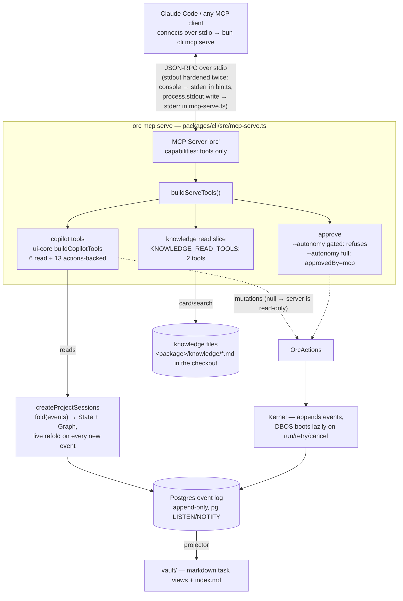
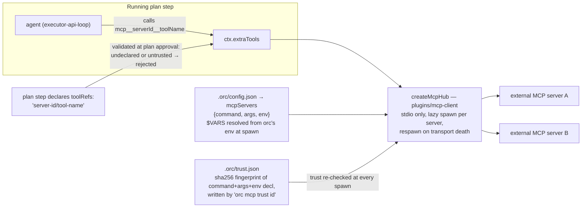

# How MCP works in this repo

The repo does MCP in **both directions**. `orc mcp serve` (an MCP client such as Claude Code connects to it over stdio) exposes the orchestrator itself as a stdio MCP server with up to **22 tools** — everything reads/writes one append-only Postgres event log. Separately, `plugins/mcp-client` lets agents running *inside* plans call out to external MCP servers declared in `.orc/config.json`.

## Direction 1: `orc` as an MCP server ("door #2")

A Claude Code session reaches this server through the plugin in `plugin/`: its manifest declares the
server inline, and the wrapper `plugin/bin/orc-mcp` changes into the session's project directory
(`CLAUDE_PROJECT_DIR`) before running `orc mcp serve`, which is what binds the server to the right
project. The same plugin's `SessionStart` hook prints `orc brief` into the session, and its three
skills (`/orc:request`, `/orc:adr`, `/orc:workspace`) teach the tools listed here. Any other MCP
client registers `orc mcp serve` as a plain stdio server.

How a call flows: the client sends `tools/call` over stdio → the handler looks the tool up in a `Map` → the tool either reads a **fold of the event log** (via `createProjectSessions`, which replays all events into State + Graph and refolds live) or appends new events through `OrcActions`/the kernel. Nothing reads domain tables directly — the event log is the single source of truth for what happened; the vault markdown is a downstream projection, and the knowledge files in the checkout hold what is true about the code.

## The tools it exposes (22 max)

| Group | Tool | What it does |
|---|---|---|
| **Read** (always) | `available_models` | Every usable model ref, fetched live from the providers — call it before choosing one |
| | `project_status` | Every task + status, the workspaces (checkouts) they are worked in with each one's health, graph node counts, knowledge health |
| | `task_plan` | Plan versions, steps, which version is approved |
| | `task_transcript` | Last 30 items of a task's agent conversation |
| | `plan_notes` | Grounded decomposition notes (subplans, uncertainty, links) |
| | `recent_activity` | Latest project events, one line each |
| **Knowledge read** (always; error-stubs if the checkout is unreadable) | `knowledge_card` | The claims anchored at or under a path, paged |
| | `knowledge_search` | Claims ranked for a query |
| **Mutate** (only when actions ≠ null) | `new_request` | Create a task; `grounded` triggers repo analysis + decomposition; `workspaceId` picks the checkout, defaulting to the one this server runs in |
| | `propose` | Propose a single-step plan for a draft task |
| | `run` | Start the approved plan in the task's workspace, or in an explicit `cwd` |
| | `reply` | Answer a task's open feedback question |
| | `retry` / `cancel` | Re-run a blocked task's incomplete steps (refused when a verdict blocked it) / terminally cancel |
| | `annotate` / `revise` | Feedback on one plan-note / wake the plan agent to revise scoped notes |
| | `workspace_list` | The project's active workspaces, each with its health (state `dangling`/`waiting`/`active`/`idle`/`merged`, last activity, task counts), attention-first — read-only, but served only with the mutating door |
| | `workspace_new` | A git worktree + branch for ONE request under `.orc/worktrees`, recorded as a workspace, with the request as its first task |
| | `decision_list` / `decision_read` | Enumerate recorded decisions attention-first / read one in full |
| | `record_decision` | Record an ADR-shaped decision file (status accepted unless proposed; `supersedes` flips the old one); attributed `mcp` |
| **Gate** | `approve` | The one tool the two doors differ on — see below |

Key behaviors:

- **Autonomy is launch-time, never the agent's choice.** Under the default `--autonomy gated`, `approve` is still *listed* but always refuses at call time, pointing to the orc UI or `orc approve <taskId>`. Only `--autonomy full` approves, and every approval is attributed `approvedBy: mcp` in the event log. There is deliberately no approve tool in the copilot set itself — the human gate is structural.
- **Read-only degradation is one mechanism, three triggers**: no port factory (CLI), and on the UI door, out-of-project or foreign-project chats — all just pass `actions: null` into the same `buildCopilotTools`.
- **`available_models` is served on the MCP door too** — `mcp-serve.ts` wires `listModels` to live provider discovery (cached for five minutes), so an MCP client can discover a valid `modelRef` before `propose`/grounded `new_request`.
- **Knowledge degrades, never blocks**: if the checkout cannot be read, the 2 read tools stay listed but each call returns an unavailable result with the reason instead of the tools silently vanishing.
- `knowledge_write` exists in the knowledge package but is not served — authoring stays with the agents running inside plans. `record_decision` is the single authoring tool this door serves; the test pins that exact set.

## Direction 2: orc as an MCP client (tools *for* agents)

Plan steps declare `toolRefs` like `"server-id/tool-name"`; plan validation rejects undeclared or untrusted servers **at approval time**, and at step start the hub resolves them into the agent's tool set under mangled names (`mcp__<server>__<tool>`). Trust is a fingerprint granted once with `orc mcp trust <id>` and re-verified on every spawn; secrets go in as `$VAR` references so they never land in committed config, and child servers never inherit the full env. The plugin also ships two stdio servers of its own: `web-mcp.ts` (Wikipedia `search` + SSRF-guarded `fetch`, used in simulations) and `fixture-server.ts` (`echo`/`fail`/`grow` test fixtures).

## Tool count

The server Claude Code connects to: **8 tools read-only, 22 with actions wired** (6 copilot read + 2 knowledge read + 13 actions-backed + `approve`).
